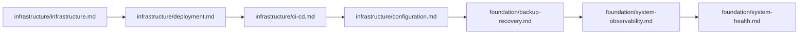
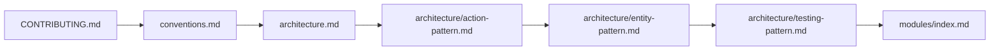

# Indeks Dokumentasi — Katalog Lengkap docs/

Katalog lengkap semua berkas dokumentasi, disusun berdasarkan topik dan audiens.

## Deskripsi

Indeks ini menyediakan peta terstruktur seluruh dokumentasi dalam proyek Internara. Dokumen
dikelompokkan berdasarkan audiens dan tujuan: dari arsitektur dan filosofi dasar hingga panduan
operasional dan referensi modul.

---

## Tautan Cepat

| Sumber Daya | Audiens |
| ----------- | ------- |
| **[CONTRIBUTING.md](../../CONTRIBUTING.md)** | Pengembang (panduan kontribusi tingkat root) |
| **[CODE_OF_CONDUCT.md](../../CODE_OF_CONDUCT.md)** | Semua peserta komunitas (Contributor Covenant v2.1) |
| **[SECURITY.md](../../SECURITY.md)** | Peneliti keamanan (pelaporan kerentanan) |
| **[README.md](../../README.md)** | Semua (gambaran umum proyek) |

---

## Produk & Visi

- **[Indeks Fondasi](guides/index.md)** — Telusuri semua dokumen fondasi
- **[README](../../README.md)** — Gambaran umum proyek: pitch, fitur, kebutuhan, instalasi, deployment, status (definisi produk mendalam ada di `project-vision.md`)
- **[Spesifikasi Proyek Internara](https://github.com/reasvyn/internara/issues/442)** (`[QLHDO]`, `label:spec`) — Kebutuhan fungsional, non-fungsional, dan UI/UX
- **[Filosofi Proyek](philosophy.md)** — Prinsip pemandu, nilai, dan visi
- **[Visi Proyek](project-vision.md)** — pernyataan visi, pilar strategis, metrik keberhasilan, batasan, kompas keputusan
- **[Arsitektur](architecture.md)** — Arsitektur 4 lapisan, alur data, Action Triad, aturan dependensi
- **[Filosofi Desain Skema](https://github.com/reasvyn/internara/issues/448)** (`[J68GZ]`, `label:spec`) — 37 tabel domain, 9 keputusan optimasi, tabel paket/framework
- **[Konvensi Pengodean](conventions.md)** — Aturan PHP, penamaan, keamanan, standar pengujian (+ ToC)
- **[Standar Dokumentasi](templates/doc-template.md)** — Model empat kuadran Diátaxis yang dipetakan ke repo ini, prinsip penulisan, kontrak metadata; kerangka siap-salin untuk semua tipe dokumen tersedia di [`docs/templates/`](templates/) (spec, ADR, guide, pattern, module, module-reference, dep)

---

## Spesifikasi Fitur

- **[Spesifikasi Instalasi & Konfigurasi Awal](specs/installation-and-initial-configuration.md)** — Spesifikasi fitur yang mencakup instalasi CLI dan wizard penyiapan ([8NZAU], [VEJCX])
- **[Spesifikasi Infrastruktur & Keamanan Sistem](specs/infrastructure-and-security.md)** — Spesifikasi fitur yang mencakup infrastruktur tiga lapis, CSP, pembatasan laju, dan pencadangan ([ZT6VS], [C9ZB6])
- **[Spesifikasi SysAdmin & Observabilitas](specs/sysadmin-and-observability.md)** — Spesifikasi fitur yang mencakup pengumuman, telemetri Pulse, log audit, dan SmartLogger ([3S55V], [89SRA])
- **[Spesifikasi Autentikasi & Manajemen Pengguna](specs/authentication-and-user-management.md)** — Spesifikasi fitur yang mencakup Auth, CRUD Pengguna, dan RBAC Datar ([YB7RG], [95EVB], [T4B26])
- **[Spesifikasi Pendaftaran & Checklist Dokumen](specs/registration-and-document-checklist.md)** — Spesifikasi fitur yang mencakup pendaftaran PKL, pemetaan penempatan, dan checklist dokumen pra-PKL ([MBB5R], [7H5D6])
- **[Spesifikasi Jurnal Harian & Kehadiran](specs/daily-journal-and-attendance.md)** — Spesifikasi Pilar Inti 1 yang mencakup kehadiran GPS, logbook reflektif, dan permohonan ketidakhadiran ([1KSWL])
- **[Spesifikasi Bimbingan & Pemantauan Lapangan](specs/guidance-and-monitoring.md)** — Spesifikasi Pilar Inti 2 yang mencakup kunjungan pemantauan guru, log supervisi, dan proxy lintas peran ([2EHSE])
- **[Spesifikasi Penilaian & Sertifikasi](specs/assessment-and-certification.md)** — Spesifikasi Pilar Inti 3 yang mencakup rubrik, penilaian magic-link, kelayakan 3 gerbang, dan verifikasi QR ([AXKZW], [J0M04])

---

## Penyiapan & Operasional

- **[Memulai](getting-started.md)** — Penelusuran menyeluruh dari kloning hingga menyelesaikan wizard penyiapan
- **[Gambaran Infrastruktur](guides/infra/infrastructure.md)** — Opsi deployment, arsitektur 3 lapis, proses latar belakang
- **[Deployment](guides/infra/deployment.md)** — Tiga jalur deployment (shared hosting, VPS, Docker), checklist produksi
- **[Konfigurasi](guides/infra/configuration.md)** — Sistem konfigurasi tiga lapis, variabel lingkungan, dev vs produksi
- **[Pipeline CI/CD](guides/infra/ci-cd.md)** — Alur kerja GitHub Actions, gerbang kualitas, manajemen artifak
- **[Kesehatan Sistem & Pemecahan Masalah](guides/system-health.md)** — Pemeriksaan kesehatan, masalah umum, diagnostik

---

## Panduan Operasional

- [Instalasi](guides/installation.md) — Persiapan server, dependensi, eksekusi pertama
- [Wizard Penyiapan](guides/setup-wizard.md) — Konfigurasi awal berbasis browser
- [Pasca-Penyiapan](guides/post-setup.md) — Tindakan pertama setelah instalasi
- [Kesehatan Sistem & Pemecahan Masalah](guides/system-health.md) — Pemeriksaan kesehatan, masalah umum, pemeliharaan
- [Peningkatan Versi](guides/upgrading.md) — Prosedur peningkatan, rollback, versi
- [Pencadangan & Pemulihan](guides/backup-recovery.md) — Pemulihan akun, pencadangan sistem, restorasi
- [Observabilitas Sistem](guides/system-observability.md) — Pulse, log audit, pembersihan, pencadangan

---

## Keamanan & Akses

- **[SECURITY.md](../../SECURITY.md)** — Kebijakan pelaporan kerentanan (root repo)
- **[RBAC](guides/rbac.md)** — Alur autentikasi, hierarki peran datar, peran fungsional, model izin
- **[Observabilitas Sistem](guides/system-observability.md)** — SmartLogger, Pulse, log audit, kepatuhan
- **[Keamanan](guides/infra/security.md)** — Pengerasan jaringan, header keamanan, pembatasan laju, PII, GDPR, pemindaian
- **[Pemulihan Akun](guides/account-recovery.md)** — Alur slip pemulihan, kode pemulihan, pemulihan super admin via CLI

---

## Frontend & UI

- **[Desain UI/UX](guides/ui-ux/index.md)** — Sistem desain (Tailwind CSS v4 + TallstackUI v4 + palet self-hosted), layout, mode gelap, [Sistem Desain & Panduan](guides/ui-ux/design-system.md)
- **[Branding](guides/branding.md)** — Tematisasi dinamis, sistem warna, preset, manajemen logo

---

## Referensi Pola

- **[Indeks Pola](guides/arch/index.md)** — Telusuri semua 16 pola desain arsitektur
- **[Action Triad](guides/arch/action-pattern.md)** — Pola Action Command/Read/Process
- **[Pemisahan Entity-Model](guides/arch/entity-pattern.md)** — Pola jembatan Entity, ketidakubahan
- **[Model (Active Record)](guides/arch/model-pattern.md)** — Pola model Eloquent, PK UUID
- **[Data Transfer Object](guides/arch/data-pattern.md)** — Pola DTO BaseData, ActionResponse
- **[Event & Notifikasi](guides/arch/event-pattern.md)** — BaseEvent, pola dispatch, listener
- **[Enum & State Machine](guides/arch/enum-pattern.md)** — LabelEnum, StatusEnum, state machine
- **[Komponen Livewire](guides/arch/livewire-pattern.md)** — Aturan komponen tipis, Form Object, BaseRecordManager
- **[Hierarki Exception](guides/arch/exception-pattern.md)** — Dua pohon AppException/ModuleException
- **[Otorisasi](guides/arch/policy-pattern.md)** — RBAC datar, auth tiga lapis, Gate::before
- **[Logging & PII](guides/arch/logging-pattern.md)** — SmartLogger, penyamaran PII, penerjemahan
- **[Caching](guides/arch/cache-pattern.md)** — Registri kunci terpusat, kategori TTL
- **[Service vs Support vs Action](guides/arch/service-pattern.md)** — Logika domain vs infra vs statis
- **[Pola Repository](guides/arch/repository-pattern.md)** — Mengapa tidak ada lapisan Repository
- **[Pola Pengujian](guides/arch/testing-pattern.md)** — Isolasi cakupan, strategi per lapisan

---

## Referensi Teknis

- **[Dokumen Referensi](refs/index.md)** — katalog tingkat referensi: referensi modul (`refs/modules/`) dan referensi per-dependensi (`refs/deps/`)
- **[Dependensi](refs/deps/index.md)** — satu referensi konseptual per dependensi runtime (`docs/refs/deps/`): `laravel` · `livewire` · `tallstackui` · `alpinejs` · `tailwindcss` · `vite` · `spatie-laravel-permission` · `spatie-laravel-medialibrary` · `spatie-laravel-activitylog` · `laravel-dompdf` · `laravel-pulse` · `laravel-lang` · `flatpickr` · `marked` · `prettier`
- **[Indeks Infrastruktur](guides/infra/index.md)** — Telusuri semua dokumen infrastruktur dan operasional
- **[Basis Data](guides/infra/database.md)** — Desain skema, PK UUID, perbandingan mesin, strategi indeks
- **[Cache](guides/infra/cache.md)** — Strategi caching, registri kunci, invalidasi, Redis
- **[Filesystem](guides/infra/filesystem.md)** — Arsitektur penyimpanan, Media Library, konversi gambar
- **[Media Library](guides/infra/media-library.md)** — Koleksi, konversi, penyimpanan kompatibel S3
- **[Rute](guides/infra/routes.md)** — Struktur rute, 17 berkas terpisah per modul, grup middleware
- **[Sesi](guides/infra/session.md)** — Konfigurasi, driver, keamanan
- **[Notifikasi](guides/infra/notification.md)** — Sistem multi-kanal, keterkiriman email
- **[Antrean](guides/infra/queue.md)** — Driver, worker, Supervisor, siklus hidup job
- **[Infrastruktur Pengujian](guides/infra/testing.md)** — Filosofi pengujian, isolasi cakupan
- **[Panduan Penskalaan](guides/infra/scaling.md)** — Dari MVP ke 2000+ pengguna, transisi tingkatan
- **[Lokalisasi](guides/infra/localization.md)** — Terjemahan, resolusi locale, kontribusi
- **[Skrip Pengembang](guides/infra/tools.md)** — Skrip pemindai Python, flag CLI, skema keluaran

---

## Modul

Lihat [Indeks Dokumentasi Modul](refs/modules/index.md) untuk daftar lengkap seluruh 19 modul
(17 bisnis + UI + Core). Setiap modul bisnis memiliki dua dokumen:

- **Gambaran Umum** (`docs/refs/modules/{module}.md`) — tujuan, batasan, fitur, prinsip desain
- **Referensi** (`docs/refs/modules/{module}-reference.md`) — referensi API lengkap (Model, Action, Rute, Policy, Livewire, event)

---

## Catatan Keputusan Arsitektur

Lihat [Indeks ADR](adr/index.md) untuk seluruh 16 catatan yang mencakup fondasi, observabilitas,
kualitas, proxy, dan keputusan strategis.

---

## Spesifikasi Fitur

- **[Issue Spesifikasi](https://github.com/reasvyn/internara/issues?q=label%3Aspec)** — Semua issue spesifikasi fitur (#442–#509)

---

## Peta Jalan & Perencanaan

- **[GitHub Issues](https://github.com/reasvyn/internara/issues)** — Pelacak bug, masalah yang diketahui, permintaan fitur
- **[GitHub Discussions](https://github.com/reasvyn/internara/discussions)** — Tanya jawab, ide, komunitas

---

## Urutan Bacaan yang Disarankan

### Untuk Pengembang Baru

### Untuk Operasional / DevOps

### Untuk Kontributor

### Berdasarkan Peran

- **Pengembang** — Mulai dari `contributing.md`, `architecture.md`, lalu pola arsitektur dan indeks modul
- **DevOps** — Mulai dari gambaran infrastruktur, deployment, CI/CD, lalu pemecahan masalah
- **Produk** — Mulai dari definisi produk, filosofi, fitur kunci
- **QA/Tester** — Mulai dari panduan pengujian, pola pengujian, dan dokumen referensi per modul
- **Karyawan Baru** — Mulai dari panduan kontribusi, memulai, gambaran arsitektur, konvensi, lalu indeks modul
