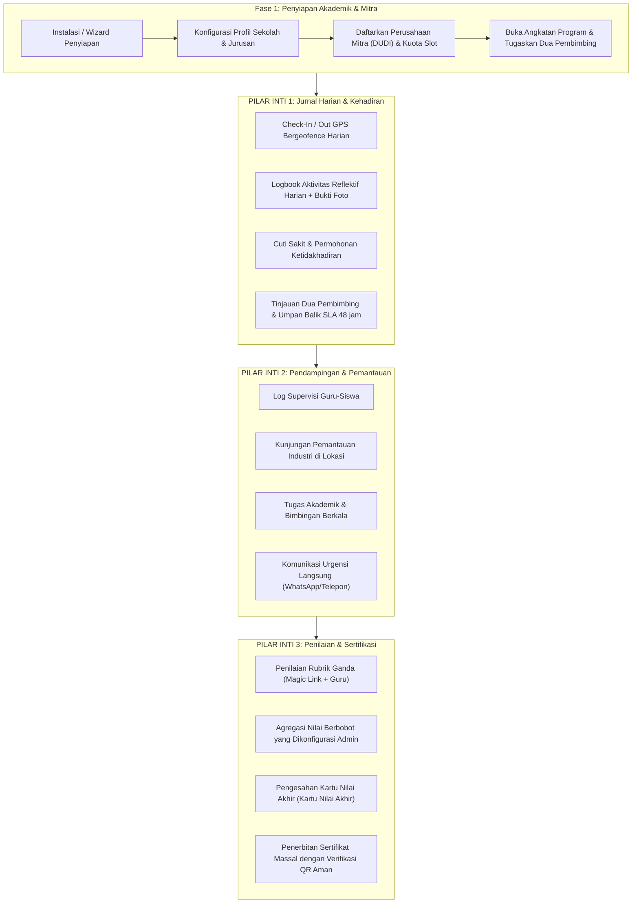

# Dokumen Kebutuhan Produk (PRD) — Platform Internara

**Versi Dokumen:** 1.1.0
**Status:** Baseline Disetujui
**Produk:** Internara — Platform Manajemen PKL & Magang Wajib
**Domain Sasaran:** Sekolah Menengah Kejuruan (SMK / SMA) & Institusi Pendidikan Indonesia
**Lisensi:** Sumber Terbuka (MIT) — Self-Hosted, Single-Tenant

---

## 1. Ringkasan Eksekutif & Visi

### 1.1 Konteks
Sekolah menengah kejuruan di Indonesia (*Sekolah Menengah Kejuruan* / SMK) diwajibkan oleh Kementerian
Pendidikan untuk menyelenggarakan praktik kerja lapangan wajib (*Praktik Kerja Lapangan* / PKL) bagi
setiap siswa. Pada sekolah tipikal, mengelola satu angkatan PKL berarti mengoordinasikan 500 hingga
1.000 siswa di 150 hingga 300 perusahaan mitra (*Dunia Usaha dan Dunia Industri* / DUDI) selama 90
hingga 180 hari.

### 1.2 Pernyataan Masalah: Realitas Operasional PKL Berbasis Kertas
Secara historis, sekolah mengelola PKL melalui sistem manual berbasis kertas yang dilengkapi aplikasi
pesan informal. Paradigma operasional ini menimbulkan kerentanan serius, biaya material tinggi, dan
beban administratif yang ekstrem:

- **Kerapuhan dan Kerentanan Catatan Kertas Fisik**:
  - **Lembar Presensi Fisik Harian**: Log kehadiran kertas dan lembar tanda tangan fisik
    (*lembar paraf presensi*) yang disimpan di lokasi industri sangat rentan hilang, robek, terkena
    tumpahan kopi, dan pemalsuan tanda tangan (*titip paraf*). Sekolah tidak memiliki visibilitas
    real-time sama sekali apakah seorang siswa benar-benar tiba di lokasi kerja.
  - **Buku Jurnal/Logbook Cetak Fisik**: Logbook fisik cetak yang tebal membutuhkan anggaran
    pencetakan dan penjilidan besar setiap semester. Siswa sering melakukan "penjejalan mundur" —
    menulis tangan 60 hingga 90 hari entri dalam satu akhir pekan penuh kepanikan tepat sebelum
    pengumpulan akhir. Guru pembimbing tidak dapat membaca tulisan yang terburu-buru atau memeriksa
    bukti foto pekerjaan.
  - **Surat Administratif Fisik**: Formulir persetujuan orang tua (*surat izin orang tua*), surat
    pengantar resmi (*surat pengantar*), dan slip konfirmasi penerimaan perusahaan
    (*surat balasan/penerimaan*) berpindah melalui banyak tangan, sering hilang di tas siswa atau
    tertunda dalam perjalanan, sehingga menghambat orientasi siswa.

- **Ketiadaan Supervisi Real-Time & Titik Buta Lapangan**:
  - Dalam alur kerja berbasis kertas, guru pembimbing sekolah hanya memeriksa logbook fisik dan
    lembar presensi sekali atau dua kali selama seluruh periode 3 hingga 6 bulan, atau hanya setelah
    kembali ke sekolah.
  - Guru tidak memiliki catatan berkelanjutan yang dapat diaudit tentang diskusi pendampingan,
    kesulitan belajar siswa, dan kunjungan pemantauan lapangan terjadwal ke mitra industri.

- **Kemacetan Penilaian Manual & Kesalahan Transkripsi**:
  - **Lembar Nilai Fisik yang Tertunda**: Pembimbing industri diminta mengisi formulir evaluasi rubrik
    fisik, mencapnya dengan stempel perusahaan, lalu mengirimkannya melalui pos atau siswa. Formulir
    ini sering tertinggal terlupakan di meja perusahaan selama berminggu-minggu, menunda kelulusan.
  - **Ketik Ulang Spreadsheet Manual**: Staf administrasi sekolah dan guru harus mengumpulkan ratusan
    lembar nilai fisik dan mengetik nilai tulisan tangan secara manual ke spreadsheet Excel yang
    terpisah-pisah. Transkripsi manual ini menimbulkan kesalahan manusia yang merata, kesalahan
    rumus, dan konflik versi antar koordinator jurusan.
  - **Berpekan-pekan Terkunci dalam Administrasi**: Menyusun, memverifikasi, dan menghitung kartu
    nilai akhir komposit (*Kartu Nilai Akhir*) untuk angkatan 800 siswa memakan waktu 2 hingga 3
    pekan penuh lembur guru, menjauhkan mereka dari pengajaran.

- **Beban Pengarsipan Fisik & Kepatuhan Regulasi**:
  - Regulasi pendidikan Indonesia mewajibkan sekolah menyimpan catatan akademik, kehadiran, dan PKL
    siswa minimal 5 tahun untuk akreditasi institusi dan audit kementerian.
  - Arsip kertas membutuhkan ruang gudang fisik, lemari arsip, dan binder dokumen. Seiring waktu,
    catatan fisik rusak karena kelembapan, jamur, pudarnya tinta, atau serangan hama. Mengambil
    sertifikat siswa lama atau memverifikasi catatan magang dari tiga tahun lalu membutuhkan
    penggalian kotak fisik selama berjam-jam atau berhari-hari.
  - Ketika sertifikat kertas hilang atau rusak, penerbitan ulang memerlukan verifikasi manual terhadap
    arsip buku besar kertas tanpa mekanisme verifikasi kriptografis seketika.

### 1.3 Visi Produk & Fokus Inti
> *Setiap sekolah kejuruan menjalankan program PKL wajibnya dengan ketelitian dan efisiensi institusi
> kelas perusahaan — dihosting pada infrastruktur yang dikendalikan sekolah, siap audit secara
> bawaan, bebas dari tumpukan kertas, dan tanpa mengubah pendidik menjadi juru tulis administratif.*

Internara adalah aplikasi web khusus bertujuan tunggal yang dirancang untuk menggantikan operasional
berbasis kertas dengan catatan digital kanonis yang berpusat pada **tiga pilar fitur inti**:
1. **Jurnal Harian & Pelacakan Kehadiran (*Jurnal Harian & Presensi*)**: Check-in/out bergeofence
   real-time, permohonan cuti sakit, logbook aktivitas harian reflektif dengan lampiran foto, dan SLA
   umpan balik pembimbing 48 jam.
2. **Bimbingan, Pendampingan & Pemantauan Lapangan (*Bimbingan & Monitoring Lapangan*)**: Pendampingan
   dwiperan terstruktur, log interaksi supervisi guru, dan kunjungan pemantauan industri di lokasi
   yang terverifikasi.
3. **Penilaian, Pemberian Nilai & Penerbitan Sertifikat (*Penilaian & Penerbitan Sertifikat*)**:
   Rubrik berbasis kompetensi, magic link pembimbing tanpa kata sandi, agregasi nilai komposit yang
   dapat dikonfigurasi admin, kartu nilai akhir otomatis, dan sertifikat anti-rusak yang dapat
   diverifikasi publik melalui kode QR.

### 1.4 Prinsip Strategis Kunci
- **Pendidikan Dulu, Teknologi Kemudian**: Alur kerja mencerminkan realitas operasional SMK Indonesia
  (seperti dua pembimbing, magic link pembimbing, dan banding perubahan penempatan) alih-alih memaksa
  sekolah masuk ke paradigma HR korporat generik.
- **Infrastruktur Progresif (Baseline $5/bulan)**: Beroperasi langsung pada shared hosting murah atau
  VPS dasar (PHP 8.5, SQLite/MySQL, filesystem lokal, cache berbasis file dan antrean sinkron) tanpa
  langganan cloud wajib, dengan jalur pertumbuhan mulus ke Redis, S3, dan worker asinkron ketika skala
  menuntut.
- **Kedaulatan Data & Privasi sejak Desain**: Arsitektur 100% self-hosted, single-tenant. Tanpa
  telemetri, tanpa pelacakan pihak ketiga, izin berbasis peran, log audit yang tidak dapat diubah,
  penyamaran PII, serta rutinitas ekspor dan penghapusan data bawaan yang sesuai GDPR.
- **Pengalaman Tanpa Admin**: Perhitungan nilai otomatis, pembuatan PDF satu klik, alur kerja CSV
  massal, dan verifikasi QR publik seketika.

### 1.5 Batasan Produk & Non-Tujuan Eksplisit
Untuk menjaga keandalan platform, beban operasional rendah, dan kemudahan pemeliharaan, kemampuan
berikut secara eksplisit di luar cakupan:
- **Manajemen Insiden & Tanggap Darurat**: Platform tidak menangani insiden tempat kerja, kecelakaan,
  pengiriman darurat, atau tiket keluhan. Semua situasi kritis-waktu yang membutuhkan respons cepat
  jauh lebih efektif dikomunikasikan langsung melalui aplikasi pesan instan (mis. WhatsApp) dan
  panggilan telepon langsung antara siswa, guru, dan pembimbing industri.
- **SaaS Multi-Tenant / Langganan Komersial**: Internara secara ketat single-tenant dan self-hosted
  per sekolah. Tanpa beban isolasi tenant atau gateway pembayaran.
- **HR Perusahaan Umum / Penggajian**: Tidak mengelola penggajian karyawan, corong perekrutan
  korporat, atau papan lowongan pascakelulusan.
- **WebSocket / Obrolan Real-Time**: Tidak mengimplementasikan pesan instan langsung. Notifikasi
  dikirim melalui pusat notifikasi dalam aplikasi dan email transaksional untuk mencegah pembengkakan
  server dan beban moderasi konten.
- **Aplikasi Mobile Native**: Menyediakan antarmuka web responsif mobile-first (Laravel Livewire +
  Alpine.js + TallstackUI + Tailwind CSS v4) yang menghindari friksi distribusi app store.
- **Sinkronisasi Langsung Basis Data Pemerintah (Dapodik/NSP)**: Untuk mencegah keterikatan API yang
  rapuh, pertukaran data dengan portal sekolah eksternal dilakukan melalui impor/ekspor CSV massal
  terstruktur dan terverifikasi.

---

## 2. Persona Pengguna & Kontrol Akses Berbasis Peran (RBAC)

Internara menegakkan otorisasi berbasis peran yang ketat dan datar pada enam peran pengguna utama:

| Peran | Persona Sasaran | Tanggung Jawab & Izin Utama |
|---|---|---|
| **Super Admin** | Spesialis TI Sekolah / Pemimpin Infrastruktur | Instalasi sistem, penyediaan lingkungan, pencadangan/pemulihan basis data mentah, audit log, dan token perbaikan sistem. |
| **Admin Sekolah** | Kepala Sekolah / Kepala Kurikulum / Koordinator PKL | Mengelola tahun ajaran, jurusan, kemitraan perusahaan, kuota slot, pendaftaran siswa, dokumen resmi, pengumuman sistem, dan persetujuan kartu nilai seluruh angkatan. |
| **Guru (Pembimbing Sekolah)** | Guru Mata Pelajaran Kejuruan / Guru Pembimbing Lapangan | Mendampingi kelompok siswa yang ditugaskan, meninjau logbook harian dalam 48 jam, mencatat kunjungan pemantauan lapangan, memasukkan nilai rubrik sisi sekolah, dan melacak kemajuan siswa. |
| **Pembimbing Industri** | Mentor Perusahaan / Supervisor Lapangan di Mitra DUDI | Memvalidasi kehadiran siswa harian, meninjau aktivitas mingguan, memberikan umpan balik kualitatif, dan mengirimkan penilaian kompetensi industri (melalui login terautentikasi atau magic link tanpa kata sandi). |
| **Siswa (Peserta PKL)** | Siswa Kejuruan Kelas 11 / 12 (Usia 16–18) | Mendaftar program, melihat penempatan perusahaan, mengirim check-in bertanda GPS, menulis logbook reflektif harian dengan bukti foto, menyelesaikan tugas, dan mengunduh sertifikat terverifikasi. |
| **Publik / Verifikator Eksternal** | Calon Pemberi Kerja, Universitas, atau Auditor Publik | Memindai kode QR pada sertifikat siswa atau slip pemulihan untuk memverifikasi validitas, nomor seri kredensial, dan keaslian siswa secara kriptografis tanpa memerlukan akun. |

---

## 3. Alur Kerja Siklus Hidup PKL Menyeluruh



---

## 4. Pilar Fitur Inti (Kebutuhan Utama)

Aplikasi berpusat pada tiga pilar operasional utama yang menggantikan alur kerja kertas manual dengan
catatan digital terverifikasi:

### 4.1 Pilar 1: Jurnal Harian & Pelacakan Kehadiran (*Jurnal Harian & Presensi Lapangan*)

- **FR-JRN-001 (Check-In / Out Kehadiran GPS Bergeofence)**:
  - Siswa mencatat kehadiran harian melalui antarmuka browser web mobile-first, menangkap lintang,
    bujur, dan stempel waktu perangkat secara presisi.
  - Sistem memvalidasi koordinat terhadap geolokasi GPS perusahaan mitra yang dikonfigurasi dalam
    radius yang dapat diatur admin (bawaan: 100 meter).
  - Waktu check-in dan check-out dikunci saat pengiriman untuk mencegah manipulasi mundur.
- **FR-JRN-002 (Klasifikasi Status Kehadiran & Timesheet)**:
  - Secara otomatis mengklasifikasikan entri kehadiran menjadi: `Present` (Hadir), `Late` (Terlambat,
    setelah ambang perusahaan), `Excused` (Izin, ketidakhadiran disetujui), dan `Absent` (Alpa, tidak
    dilaporkan).
  - Merangkum persentase kehadiran bulanan angkatan dan individu secara real time untuk guru dan
    administrator.
- **FR-JRN-003 (Alur Permohonan Ketidakhadiran & Cuti Sakit)**:
  - Memungkinkan siswa mengirim permohonan ketidakhadiran formal karena sakit atau alasan pribadi
    mendesak.
  - Mewajibkan unggahan surat keterangan medis pendukung (*surat dokter*) atau catatan resmi orang tua.
  - Memicu alur tinjauan dan persetujuan bagi guru pembimbing sekolah yang ditugaskan sebelum
    menandai status kehadiran sebagai `Excused`.
- **FR-JRN-004 (Logbook Aktivitas Reflektif Harian)**:
  - Siswa mengirim entri jurnal reflektif harian yang menangkap: tugas kejuruan spesifik yang
    dilakukan, keterampilan kompetensi yang dilatih, jam kerja, dan hingga 3 lampiran foto yang
    memverifikasi aktivitas kerja.
  - Melarang pengiriman massal atau pengisian mundur melampaui masa tenggang yang dapat dikonfigurasi
    (bawaan: 48 jam), menghilangkan masalah kertas umum berupa penjejalan di akhir semester.
- **FR-JRN-005 (Tinjauan Dua Pembimbing & Umpan Balik SLA 48 Jam)**:
  - Menyediakan antarmuka tinjauan yang efisien untuk Guru Sekolah dan Pembimbing Industri.
  - Pembimbing dapat menyetujui, meminta revisi, atau mengomentari entri logbook.
  - Melacak ketepatan waktu tinjauan terhadap Service Level Agreement (SLA) 48 jam, menandai entri
    yang belum ditinjau pada dasbor guru.

---

### 4.2 Pilar 2: Bimbingan, Pendampingan & Pemantauan Lapangan (*Bimbingan & Monitoring Lapangan*)

- **FR-MNT-001 (Pengikatan & Pengelompokan Pendampingan Ganda)**:
  - Mengikat setiap siswa peserta ke sebuah kelompok magang operasional (*rombel PKL*).
  - Setiap kelompok ditautkan ke tepat dua peran pembimbing wajib: tepat satu Guru Pembimbing Sekolah
    (*Guru Pembimbing*) dan minimal satu Pembimbing Lapangan Industri (*Pembimbing DUDI*).
- **FR-MNT-002 (Log Supervisi Guru / *Catatan Bimbingan*)**:
  - Menyediakan catatan digital khusus bagi guru untuk mencatat sesi bimbingan akademik, pemeriksaan
    adaptasi perilaku siswa, dan catatan bimbingan berkala.
  - Memelihara log kronologis interaksi bimbingan yang dapat diakses koordinator sekolah.
- **FR-MNT-003 (Kunjungan Pemantauan Lapangan di Lokasi / *Kunjungan Industri*)**:
  - Memungkinkan guru pembimbing menjadwalkan, mendokumentasikan, dan memverifikasi kunjungan ke
    perusahaan mitra.
  - Mencatat notulen diskusi di lokasi dengan pembimbing perusahaan, observasi kinerja siswa, dan
    bukti foto kunjungan.
  - Menghasilkan bukti kunjungan pemantauan yang dapat diverifikasi untuk verifikasi klaim perjalanan
    administratif.
- **FR-MNT-004 (Tugas Akademik & Pekerjaan Kursus Berkala)**:
  - Memungkinkan guru pembimbing menerbitkan tugas kejuruan tengah semester, studi kasus teknis, atau
    laporan kemajuan.
  - Menegakkan tenggat pengiriman dan batasan format berkas (PDF, DOCX, ZIP).
  - Menyediakan penilaian berbasis rubrik (0–100) dan umpan balik kualitatif, memastikan standar
    akademik tetap terjaga selama penempatan industri.
- **FR-MNT-005 (Protokol Komunikasi Urgensi Langsung)**:
  - Sistem secara eksplisit mendelegasikan kekhawatiran lapangan yang mendesak dan sensitif waktu
    (mis. siswa sakit, perselisihan kecil, perubahan jadwal mendadak) ke pesan seluler langsung
    (WhatsApp) dan panggilan telepon.
  - Platform berperan sebagai catatan permanen otoritatif untuk bimbingan tervalidasi, pemantauan
    terverifikasi, dan kemajuan akademik tanpa beban tiket.

---

### 4.3 Pilar 3: Penilaian, Pemberian Nilai & Penerbitan Sertifikat (*Penilaian & Penerbitan Sertifikat*)

- **FR-ASM-001 (Penyusunan Rubrik Kompetensi Multi-Dimensi & Bobot Bawaan)**:
  - Memungkinkan administrator sekolah dan jurusan mendefinisikan rubrik penilaian fleksibel yang
    disesuaikan dengan spesialisasi kejuruan tertentu.
  - Selaras dengan standar kurikulum kejuruan nasional (Kurikulum Merdeka SMK) dengan bobot penilaian
    tempat kerja bawaan yang terstandardisasi (total 100%):
    1. **Internalisasi Soft Skills** (Bobot Asesmen ~20%): Budaya kerja industri, etika profesi,
       kedisiplinan kehadiran, kepatuhan K3, dan komunikasi tim.
    2. **Penerapan Hard Skills** (Bobot Asesmen ~60%): Penguasaan kompetensi teknis kejuruan,
       ketepatan penyelesaian tugas spesifik, dan pemecahan masalah praktis.
    3. **Penyiapan Kewirausahaan** (Bobot Asesmen ~20%): Pemahaman alur proses bisnis industri,
       inisiatif mandiri, kreativitas, dan efisiensi kerja berorientasi wirausaha.
  - Administrator memegang otoritas penuh untuk menyesuaikan dan mengonfigurasi bobot kriteria per
    jurusan atau program magang.
- **FR-ASM-002 (Kerangka Evaluasi Ganda)**:
  - Mengimplementasikan portal penilaian independen untuk Guru Pembimbing Sekolah dan Pembimbing
    Lapangan Industri.
  - Mencegah paparan nilai terlalu dini antar pembimbing hingga tenggat evaluasi berakhir.
- **FR-ASM-003 (Magic Link Pembimbing Tanpa Kata Sandi)**:
  - Menghasilkan magic link aman, terenkripsi, sekali pakai, dan berbatas waktu yang dikirim melalui
    email atau pembagian tautan langsung.
  - Memungkinkan pembimbing perusahaan eksternal yang sibuk menyelesaikan dan mengirimkan penilaian
    kompetensi siswa langsung dari perangkat apa pun tanpa memerlukan pendaftaran akun, pengelolaan
    nama pengguna/kata sandi, atau friksi orientasi portal sekolah.
- **FR-RPT-001 (Mesin Agregasi Nilai Komposit yang Dapat Dikonfigurasi Admin)**:
  - Secara otomatis mengagregasikan komponen evaluasi yang berbeda menjadi satu nilai akhir komposit
    (*Nilai Akhir PKL*).
  - Menegakkan bobot nilai akhir bawaan standar (total 100%):
    - **Pelaksanaan Magang di DUDI / Tempat Kerja** (hasil asesmen Soft Skills, Hard Skills,
      Kewirausahaan + Logbook): **70%**
    - **Penyusunan Laporan dan Presentasi Akademis-Praktis** (Bimbingan, penulisan laporan PKL, dan
      ujian presentasi/sidang di hadapan guru sekolah): **30%**
  - Memungkinkan administrator menyesuaikan bobot komponen per program atau jurusan, dengan validasi
    otomatis jumlah total 100%.
  - Jika tidak dikonfigurasi atau diatur ulang oleh administrator, sistem menggunakan standar
    proporsional di atas secara bawaan (70% Pelaksanaan DUDI : 30% Laporan & Presentasi Sekolah).
- **FR-RPT-002 (Konversi Nilai Huruf & Pengesahan Koordinator)**:
  - Mengonversi nilai komposit numerik (0–100) menjadi nilai huruf institusional (mis. A ≥ 85,
    B ≥ 75, C ≥ 65, D < 65) berdasarkan ambang penilaian sekolah.
  - Menyediakan dasbor tinjauan seluruh angkatan bagi Koordinator PKL untuk memeriksa nilai,
    memverifikasi penyelesaian, dan menjalankan pengesahan digital formal yang mengunci catatan dari
    perubahan lebih lanjut.
  - Menghasilkan PDF Kartu Nilai Akhir resmi yang dapat dicetak (*Kartu Nilai Akhir*) dengan kop surat
    sekolah, tanda tangan berwenang, dan NISN siswa.
- **FR-CRT-001 (Pembuatan Sertifikat Massal Otomatis)**:
  - Secara otomatis menghasilkan sertifikat kelulusan resmi bagi semua siswa yang memperoleh nilai
    kelulusan pada kartu nilai yang telah disahkan.
  - Mendukung template sertifikat yang dapat disesuaikan (kop surat sekolah, branding perusahaan, blok
    tanda tangan ganda kepala sekolah/perusahaan, dan rincian nilai kompetensi pada halaman balik).
- **FR-CRT-002 (Verifikasi Kode QR Publik Anti-Rusak)**:
  - Menanamkan kode QR bertanda tangan kriptografis pada setiap sertifikat yang diterbitkan, menautkan
    ke endpoint verifikasi publik (`/verify/{certificate_serial}`).
  - Memungkinkan pemberi kerja, universitas, dan auditor publik memverifikasi nama siswa, sekolah,
    penempatan perusahaan, tanggal, dan pencapaian kompetensi secara seketika tanpa memerlukan login
    pengguna.

---

## 5. Modul Pendukung & Infrastruktur

Meskipun aplikasi berpusat pada 3 pilar inti, modul pendukung berikut menyediakan kerangka fondasi:

### 5.1 Struktur Akademik & Penyiapan Kemitraan (`Academics`, `Partner`, `Program`)
- **FR-SUP-001 (Profil Sekolah & Jurusan)**: Mengelola NPSN sekolah resmi, alamat institusi, kredensial
  kepala sekolah, dan jurusan kejuruan (mis. RPL, TKJ, TKR).
- **FR-SUP-002 (Kalender Akademik)**: Mengelola tahun ajaran (mis. 2026/2027) dengan penanda semester
  aktif.
- **FR-SUP-003 (Direktori Perusahaan & Kuota Slot)**: Memelihara profil perusahaan, alamat, koordinat
  GPS, dan kapasitas kuota siswa per jurusan.
- **FR-SUP-004 (Pelacakan MoU)**: Mencatat nomor perjanjian Memorandum of Understanding dan interval
  peringatan kedaluwarsa (30, 14, 7 hari).

### 5.2 Operasional Pendaftaran & Penempatan (`Enrollment`)
- **FR-SUP-005 (Pendaftaran Program)**: Menangani pendaftaran angkatan siswa dan verifikasi
  administratif.
- **FR-SUP-006 (Alokasi Slot & Penempatan Langsung)**: Menugaskan siswa ke slot perusahaan, menegakkan
  kuota kapasitas secara ketat.
- **FR-SUP-007 (Banding Perubahan Penempatan)**: Mendukung permohonan formal untuk memindahkan lokasi
  penempatan karena perubahan operasional, dengan tetap memelihara catatan jurnal historis.

### 5.3 Penyediaan, Keamanan & Identitas (`Setup`, `Auth`, `User`)
- **FR-SUP-008 (Wizard Penyiapan & Penyediaan)**: Wizard instalasi terpandu (`/setup`) dan perintah CLI
  (`php artisan setup:install`) dengan pengisian basis data dan penguncian penyiapan.
- **FR-SUP-009 (Autentikasi & Mode Sudo)**: Autentikasi multi-peran, pembatasan laju brute-force,
  reset kata sandi, dan konfirmasi kata sandi untuk tindakan sensitif.
- **FR-SUP-010 (Slip Aktivasi Akun Fisik)**: Menghasilkan slip yang dapat dicetak dengan kredensial
  sementara dan kode QR untuk orientasi siswa massal.
- **FR-SUP-011 (Profil Pengguna & Siklus Hidup Status)**: Mengelola status pengguna (`Active`,
  `Suspended`, `Archived`) dan pengikatan peran.

### 5.4 Tata Kelola Administratif (`Document`, `SysAdmin`, `Setting`, `Core`)
- **FR-SUP-012 (Pembuatan Surat Resmi)**: Menghasilkan surat administratif bertemplat (Surat
  Pengantar, Izin Orang Tua, Penerimaan, Surat Tugas).
- **FR-SUP-013 (Pengumuman Sistem & Peringatan Push)**: Pengumuman siaran bertarget peran yang
  ditampilkan pada dasbor.
- **FR-SUP-014 (Pencadangan Otomatis & Siklus Hidup Data 5 Tahun)**: Pencadangan basis data/media
  terjadwal (RPO 4 jam, RTO 1 jam), log aktivitas yang tidak dapat diubah (`activity_log`), dan
  retensi data 5 tahun sesuai regulasi dengan alur penghapusan GDPR.
- **FR-SUP-015 (Branding, Tema & Lokalisasi Ganda)**: Logo/favicon kustom, preset tema gelap/terang,
  dan paritas bahasa runtime penuh antara Indonesia (`id`) dan Inggris (`en`).
- **FR-SUP-016 (Media Inti & Impor/Ekspor Massal)**: Pipeline unggah Spatie MediaLibrary, mesin
  Dompdf, dan impor/ekspor CSV yang kompatibel Dapodik.

---

## 6. Kebutuhan Non-Fungsional (NFR)

Semua kebutuhan non-fungsional dispesifikasikan dengan Service Level Objective (SLO) yang terukur
sesuai standar ISO 25010:

### 6.1 Keamanan & Keselamatan Akses (ISO 25010: Security)
- **NFR-SEC-001 (Otorisasi Multi-Lapisan)**: Setiap permintaan melewati middleware rute, otorisasi
  Policy (`Gate`/`Policy`), dan pemeriksaan invarian bisnis entity.
- **NFR-SEC-002 (Pencegahan Injeksi SQL)**: Binding berparameter wajib pada semua kueri basis data.
  Penggabungan SQL mentah dilarang keras (`scan_security.py`).
- **NFR-SEC-003 (Header Keamanan HTTP yang Diperkuat)**: Semua respons HTTP harus menyertakan
  `X-Frame-Options: SAMEORIGIN`, `X-Content-Type-Options: nosniff`,
  `Referrer-Policy: strict-origin-when-cross-origin`, dan aturan CSP yang ketat.
- **NFR-SEC-004 (CSRF & Autentikasi Token)**: Token CSRF wajib pada permintaan yang mengubah status;
  endpoint API menegakkan autentikasi token Sanctum.
- **NFR-SEC-005 (Redaksi PII dalam Log)**: Kata sandi, nomor identitas nasional (NIK), nomor telepon,
  dan catatan pribadi siswa disunting sebelum dicatat ke disk (`SmartLogger`).

### 6.2 Kinerja & Skalabilitas (ISO 25010: Performance Efficiency)
- **NFR-PRF-001 (Latensi Respons Server)**: Latensi render halaman P95 tetap di bawah 400 ms pada
  konkurensi standar (50 pengguna aktif bersamaan pada hosting 1 vCPU / RAM 2GB).
- **NFR-PRF-002 (Optimasi & Pengindeksan Basis Data)**: Kunci primer UUID v7 di seluruh entity domain
  menghilangkan fragmentasi B-tree. Indeks komposit foreign key mencakup semua jalur filter
  frekuensi tinggi.
- **NFR-PRF-003 (Eager Loading & Pencegahan N+1)**: Semua kueri relasi di Livewire dan Read Action
  menegakkan eager loading eksplisit (`with()`).
- **NFR-PRF-004 (Registri Cache Terpusat)**: Semua kunci kueri yang di-cache terdaftar di
  `config/cache-keys.php` dengan nilai Time-To-Live (TTL) yang ditetapkan.

### 6.3 Keandalan, Ketersediaan & Pencadangan (ISO 25010: Reliability)
- **NFR-REL-001 (Recovery Point Objective - RPO)**: Pencadangan basis data otomatis terjadwal
  memastikan RPO tidak lebih dari 4 jam selama jam operasional sekolah.
- **NFR-REL-002 (Recovery Time Objective - RTO)**: Pemulihan bencana dari dump cadangan dingin ke
  keadaan online fungsional selesai dalam waktu kurang dari 60 menit.
- **NFR-REL-003 (Degradasi Offline yang Anggun)**: Antarmuka web seluler untuk kehadiran dan draf
  logbook menyimpan input secara lokal di browser ketika konektivitas lapangan terputus, lalu
  menyinkronkan setelah tersambung kembali.

### 6.4 Kegunaan & Aksesibilitas (ISO 25010: Usability)
- **NFR-USB-001 (Standar Aksesibilitas - WCAG 2.1 AA)**: Semua elemen UI memenuhi standar kontras
  visual WCAG 2.1 AA (rasio minimum 4,5:1 untuk teks biasa).
- **NFR-USB-002 (Responsivitas Mobile-First)**: Alur kerja inti (check-in kehadiran, penyusunan
  logbook, tinjauan pembimbing) beroperasi mulus dari lebar viewport 360 px hingga layar desktop 4K.
- **NFR-USB-003 (Paritas Dua Bahasa)**: 100% string UI, notifikasi, dan pesan validasi menjaga paritas
  antara Indonesia (`id`) dan Inggris (`en`).

### 6.5 Kemudahan Pemeliharaan & Disiplin Arsitektur (ISO 25010: Maintainability)
- **NFR-MNT-001 (Vertical Slicing & Kolokasi Modul)**: Kode disusun dalam irisan vertikal modular di
  bawah `app/Modules/{Module}/`.
- **NFR-MNT-002 (Action Triad Bertanggung Jawab Tunggal)**: Logika bisnis dipartisi menjadi
  `BaseCommandAction` (mutasi), `BaseReadAction` (kueri), dan `BaseProcessAction` (orkestrasi).
- **NFR-MNT-003 (Cakupan Tes & Ketertelusuran Spesifikasi)**: 100% kebutuhan fungsional dan user story
  terlacak langsung ke tes otomatis yang mengikuti konvensi penamaan `{SpecID}-{ReqID}: {description}`.

---

## 7. Arsitektur Data & Peta Relasional

### 7.1 Mesin Basis Data & Strategi Kunci
- **Mesin**: SQLite 3 (mode WAL) untuk pengembangan, pengujian, dan sekolah kecil; MySQL 8.0+ /
  MariaDB 10.6+ untuk deployment produksi.
- **Strategi Kunci**: UUID v7 (UUID terurut waktu) di seluruh tabel domain.

### 7.2 Peta Alur Entity Relasional

```
+---------------------------------------------------------------------------------------+
|                                    AKADEMIK & MITRA                                   |
+---------------------------------------------------------------------------------------+
|  [SchoolProfile] <--- [Department] <--- [Program] <--- [InternshipGroup]              |
|                                            |                 |                        |
|  [Company] <--- [PartnershipSlot] <--------+                 |                        |
+--------------------------------------------------------------+------------------------+
                                                               |
+--------------------------------------------------------------+------------------------+
|                                 INTI 1: JURNAL & KEHADIRAN   |                        |
+--------------------------------------------------------------+                        |
|  [User (Student)] <--- [Registration] <----------------------+                        |
|          |                 |                                                          |
|          +--- (1:N) ---> [Attendance (Koordinat GPS & Status)]                       |
|          +--- (1:N) ---> [Logbook (Entri Reflektif, Tugas, Media Foto)]              |
|          +--- (1:N) ---> [AbsenceRequest (Surat Dokter, Persetujuan Pembimbing)]     |
+---------------------------------------------------------------------------------------+
                                     |
+------------------------------------+--------------------------------------------------+
|                                 INTI 2: BIMBINGAN & PEMANTAUAN                       |
+---------------------------------------------------------------------------------------+
|  [TeacherSupervisionLog]  (Catatan bimbingan guru & pemeriksaan kemajuan siswa)       |
|  [MonitoringVisit]        (Kunjungan perusahaan, notulen, foto, verifikasi)           |
|  [AssignmentSubmission]   (Tugas akademik, berkas pengiriman, penilaian guru)         |
+---------------------------------------------------------------------------------------+
                                     |
+------------------------------------+--------------------------------------------------+
|                                 INTI 3: PENILAIAN & SERTIFIKASI                      |
+---------------------------------------------------------------------------------------+
|  [AssessmentRubric]       (Kriteria & bobot teknis dan etis)                          |
|  [AssessmentScore]        (Nilai guru sekolah + nilai pembimbing industri magic-link) |
|  [FinalGradeCard]         (Nilai komposit berbobot terkonfigurasi admin, kunci sah)   |
|  [Certificate]            (Nomor seri, tata letak PDF, URL verifikasi QR publik)      |
+---------------------------------------------------------------------------------------+
```

---

## 8. Register Risiko & Strategi Mitigasi

| ID Risiko | Deskripsi & Penyebab Risiko | Kemungkinan | Dampak | Strategi Mitigasi | Pemilik |
|---|---|---|---|---|---|
| **RSK-001** | **Konektivitas Internet Lapangan Terputus-putus**: Siswa tidak dapat check-in atau mengirim logbook harian karena sinyal seluler buruk di lokasi industri. | Tinggi | Sedang | Terapkan caching formulir lokal di tingkat browser; izinkan penyimpanan draf offline dengan sinkronisasi bertanda waktu otomatis saat tersambung kembali. | Pemimpin Frontend |
| **RSK-002** | **Ketidakterlibatan Pembimbing Eksternal**: Pembimbing industri gagal login atau menyelesaikan evaluasi sebelum tenggat penilaian akhir semester. | Tinggi | Tinggi | Terapkan magic link terenkripsi tanpa kata sandi yang dikirim via email/WhatsApp, pemberitahuan pengingat otomatis, dan aturan proxy lintas peran yang memungkinkan guru berwenang memasukkan evaluasi terkonfirmasi dengan jejak audit. | Pemimpin Produk |
| **RSK-003** | **Pemalsuan Geofence GPS**: Siswa menggunakan aplikasi lokasi palsu atau fake GPS untuk memalsukan kehadiran PKL. | Sedang | Tinggi | Tegakkan perhitungan jarak sisi server, periksa parameter geolokasi akurasi tinggi browser, catat anomali user-agent perangkat, dan wajibkan bukti foto pada setiap check-in. | Pemimpin Keamanan |
| **RSK-004** | **Kemacetan Konkurensi Shared Hosting**: Kunci basis data atau kehabisan sumber daya pada host shared murah ketika 500+ siswa check-in bersamaan pukul 08.00. | Sedang | Sedang | SQLite dikonfigurasi dengan mode WAL dan busy timeout tinggi; pemrosesan antrean latar belakang bertahap; payload DOM Livewire ringan; eager-loading N+1 bersih di semua kueri baca. | Pemimpin Backend |
| **RSK-005** | **Paparan Data Siswa Sensitif**: Kebocoran data pribadi siswa atau catatan akademik. | Rendah | Kritis | Pemeriksaan otorisasi tingkat field pada semua kueri; penyamaran PII dalam log; kontrol akses berbasis peran yang ketat; pemindaian keamanan mingguan otomatis via `scan_security.py`. | Pemimpin Keamanan |

---

## 9. Matriks Ketertelusuran Spesifikasi & GitHub

PRD ini memformalkan dan menyelaraskan spesifikasi fitur aktif di seluruh siklus hidup repositori
Internara:

- **Pilar Inti 1 — Jurnal & Kehadiran (#485, #486)**: ID spesifikasi `1KSWL`, `2EHSE`.
- **Pilar Inti 2 — Bimbingan & Pemantauan (#478, #486, #490–#492)**: ID spesifikasi `IT0OE`, `2EHSE`, `T657Z`, `T657B`, `T657C`.
- **Pilar Inti 3 — Penilaian & Sertifikasi (#489, #495, #498, #499)**: ID spesifikasi `AXKZW`, `J0M04`, `7UB7S`, `R6BMW`.
- **Kerangka Akademik & Kemitraan (#462, #473–#477, #479–#481)**: ID spesifikasi `81SMS`, `4HWSB`, `XW6F5`, `XI3LB`, `NTHQA`, `7C5WM`, `MBB5R`, `J9GBH`, `920SO`.
- **Identitas, Akses & Penyediaan (#457–#459, #465, #466, #468–#472, #482, #484)**: ID spesifikasi `8NZAU`, `VEJCX`, `C9ZB6`, `YB7RG`, `TXR2H`, `CKKZC`, `D9TKW`, `CQVSK`, `SHQ1J`, `OCEMS`, `95EVB`, `EWCZ0`, `K8HP1`.
- **Administrasi Sistem & Utilitas Inti (#442–#456, #460, #461, #467, #483, #493, #494, #497, #500, #502, #504)**: ID spesifikasi `QLHDO`, `D2FT3`, `FB792`, `ZT6VS`, `SE5Q9`, `C8F0D`, `J68GZ`, `I1BCV`, `89SRA`, `NUCY3`, `T4B26`, `2CF4Y`, `C7Q9R`, `B114U`, `8XMYS`, `52O1I`, `YB22J`, `3S55V`, `O2KCR`, `PKYX6`, `ZUFG8`, `WQGTP`, `7H5D6`, `HBXCI`, `7HNCF`.
- **Batas yang Dinonaktifkan / Dikecualikan**: Manajemen Insiden & Keselamatan (#487 / `3RU9S`) secara
  formal dihapus dan digantikan oleh komunikasi langsung di luar platform.

---

## 10. Referensi Cepat

- [index.md](index.md) — Indeks dokumentasi
- [philosophy.md](philosophy.md) — Filosofi proyek, nilai inti & visi
- [architecture.md](architecture.md) — Arsitektur tingkat tinggi dan Action Triad
- [refs/modules/index.md](refs/modules/index.md) — Katalog dan referensi 18 modul
- [Issue Spesifikasi GitHub](https://github.com/reasvyn/internara/issues?q=label%3Aspec) — Issue spesifikasi otoritatif #442–#509
