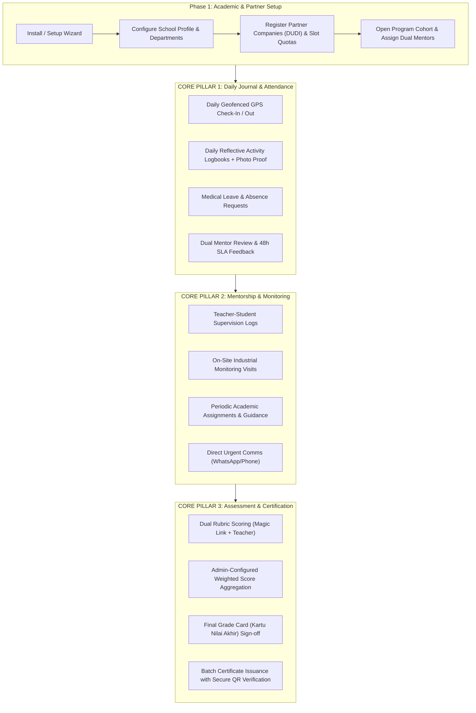

# Product Requirement Document (PRD) — Internara Platform

**Document Version:** 1.1.0  
**Status:** Approved Baseline  
**Product:** Internara — Compulsory Fieldwork & Internship Management Platform  
**Target Domain:** Indonesian Vocational High Schools (SMK / SMA) & Educational Institutions  
**License:** Open Source (MIT) — Self-Hosted, Single-Tenant  

---

## 1. Executive Summary & Vision

### 1.1 Context
Indonesian vocational high schools (*Sekolah Menengah Kejuruan* / SMK) are legally mandated by the Ministry of Education to conduct compulsory industrial fieldwork (*Praktik Kerja Lapangan* / PKL) for every student. In a typical school, managing a PKL cohort entails coordinating 500 to 1,000 students across 150 to 300 partner companies (*Dunia Usaha dan Dunia Industri* / DUDI) for 90 to 180 days.

### 1.2 Problem Statement: The Operational Reality of Paper-Based PKL
Historically, schools have managed PKL through manual, paper-based systems supplemented by informal messaging apps. This operational paradigm creates severe vulnerabilities, high material costs, and extreme administrative overhead:

- **Fragility and Vulnerability of Physical Paper Records**:
  - **Daily Physical Attendance Sheets**: Paper attendance logs and physical signature sheets (*lembar paraf presensi*) kept at industrial sites are highly prone to loss, tearing, coffee spills, and signature forgery (*titip paraf*). Schools have zero real-time visibility into whether a student actually arrived at the job site.
  - **Physical Journal Books (*Buku Jurnal/Logbook Cetak*)**: Heavy, printed physical logbooks require substantial printing and binding budgets each semester. Students frequently engage in "retroactive cramming" — handwriting 60 to 90 days worth of entries in a single panic-filled weekend right before final submission. Mentor teachers cannot read hurried handwriting or inspect photographic proof of work.
  - **Physical Administrative Letters**: Physical parent consent forms (*surat izin orang tua*), formal introduction letters (*surat pengantar*), and company acceptance confirmation slips (*surat balasan/penerimaan*) pass through multiple hands, frequently getting lost in student backpacks or delayed in transit, stalling student onboarding.

- **Absence of Real-Time Supervision & Field Blindspots**:
  - Under paper-based workflows, school mentor teachers only inspect physical logbooks and attendance sheets once or twice during the entire 3-to-6 month period, or only upon return to school.
  - Teachers lack an auditable, continuous record of mentorship discussions, student learning difficulties, and scheduled on-site field monitoring visits to industrial partners.

- **Manual Assessment Bottlenecks & Transcription Errors**:
  - **Delayed Physical Score Sheets**: Industry supervisors are asked to fill out physical rubric evaluation forms, stamp them with company seals, and mail or hand them back via students. These forms often sit forgotten on corporate desks for weeks, delaying graduation clearance.
  - **Manual Spreadsheet Re-keying**: School administrative staff and teachers must collect hundreds of physical score sheets and manually type handwritten scores into disconnected Excel spreadsheets. This manual transcription introduces pervasive human errors, formula mistakes, and version conflicts between department coordinators.
  - **Weeks of Administrative Lockout**: Compiling, verifying, and calculating final composite grade cards (*Kartu Nilai Akhir*) for a cohort of 800 students takes teachers 2 to 3 full weeks of overtime, taking them away from instructional teaching.

- **Physical Archival & Regulatory Compliance Burdens**:
  - Indonesian educational regulations mandate that schools retain student academic, attendance, and fieldwork records for a minimum of 5 years for institutional accreditation and ministry audits.
  - Paper archives require physical warehouse storage rooms, filing cabinets, and document binders. Over time, physical records degrade due to humidity, mold, ink fading, or pest damage. Retrieving a past student's certificate or verifying an internship record from three years ago requires digging through physical boxes for hours or days.
  - When paper certificates are lost or damaged, reissuing them requires manual verification against paper ledger archives with no instantaneous cryptographic verification mechanism.

### 1.3 Product Vision & Core Focus
> *Every vocational school operates its compulsory fieldwork programs with the rigor and efficiency of an enterprise-grade institution — hosted on school-controlled infrastructure, audit-ready by default, free from paperwork, and without turning educators into administrative clerks.*

Internara is a dedicated, single-purpose web application designed to replace paper-based operations with a canonical digital record centered around **three core feature pillars**:
1. **Daily Journal & Attendance Tracking (*Jurnal Harian & Presensi*)**: Real-time geofenced check-in/out, medical leave requests, reflective daily activity logbooks with photo attachments, and a 48-hour mentor feedback SLA.
2. **Guidance, Mentorship & Field Monitoring (*Bimbingan & Monitoring Lapangan*)**: Structured dual mentorship, teacher supervision interaction logs, and verified on-site industrial monitoring visits.
3. **Assessment, Grading & Certificate Issuance (*Penilaian & Penerbitan Sertifikat*)**: Competency-based rubrics, passwordless supervisor magic links, admin-configurable composite score aggregation, automated final grade cards, and tamper-proof public QR-code verifiable certificates.

### 1.4 Key Strategic Principles
- **Education First, Technology Second**: Workflows mirror real Indonesian SMK operational realities (such as dual mentors, supervisor magic links, and placement change appeals) rather than forcing schools into generic corporate HR paradigms.
- **Progressive Infrastructure ($5/month Baseline)**: Operates out-of-the-box on inexpensive shared hosting or basic VPS (PHP 8.5, SQLite/MySQL, local filesystem, file-based cache and sync queue) without mandatory cloud subscriptions, with a seamless growth path to Redis, S3, and async workers when scale demands.
- **Data Sovereignty & Privacy by Design**: 100% self-hosted, single-tenant architecture. No telemetry, no third-party tracking, role-scoped permissions, immutable audit logging, PII masking, and built-in GDPR-compliant data export and erasure routines.
- **Zero-Admin Experience**: Automated score calculations, one-click PDF generation, batch CSV workflows, and instant public QR verification.

### 1.5 Product Boundaries & Explicit Non-Goals
To preserve platform reliability, low operational overhead, and maintainability, the following capabilities are explicitly out of scope:
- **Incident & Emergency Response Management**: The platform does not handle workplace incidents, accidents, emergency dispatches, or grievance tickets. All rapid-response, time-critical situations are far more effectively communicated directly via instant messaging applications (e.g., WhatsApp) and direct phone calls between students, teachers, and industrial supervisors.
- **Multi-Tenant SaaS / Commercial Subscriptions**: Internara is strictly single-tenant and self-hosted per school. No tenant isolation overhead or payment gateways.
- **General Enterprise HR / Payroll**: Does not manage employee payroll, corporate hiring funnels, or post-graduation job boards.
- **Real-Time WebSockets / Chat**: Does not implement live instant messaging. Notifications are delivered through in-app notification centers and transactional email to prevent server bloat and content moderation burdens.
- **Native Mobile Apps**: Features a responsive, mobile-first web interface (Laravel Livewire + Alpine.js + TallstackUI + Tailwind CSS v4) avoiding mobile app store distribution friction.
- **Direct Government Database Sync (Dapodik/NSP)**: To prevent fragile API lock-in, data exchange with external school portals is achieved via structured, verified CSV bulk import/export.

---

## 2. User Personas & Role-Based Access Control (RBAC)

Internara enforces strict, flat role-based authorization across six primary user roles:

| Role | Target Persona | Primary Responsibilities & Permissions |
|---|---|---|
| **Super Admin** | School IT Specialist / Infrastructure Lead | System installation, environment provisioning, raw database backup/recovery, log audit, and system repair tokens. |
| **School Admin** | School Principal / Head of Curriculum / PKL Coordinator | Manages academic years, departments, company partnerships, slot quotas, student applications, official documents, system announcements, and cohort-wide grade card approvals. |
| **Teacher (School Mentor)** | Vocational Subject Teacher / Field Supervising Teacher | Mentors assigned student groups, reviews daily logbooks within 48 hours, logs field monitoring visits, inputs school-side rubric scores, and tracks student progress. |
| **Industry Supervisor** | Company Mentor / Field Supervisor at DUDI Partner | Validates daily student attendance, reviews weekly activities, provides qualitative feedback, and submits industry competency assessments (via authenticated login or passwordless magic link). |
| **Student (Intern)** | 11th / 12th Grade Vocational Student (Ages 16–18) | Registers for programs, views company placements, submits GPS-tagged check-ins, writes daily reflective logbooks with photo evidence, completes assignments, and downloads verified certificates. |
| **Public / External Verifier** | Prospective Employers, Universities, or Public Auditors | Scans QR codes on student certificates or recovery slips to cryptographically verify validity, credential serial numbers, and student authenticity without requiring an account. |

---

## 3. End-to-End PKL Lifecycle Workflow



---

## 4. Core Feature Pillars (Primary Requirements)

The application centers around three primary operational pillars that replace manual paper workflows with verified digital records:

### 4.1 Pillar 1: Daily Journal & Attendance Tracking (*Jurnal Harian & Presensi Lapangan*)

- **FR-JRN-001 (Geofenced GPS Attendance Check-In / Out)**:
  - Students record daily presence via a mobile-first web browser interface, capturing precise latitude, longitude, and device timestamp.
  - The system validates coordinates against the partner company's configured GPS geolocation within an admin-configurable radius (default: 100 meters).
  - Check-in and check-out times are locked upon submission to prevent retroactive tampering.
- **FR-JRN-002 (Attendance Status Classification & Timesheets)**:
  - Automatically classifies attendance entries into: `Present`, `Late` (after company threshold), `Excused` (approved absence), and `Absent` (unreported missing).
  - Summarizes cohort and individual monthly attendance percentages in real time for teachers and administrators.
- **FR-JRN-003 (Absence Request & Medical Leave Workflow)**:
  - Enables students to submit formal absence requests for illness or urgent personal reasons.
  - Requires the upload of supporting medical certificates (*surat dokter*) or official parental notes.
  - Triggers review and approval workflows for the assigned school mentor teacher before marking the attendance status as `Excused`.
- **FR-JRN-004 (Daily Reflective Activity Logbook)**:
  - Students submit daily reflective journal entries capturing: specific vocational tasks performed, competency skills practiced, hours worked, and up to 3 photographic attachments verifying work activities.
  - Prohibits bulk submission or retroactive back-filling beyond a configurable grace period (default: 48 hours), eliminating the common paper issue of end-of-semester cramming.
- **FR-JRN-005 (Dual Mentor Review & 48-Hour SLA Feedback)**:
  - Provides a streamlined review interface for both School Teachers and Industry Supervisors.
  - Mentors can approve, request revision, or comment on logbook entries.
  - Tracks review timeliness against a 48-hour Service Level Agreement (SLA), flagging overdue unreviewed entries on teacher dashboards.

---

### 4.2 Pillar 2: Guidance, Mentorship & Field Monitoring (*Bimbingan & Monitoring Lapangan*)

- **FR-MNT-001 (Dual Mentorship Binding & Grouping)**:
  - Binds every participating student to an operational internship group (*rombel PKL*).
  - Every group is linked to exactly two mandatory mentor roles: exactly one School Supervising Teacher (*Guru Pembimbing*) and at least one Industry Field Supervisor (*Pembimbing DUDI*).
- **FR-MNT-002 (Teacher Supervision Logs / *Catatan Bimbingan*)**:
  - Provides teachers with a dedicated digital record to log academic bimbingan sessions, student behavioral adaptation checks, and periodic guidance notes.
  - Maintains a chronological log of guidance interactions accessible to school coordinators.
- **FR-MNT-003 (On-Site Field Monitoring Visits / *Kunjungan Industri*)**:
  - Allows supervising teachers to schedule, document, and verify on-site visits to partner companies.
  - Records on-site discussion minutes with company supervisors, student performance observations, and photographic proof of the on-site visit.
  - Generates verifiable monitoring visit receipts for administrative travel claim verification.
- **FR-MNT-004 (Periodic Academic Assignments & Coursework)**:
  - Enables supervising teachers to publish midterm vocational assignments, technical case studies, or progress reports.
  - Enforces submission deadlines and file format constraints (PDF, DOCX, ZIP).
  - Provides rubrics-based grading (0–100) and qualitative feedback, ensuring academic standards are maintained during industrial placement.
- **FR-MNT-005 (Direct Urgent Communication Protocol)**:
  - The system explicitly delegates urgent, time-sensitive field concerns (e.g., student illness, minor disputes, immediate schedule changes) to direct mobile messaging (WhatsApp) and phone calls.
  - The platform serves as the authoritative, permanent record for validated guidance, verified monitoring, and academic progress without ticketing overhead.

---

### 4.3 Pillar 3: Assessment, Grading & Certificate Issuance (*Penilaian & Penerbitan Sertifikat*)

- **FR-ASM-001 (Multi-Dimensional Competency Rubric Authoring & Default Weights)**:
  - Allows school administrators and departments to define flexible assessment rubrics tailored to specific vocational specializations.
  - Aligns with national vocational curriculum (Kurikulum Merdeka SMK) standards with standardized default workplace assessment weights (total 100%):
    1. **Internalisasi Soft Skills** (Bobot Asesmen ~20%): Budaya kerja industri, etika profesi, kedisiplinan kehadiran, kepatuhan K3, dan komunikasi tim.
    2. **Penerapan Hard Skills** (Bobot Asesmen ~60%): Penguasaan kompetensi teknis kejuruan, ketepatan penyelesaian tugas spesifik, dan pemecahan masalah praktis.
    3. **Penyiapan Kewirausahaan** (Bobot Asesmen ~20%): Pemahaman alur proses bisnis industri, inisiatif mandiri, kreativitas, dan efisiensi kerja berorientasi wirausaha.
  - Administrators maintain full authority to adjust and configure criteria weights per department or internship program.
- **FR-ASM-002 (Dual Evaluation Framework)**:
  - Implements independent assessment portals for the School Supervising Teacher and the Industry Field Supervisor.
  - Prevents premature grade exposure between mentors until evaluation deadlines conclude.
- **FR-ASM-003 (Passwordless Supervisor Magic Links)**:
  - Generates secure, encrypted, single-use, time-limited magic links dispatched via email or direct link sharing.
  - Enables busy external company supervisors to complete and submit student competency assessments directly from any device without requiring account registration, username/password management, or school portal onboarding friction.
- **FR-RPT-001 (Admin-Configurable Composite Score Aggregation Engine)**:
  - Automatically aggregates disparate evaluation components into a single composite final score (*Nilai Akhir PKL*).
  - Enforces standard default final grade weighting (total 100%):
    - **Pelaksanaan Magang di DUDI / Tempat Kerja** (hasil asesmen Soft Skills, Hard Skills, Kewirausahaan + Logbook): **70%**
    - **Penyusunan Laporan dan Presentasi Akademis-Praktis** (Bimbingan, penulisan laporan PKL, dan ujian presentasi/sidang di hadapan guru sekolah): **30%**
  - Allows administrators to customize component weights per program or department, with automated 100% total sum validation.
  - If unconfigured or reset by the administrator, the system defaults to the proportional standard above (70% Pelaksanaan DUDI : 30% Laporan & Presentasi Sekolah).
- **FR-RPT-002 (Letter Grade Conversion & Coordinator Sign-off)**:
  - Converts numerical composite scores (0–100) into institutional letter grades (e.g., A ≥ 85, B ≥ 75, C ≥ 65, D < 65) based on school grading thresholds.
  - Provides the PKL Coordinator with a cohort-wide review dashboard to inspect grades, verify completion, and execute a formal digital sign-off that locks records against further alteration.
  - Generates official, printable Final Grade Card PDFs (*Kartu Nilai Akhir*) formatted with school letterhead, authorized signatures, and student NISN.
- **FR-CRT-001 (Automated Batch Certificate Generation)**:
  - Automatically generates official completion certificates for all students who achieve passing grades on signed-off grade cards.
  - Supports customizable certificate templates (school letterhead, company branding, dual principal/company signature blocks, and competency score breakdown on the reverse page).
- **FR-CRT-002 (Tamper-Proof Public QR-Code Verification)**:
  - Embeds a cryptographically signed QR code on every issued certificate linking to a public verification endpoint (`/verify/{certificate_serial}`).
  - Allows employers, universities, and public auditors to instantaneously verify student name, school, company placement, dates, and competency achievements without requiring a user login.

---

## 5. Supporting Enablers & Infrastructure Modules

While the application centers on the 3 core pillars, the following supporting modules provide foundational scaffolding:

### 5.1 Academic Structure & Partnership Setup (`Academics`, `Partner`, `Program`)
- **FR-SUP-001 (School Profile & Departments)**: Manages official school NPSN, institutional address, principal credentials, and vocational departments (e.g., RPL, TKJ, TKR).
- **FR-SUP-002 (Academic Calendar)**: Manages academic years (e.g., 2026/2027) with active semester flags.
- **FR-SUP-003 (Company Directory & Slot Quotas)**: Maintains company profiles, addresses, GPS coordinates, and student quota capacity per department.
- **FR-SUP-004 (MoU Tracking)**: Records Memorandum of Understanding agreement numbers and expiration alert intervals (30, 14, 7 days).

### 5.2 Enrollment & Placement Operations (`Enrollment`)
- **FR-SUP-005 (Program Registration)**: Handles student cohort registration and administrative verification.
- **FR-SUP-006 (Slot Allocation & Direct Placement)**: Assigns students to company slots, strictly enforcing capacity quotas.
- **FR-SUP-007 (Placement Change Appeals)**: Supports formal requests to transfer placement location due to operational shifts, preserving historical journal records.

### 5.3 Provisioning, Security & Identity (`Setup`, `Auth`, `User`)
- **FR-SUP-008 (Setup Wizard & Provisioning)**: Guided installation wizard (`/setup`) and CLI command (`php artisan setup:install`) with database seeding and setup lockout.
- **FR-SUP-009 (Authentication & Sudo Mode)**: Multi-role authentication, brute-force rate limiting, password reset, and password confirmation for sensitive actions.
- **FR-SUP-010 (Physical Account Activation Slips)**: Generates printable slips with temporary credentials and QR codes for bulk student onboarding.
- **FR-SUP-011 (User Profiles & Status Lifecycle)**: Manages user states (`Active`, `Suspended`, `Archived`) and role bindings.

### 5.4 Administrative Governance (`Document`, `SysAdmin`, `Setting`, `Core`)
- **FR-SUP-012 (Official Correspondence Generation)**: Generates templated administrative letters (Introduction, Parent Consent, Acceptance, Assignment letters).
- **FR-SUP-013 (System Announcements & Push Alerts)**: Role-targeted broadcast announcements displayed on dashboards.
- **FR-SUP-014 (Automated Backups & 5-Year Data Lifecycle)**: Scheduled database/media backups (RPO 4h, RTO 1h), immutable activity logging (`activity_log`), and regulatory 5-year data retention with GDPR erasure workflows.
- **FR-SUP-015 (Branding, Themes & Dual Localization)**: Custom logo/favicon, dark/light theme presets, and full runtime language parity between Indonesian (`id`) and English (`en`).
- **FR-SUP-016 (Core Media & Bulk Import/Export)**: Spatie MediaLibrary upload pipeline, Dompdf engine, and Dapodik-compatible CSV import/export.

---

## 6. Non-Functional Requirements (NFR)

All non-functional requirements are specified with measurable Service Level Objectives (SLOs) per ISO 25010 standards:

### 6.1 Security & Access Safety (ISO 25010: Security)
- **NFR-SEC-001 (Multi-Layer Authorization)**: Every request passes route middleware, Policy authorization (`Gate`/`Policy`), and entity business invariant checks.
- **NFR-SEC-002 (SQL Injection Prevention)**: Parameterized bindings are mandatory across all database queries. Raw SQL concatenation is strictly barred (`scan_security.py`).
- **NFR-SEC-003 (Hardened HTTP Security Headers)**: All HTTP responses must include `X-Frame-Options: SAMEORIGIN`, `X-Content-Type-Options: nosniff`, `Referrer-Policy: strict-origin-when-cross-origin`, and strict CSP rules.
- **NFR-SEC-004 (CSRF & Token Authentication)**: CSRF tokens are mandatory on state-changing requests; API endpoints enforce Sanctum token authentication.
- **NFR-SEC-005 (PII Redaction in Logs)**: Passwords, national IDs (NIK), phone numbers, and student personal records are redacted before disk logging (`SmartLogger`).

### 6.2 Performance & Scalability (ISO 25010: Performance Efficiency)
- **NFR-PRF-001 (Server Response Latency)**: P95 page render latency remains below 400ms under standard concurrency (50 active concurrent users on 1 vCPU / 2GB RAM budget hosting).
- **NFR-PRF-002 (Database Optimization & Indexing)**: UUID v7 primary keys across all domain entities eliminate B-tree fragmentation. Composite foreign key indexes cover all high-frequency filter paths.
- **NFR-PRF-003 (Eager Loading & N+1 Prevention)**: All relationship queries in Livewire and Read Actions enforce explicit eager loading (`with()`).
- **NFR-PRF-004 (Centralized Cache Registry)**: All cached query keys are registered in `config/cache-keys.php` with defined Time-To-Live (TTL) values.

### 6.3 Reliability, Availability & Backup (ISO 25010: Reliability)
- **NFR-REL-001 (Recovery Point Objective - RPO)**: Scheduled automated database backups ensure an RPO of no more than 4 hours during operational school hours.
- **NFR-REL-002 (Recovery Time Objective - RTO)**: Disaster recovery from cold backup dump to functional online state completes in under 60 minutes.
- **NFR-REL-003 (Graceful Offline Degradation)**: The mobile web interface for attendance and logbook drafts caches input locally in the browser when field connectivity drops, synchronizing once reconnected.

### 6.4 Usability & Accessibility (ISO 25010: Usability)
- **NFR-USB-001 (Accessibility Standard - WCAG 2.1 AA)**: All UI elements meet WCAG 2.1 AA visual contrast standards (minimum 4.5:1 ratio for regular text).
- **NFR-USB-002 (Mobile-First Responsiveness)**: Core workflows (attendance check-in, logbook drafting, mentor review) operate seamlessly from 360px viewport width up to 4K desktop screens.
- **NFR-USB-003 (Bilingual Parity)**: 100% of UI strings, notifications, and validation messages maintain parity between Indonesian (`id`) and English (`en`).

### 6.5 Maintainability & Architecture Discipline (ISO 25010: Maintainability)
- **NFR-MNT-001 (Vertical Slicing & Module Colocation)**: Code is organized into modular vertical slices under `app/Modules/{Module}/`.
- **NFR-MNT-002 (Single-Responsibility Action Triad)**: Business logic is partitioned into `BaseCommandAction` (mutations), `BaseReadAction` (queries), and `BaseProcessAction` (orchestration).
- **NFR-MNT-003 (Test Coverage & Spec Traceability)**: 100% of functional requirements and user stories trace directly to automated tests adhering to the naming convention `{SpecID}-{ReqID}: {description}`.

---

## 7. Data Architecture & Relational Map

### 7.1 Database Engine & Key Strategy
- **Engines**: SQLite 3 (WAL mode) for development, testing, and small schools; MySQL 8.0+ / MariaDB 10.6+ for production deployments.
- **Key Strategy**: UUID v7 (time-ordered UUIDs) across all domain tables.

### 7.2 Relational Entity Flow Map

```
+---------------------------------------------------------------------------------------+
|                                    ACADEMIC & PARTNERS                                |
+---------------------------------------------------------------------------------------+
|  [SchoolProfile] <--- [Department] <--- [Program] <--- [InternshipGroup]              |
|                                            |                 |                        |
|  [Company] <--- [PartnershipSlot] <--------+                 |                        |
+--------------------------------------------------------------+------------------------+
                                                               |
+--------------------------------------------------------------+------------------------+
|                                 CORE 1: JOURNAL & ATTENDANCE |                        |
+--------------------------------------------------------------+                        |
|  [User (Student)] <--- [Registration] <----------------------+                        |
|          |                 |                                                          |
|          +--- (1:N) ---> [Attendance (GPS Coordinates & Status)]                      |
|          +--- (1:N) ---> [Logbook (Reflective Entry, Tasks, Photo Media)]             |
|          +--- (1:N) ---> [AbsenceRequest (Doctor Note, Mentor Approval)]              |
+---------------------------------------------------------------------------------------+
                                     |
+------------------------------------+--------------------------------------------------+
|                                 CORE 2: GUIDANCE & MONITORING                         |
+---------------------------------------------------------------------------------------+
|  [TeacherSupervisionLog]  (Teacher guidance notes & student progress checks)          |
|  [MonitoringVisit]        (On-site company visits, minutes, photos, verification)      |
|  [AssignmentSubmission]   (Academic tasks, submission files, teacher grading)         |
+---------------------------------------------------------------------------------------+
                                     |
+------------------------------------+--------------------------------------------------+
|                                 CORE 3: ASSESSMENT & CERTIFICATION                    |
+---------------------------------------------------------------------------------------+
|  [AssessmentRubric]       (Technical and ethical criteria & weights)                  |
|  [AssessmentScore]        (School teacher score + Magic-link industry supervisor score)|
|  [FinalGradeCard]         (Admin-configured weighted composite grade, sign-off lock)  |
|  [Certificate]            (Serial number, PDF layout, public QR verification URL)     |
+---------------------------------------------------------------------------------------+
```

---

## 8. Risk Register & Mitigation Strategy

| Risk ID | Risk Description & Cause | Likelihood | Impact | Mitigation Strategy | Owner |
|---|---|---|---|---|---|
| **RSK-001** | **Intermittent Field Internet Connectivity**: Students unable to check in or submit daily logbooks due to poor cellular reception at industrial sites. | High | Medium | Implement browser-level local form caching; allow offline draft saving with automated timestamped sync upon reconnection. | Frontend Lead |
| **RSK-002** | **External Supervisor Disengagement**: Industry supervisors fail to log in or complete evaluations before end-of-semester grading deadlines. | High | High | Implement passwordless encrypted magic links sent via email/WhatsApp, automated reminder notices, and a cross-role proxy rule allowing authorized teachers to input confirmed evaluations with an audit trail. | Product Lead |
| **RSK-003** | **GPS Geofence Spoofing**: Students using mock location or fake GPS applications to falsify fieldwork attendance. | Medium | High | Enforce server-side distance calculation, inspect browser high-accuracy geolocation parameters, log device user-agent anomalies, and require photo evidence with every check-in. | Security Lead |
| **RSK-004** | **Shared Hosting Concurrency Bottlenecks**: Database locks or resource exhaustion on budget shared hosts when 500+ students check in simultaneously at 08:00 AM. | Medium | Medium | SQLite configured with WAL mode and high busy timeout; staggered background queue processing; lightweight Livewire DOM payloads; clean N+1 eager-loading across all read queries. | Backend Lead |
| **RSK-005** | **Sensitive Student Data Exposure**: Leakage of student personal data or academic records. | Low | Critical | Field-level authorization checks on all queries; PII masking in logs; strict role-scoped access control; automated weekly security scans via `scan_security.py`. | Security Lead |

---

## 9. Specification & GitHub Traceability Matrix

This PRD formalizes and aligns the active feature specifications across the Internara repository lifecycle:

- **Core Pillar 1 — Journals & Attendance (#485, #486)**: Spec IDs `1KSWL`, `2EHSE`.
- **Core Pillar 2 — Guidance & Monitoring (#478, #486, #490–#492)**: Spec IDs `IT0OE`, `2EHSE`, `T657Z`, `T657B`, `T657C`.
- **Core Pillar 3 — Assessment & Certification (#489, #495, #498, #499)**: Spec IDs `AXKZW`, `J0M04`, `7UB7S`, `R6BMW`.
- **Academic & Partnerships Scaffolding (#462, #473–#477, #479–#481)**: Spec IDs `81SMS`, `4HWSB`, `XW6F5`, `XI3LB`, `NTHQA`, `7C5WM`, `MBB5R`, `J9GBH`, `920SO`.
- **Identity, Access & Provisioning (#457–#459, #465, #466, #468–#472, #482, #484)**: Spec IDs `8NZAU`, `VEJCX`, `C9ZB6`, `YB7RG`, `TXR2H`, `CKKZC`, `D9TKW`, `CQVSK`, `SHQ1J`, `OCEMS`, `95EVB`, `EWCZ0`, `K8HP1`.
- **System Administration & Core Utilities (#442–#456, #460, #461, #467, #483, #493, #494, #497, #500, #502, #504)**: Spec IDs `QLHDO`, `D2FT3`, `FB792`, `ZT6VS`, `SE5Q9`, `C8F0D`, `J68GZ`, `I1BCV`, `89SRA`, `NUCY3`, `T4B26`, `2CF4Y`, `C7Q9R`, `B114U`, `8XMYS`, `52O1I`, `YB22J`, `3S55V`, `O2KCR`, `PKYX6`, `ZUFG8`, `WQGTP`, `7H5D6`, `HBXCI`, `7HNCF`.
- **Decommissioned / Excluded Boundary**: Incident & Safety Management (#487 / `3RU9S`) is formally removed and replaced by direct off-platform communication.

---

## 10. Quick References

- [`docs/index.md`](index.md) — Documentation index
- [`docs/philosophy.md`](philosophy.md) — Project philosophy, core values & vision
- [`docs/architecture.md`](architecture.md) — High-level architecture and Action Triad
- [`docs/refs/modules/index.md`](refs/modules/index.md) — 18-module catalog and reference
- [GitHub Spec Issues](https://github.com/reasvyn/internara/issues?q=label%3Aspec) — Authoritative spec issues #442–#509
