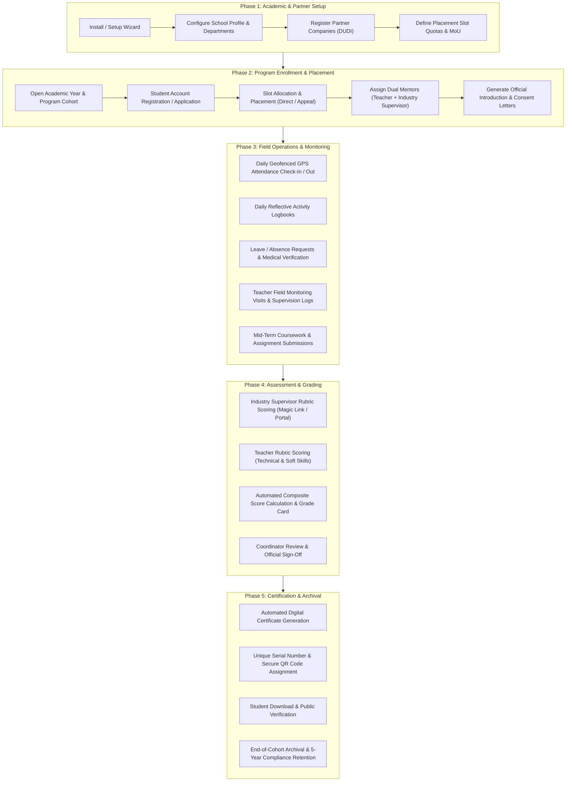

# Product Requirement Document (PRD) — Internara Platform

**Document Version:** 1.0.0  
**Status:** Approved Baseline  
**Product:** Internara — Compulsory Fieldwork & Internship Management Platform  
**Target Domain:** Indonesian Vocational High Schools (SMK / SMA) & Educational Institutions  
**License:** Open Source (MIT) — Self-Hosted, Single-Tenant  

---

## 1. Executive Summary & Vision

### 1.1 Context
Indonesian vocational high schools (*Sekolah Menengah Kejuruan* / SMK) are legally mandated by the Ministry of Education to conduct compulsory industrial fieldwork (*Praktik Kerja Lapangan* / PKL) for every student. In a typical school, managing a PKL cohort entails coordinating 500 to 1,000 students across 150 to 300 partner companies (*Dunia Usaha dan Dunia Industri* / DUDI) for 90 to 180 days.

### 1.2 Problem Statement: The Operational Reality of Paper-Based PKL
Historically, schools have managed PKL through manual, paper-based systems supplemented by informal messaging apps. This operational paradigm creates severe vulnerabilities, high material costs, and extreme administrative overhead:

- **Fragility and Vulnerability of Physical Paper Records**:
  - **Daily Physical Attendance Sheets**: Paper attendance logs and physical signature sheets (*lembar paraf presensi*) kept at industrial sites are highly prone to loss, tearing, coffee spills, and signature forgery (*titip paraf*). Schools have zero real-time visibility into whether a student actually arrived at the job site.
  - **Physical Journal Books (*Buku Jurnal/Logbook Cetak*)**: Heavy, printed physical logbooks require substantial printing and binding budgets each semester. Students frequently engage in "retroactive cramming" — handwriting 60 to 90 days worth of entries in a single panic-filled weekend right before final submission. Mentor teachers cannot read hurried handwriting or inspect photographic proof of work.
  - **Physical Administrative Letters**: Physical parent consent forms (*surat izin orang tua*), formal introduction letters (*surat pengantar*), and company acceptance confirmation slips (*surat balasan/penerimaan*) pass through multiple hands, frequently getting lost in student backpacks or delayed in transit, stalling student onboarding.

- **Absence of Real-Time Supervision & Field Blindspots**:
  - Under paper-based workflows, school mentor teachers only inspect physical logbooks and attendance sheets once or twice during the entire 3-to-6 month period, or only upon return to school.
  - If a student encounters workplace harassment, unexcused absenteeism, safety hazards, or tasks completely unrelated to their vocational competency curriculum, the school learns of it weeks or months too late to intervene.

- **Manual Assessment Bottlenecks & Transcription Errors**:
  - **Delayed Physical Score Sheets**: Industry supervisors are asked to fill out physical rubric evaluation forms, stamp them with company seals, and mail or hand them back via students. These forms often sit forgotten on corporate desks for weeks, delaying graduation clearance.
  - **Manual Spreadsheet Re-keying**: School administrative staff and teachers must collect hundreds of physical score sheets and manually type handwritten scores into disconnected Excel spreadsheets. This manual transcription introduces pervasive human errors, formula mistakes, and version conflicts between department coordinators.
  - **Weeks of Administrative Lockout**: Compiling, verifying, and calculating final composite grade cards (*Kartu Nilai Akhir*) for a cohort of 800 students takes teachers 2 to 3 full weeks of overtime, taking them away from instructional teaching.

- **Physical Archival & Regulatory Compliance Burdens**:
  - Indonesian educational regulations mandate that schools retain student academic, attendance, and fieldwork records for a minimum of 5 years for institutional accreditation and ministry audits.
  - Paper archives require physical warehouse storage rooms, filing cabinets, and document binders. Over time, physical records degrade due to humidity, mold, ink fading, or pest damage. Retrieving a past student's certificate or verifying an internship record from three years ago requires digging through physical boxes for hours or days.
  - When paper certificates are lost or damaged, reissuing them requires manual verification against paper ledger archives with no instantaneous cryptographic verification mechanism.

### 1.3 Product Vision
> *Every vocational school operates its compulsory fieldwork programs with the rigor and efficiency of an enterprise-grade institution — hosted on school-controlled infrastructure, audit-ready by default, free from paperwork, and without turning educators into administrative clerks.*

Internara is a dedicated, single-purpose web application specifically designed to replace physical paper-based operations with a canonical digital record: from company partnership onboarding and quota-based placement, to GPS-verified attendance, reflective daily logbooks, teacher monitoring visits, rubrics-based dual evaluation, automated grade card calculation, and cryptographically verifiable digital certificates.

### 1.4 Key Strategic Principles
- **Education First, Technology Second**: Workflows mirror real Indonesian SMK operational realities (such as dual mentors, supervisor magic links, and placement change appeals) rather than forcing schools into generic corporate HR paradigms.
- **Progressive Infrastructure ($5/month Baseline)**: Operates out-of-the-box on inexpensive shared hosting or basic VPS (PHP 8.5, SQLite/MySQL, local filesystem, file-based cache and sync queue) without mandatory cloud subscriptions, with a seamless growth path to Redis, S3, and async workers when scale demands.
- **Data Sovereignty & Privacy by Design**: 100% self-hosted, single-tenant architecture. No telemetry, no third-party tracking, role-scoped permissions, immutable audit logging, PII masking, and built-in GDPR-compliant data export and erasure routines.
- **Zero-Admin Experience**: Automated score calculations, one-click PDF generation, batch CSV workflows, and instant public QR verification.

### 1.5 Product Boundaries & Explicit Non-Goals
To preserve platform reliability, low operational overhead, and maintainability, the following capabilities are explicitly out of scope:
- **Multi-Tenant SaaS / Commercial Subscriptions**: Internara is strictly single-tenant and self-hosted per school. No tenant isolation overhead or payment gateways.
- **General Enterprise HR / Payroll**: Does not manage employee payroll, corporate hiring funnels, or post-graduation job boards.
- **Real-Time WebSockets / Chat**: Does not implement live instant messaging. Notifications are delivered through in-app notification centers and transactional email to prevent server bloat and content moderation burdens.
- **Native Mobile Apps**: Features a responsive, mobile-first web interface (Laravel Livewire + Alpine.js + TallstackUI + Tailwind CSS v4) avoiding mobile app store distribution friction.
- **Direct Government Database Sync (Dapodik/NSP)**: To prevent fragile API lock-in, data exchange with external school portals is achieved via structured, verified CSV bulk import/export.

---

## 2. User Personas & Role-Based Access Control (RBAC)

Internara enforces strict, flat role-based authorization across six primary user roles:

| Role | Target Persona | Primary Responsibilities & Permissions |
|---|---|---|
| **Super Admin** | School IT Specialist / Infrastructure Lead | System installation, environment provisioning, raw database backup/recovery, log audit, and system repair tokens. |
| **School Admin** | School Principal / Head of Curriculum / PKL Coordinator | Manages academic years, departments, company partnerships, slot quotas, student applications, official documents, system announcements, and cohort-wide grade card approvals. |
| **Teacher (School Mentor)** | Vocational Subject Teacher / Field Supervising Teacher | Mentors assigned student groups, reviews daily logbooks within 48 hours, logs field monitoring visits, inputs school-side rubric scores, and tracks student progress. |
| **Industry Supervisor** | Company Mentor / Field Supervisor at DUDI Partner | Validates daily student attendance, reviews weekly activities, provides qualitative feedback, and submits industry competency assessments (via authenticated login or passwordless magic link). |
| **Student (Intern)** | 11th / 12th Grade Vocational Student (Ages 16–18) | Registers for programs, views company placements, submits GPS-tagged check-ins, writes daily reflective logbooks with photo evidence, completes assignments, and downloads verified certificates. |
| **Public / External Verifier** | Prospective Employers, Universities, or Public Auditors | Scans QR codes on student certificates or recovery slips to cryptographically verify validity, credential serial numbers, and student authenticity without requiring an account. |

---

## 3. End-to-End PKL Lifecycle Workflow



---

## 4. Comprehensive Functional Requirements (FR)

The system consists of 19 dedicated, vertically-sliced domain modules. Requirements are categorized below by operational domain.

### 4.1 System Provisioning & Access Governance

#### Module: Setup & Installation (`Setup`)
- **FR-SET-001 (Automated Provisioning Wizard)**: The system must provide a guided multi-step wizard (`/setup`) and CLI command (`php artisan setup:install`) that verifies runtime requirements (PHP version, PDO SQLite/MySQL, file write permissions, and required extensions).
- **FR-SET-002 (Database Provisioning & Seeding)**: Executes fresh database schema migrations and seeds essential system roles, default lookup values, and document templates.
- **FR-SET-003 (Root Super Admin Initialization)**: Prompts for the creation of exactly one primary `superadmin` credential set during initialization.
- **FR-SET-004 (Setup Lockout Mechanism)**: Generates a persistent technical lock file (`storage/installed`) and technical setup token upon successful completion to prevent unauthorized re-installation.
- **FR-SET-005 (Rescue & Recovery Ecosystem)**: Supports technical recovery mechanisms including CLI-generated one-time rescue tokens and printed recovery slips with hash verification.

#### Module: Authentication & Session Security (`Auth`)
- **FR-AUT-001 (Multi-Role Authentication)**: Authenticates users using email/username and password, directing them to role-specific dashboard views.
- **FR-AUT-002 (Rate Limiting & Brute-Force Protection)**: Enforces progressive rate limiting (maximum 5 failed attempts per minute per IP address) before temporary lockout.
- **FR-AUT-003 (Self-Service Password Reset)**: Enables password reset workflows via signed, time-limited email tokens with guaranteed expiration (60 minutes).
- **FR-AUT-004 (Sudo Mode Password Confirmation)**: Requires password re-authentication before executing sensitive administrative actions (e.g., database backups, user deletions, school profile updates).
- **FR-AUT-005 (Account Activation Slips)**: Allows administrators to generate and print physical Account Activation Slips containing temporary initial passwords and QR codes for bulk onboarding of students lacking initial personal email access.

#### Module: User & Identity Management (`User`)
- **FR-USR-001 (User Profile Management)**: Allows users to update contact details, phone numbers, avatars, and notification preferences, while enforcing administrator-controlled restrictions on formal identity numbers (NISN/NIP).
- **FR-USR-002 (Account Status Lifecycle)**: Supports user states: `Pending`, `Active`, `Suspended`, and `Archived`. Suspended users are immediately denied active sessions.
- **FR-USR-003 (Role & Department Association)**: Binds teachers and students to specific vocational departments and academic cohorts.
- **FR-USR-004 (Notification Infrastructure)**: Delivers both in-app notification alerts and transactional emails for critical lifecycle events (e.g., absence approvals, logbook feedback, assignment grading).
- **FR-USR-005 (Personalized Dashboards)**: Displays role-tailored dashboards highlighting pending actions (e.g., pending logbooks for teachers, today's attendance status for students, company quota occupancy for administrators).

---

### 4.2 Academic Structure & Partnership Management

#### Module: Academic Structure (`Academics`)
- **FR-ACD-001 (School Profile Configuration)**: Manages official institutional metadata including National School Identification Number (NPSN), school name, official address, letterhead logos, principal name, and principal NIP.
- **FR-ACD-002 (Department & Program Management)**: Manages vocational departments (e.g., Software Engineering, Computer Network Engineering, Automotive), department codes, and department head assignments.
- **FR-ACD-003 (Academic Calendar & Periods)**: Defines academic years (e.g., 2026/2027) with active semester flags, start dates, and closing dates. Only one academic year can be set as currently active at a time.

#### Module: Industrial Partners & Companies (`Partner`)
- **FR-PTN-001 (Company Directory & Profiles)**: Maintains a master catalog of industry partner companies (DUDI), including commercial name, industrial sector, business address, Google Maps geolocation coordinates, website, and primary HR/mentor contact info.
- **FR-PTN-002 (Placement Quotas & Capacity)**: Tracks available student internship slots per company, partitioned by academic department and academic year.
- **FR-PTN-003 (Partnership Agreement / MoU Tracking)**: Records Memorandum of Understanding (MoU) numbers, start dates, expiration dates, and document attachments, triggering proactive renewal warnings (30, 14, and 7 days prior to expiry).

#### Module: Internship Programs (`Program`)
- **FR-PRG-001 (Cohort Program Creation & Grading Rules)**: Creates internship programs tied to an academic year, department, and cohort date range (e.g., "PKL Semester Gasal 2026/2027"), allowing administrators to configure program-specific grading component weights and passing thresholds.
- **FR-PRG-002 (Internship Grouping / Rombel)**: Organizes participating students into operational internship groups assigned to a specific company location.
- **FR-PRG-003 (Dual Mentorship Binding)**: Binds each internship group to two mandatory mentor roles: exactly one School Supervising Teacher and at least one Industry Field Supervisor.

---

### 4.3 Student Enrollment, Placement & Field Tracking

#### Module: Enrollment & Placement (`Enrollment`)
- **FR-ENR-001 (Student Program Registration)**: Allows eligible students to register for an upcoming PKL program cohort, subject to administrative approval.
- **FR-ENR-002 (Slot Allocation & Direct Placement)**: Enables administrators to assign approved students to company partnership slots, enforcing slot quota limits so companies cannot be oversubscribed.
- **FR-ENR-003 (Self-Registration Account Application)**: Provides an open account application workflow where external or new students register online and submit required personal data for school verification.
- **FR-ENR-004 (Placement Change Request Workflow)**: Supports formal requests from students or teachers to transfer a placement to another company due to verified workplace conflicts or business operational shifts, preserving historical journal records.

#### Module: Field Activity Journals & Monitoring (`Journal`)
- **FR-JRN-001 (Geofenced GPS Attendance)**: Allows students to check in and check out daily via mobile web browser, capturing latitude, longitude, and device timestamp. Validates geolocation against the partner company's configured GPS radius (configurable geofence, default 100 meters).
- **FR-JRN-002 (Attendance Status Classification)**: Classifies attendance records into: `Present`, `Late`, `Excused`, and `Absent`.
- **FR-JRN-003 (Absence Request & Medical Leave)**: Allows students to submit absence requests with reason notes and doctor's medical certificate uploads, requiring approval from the school mentor.
- **FR-JRN-004 (Daily Reflective Logbook)**: Enables students to submit daily journal entries detailing tasks performed, competencies practiced, hours worked, and up to three photographic proof attachments.
- **FR-JRN-005 (Mentor Logbook Feedback & SLA)**: Allows teachers and industry supervisors to review, comment on, and approve or reject logbooks within an expected 48-hour service level agreement (SLA).
- **FR-JRN-006 (Teacher Field Monitoring Visits)**: Enables school teachers to schedule, conduct, and log on-site company monitoring visits, recording discussion notes, industry feedback, and photographic evidence.

#### Module: Coursework & Assignments (`Assignment`)
- **FR-ASN-001 (Assignment Publishing)**: Allows teachers to publish academic tasks, research assignments, or periodic PKL progress reports with submission deadlines and file attachment guidelines.
- **FR-ASN-002 (Student Submission)**: Allows students to upload assignment solutions (PDF, DOCX, ZIP) with submission timestamps and revision history.
- **FR-ASN-003 (Grading & Constructive Feedback)**: Allows teachers to score submissions (0–100 scale), annotate evaluation comments, and return submissions for revision if requirements are unmet.

#### Module: Incident & Workplace Safety (`Incident`)
- **FR-ICD-001 (Confidential Incident Reporting)**: Provides a secure channel for students or teachers to report workplace safety violations, sexual harassment, labor exploitation, or severe health hazards.
- **FR-ICD-002 (Severity Triage & Case Management)**: Categorizes incidents by severity (`Low`, `Medium`, `High`, `Critical`), restricting access strictly to authorized school administrators.
- **FR-ICD-003 (Action Plan & Case Resolution)**: Logs emergency mediation actions, placement transfers, legal referrals, and final resolution sign-off.

---

### 4.4 Assessment, Grading & Certification

#### Module: Assessment Framework (`Assessment`)
- **FR-ASM-001 (Competency Rubric Authoring)**: Allows schools to author flexible, multi-dimensional assessment rubrics covering technical skills (*hard skills*) and non-technical work ethics (*soft skills*, e.g., discipline, teamwork, initiative).
- **FR-ASM-002 (Dual Evaluation Framework)**: Supports separate assessment submissions from both the School Teacher and the Industry Supervisor.
- **FR-ASM-003 (Passwordless Supervisor Magic Links)**: Generates secure, encrypted, time-limited magic links allowing external company supervisors to complete student assessments without needing to create or remember school login credentials.

#### Module: Evaluation Forms (`Evaluation`)
- **FR-EVL-001 (Configurable Survey Engine)**: Enables administrators to design structured evaluation surveys with multiple question types (Likert scale, multiple choice, open text).
- **FR-EVL-002 (Polymorphic Evaluation Targets)**: Allows evaluations to target students, teachers, companies, or the overall internship program for continuous institutional quality improvement.

#### Module: Student Reports & Final Grade Cards (`Report`)
- **FR-RPT-001 (Admin-Configurable Composite Score Aggregation Engine)**: Calculates final weighted grades based on administrator-configurable component weights (Industry Supervisor Evaluation, School Teacher Assessment, Daily Activity Logbooks / Attendance, and Final Assignment / Exam) with automated 100% total sum validation. If unconfigured or reset by the administrator, the system defaults proportionally across all active evaluation components (e.g., equal 25% distribution across all four components).
- **FR-RPT-002 (Letter Grade Conversion)**: Automatically converts aggregated numerical scores into institutional letter grades (e.g., A ≥ 85, B ≥ 75, C ≥ 65, D < 65) based on school grading thresholds.
- **FR-RPT-003 (Official Coordinator Sign-Off & Lock)**: Allows the PKL Coordinator to review aggregated cohort scores, apply manual moderations if justified, and officially sign off, locking records against further modifications.
- **FR-RPT-004 (Grade Card PDF Export)**: Generates official, printable Final Grade Card PDFs (*Kartu Nilai Akhir*) formatted with school letterhead and authorized signatures.

#### Module: Certification & Credentials (`Certification`)
- **FR-CRT-001 (Certificate Template Authoring)**: Enables administrators to configure certificate layouts, including school and company logos, border styles, signature placements, and competency summary tables on the reverse page.
- **FR-CRT-002 (Automated Batch Certificate Issuance)**: Issues digital certificates in bulk for all students who achieve passing grades in finalized reports.
- **FR-CRT-003 (Unique Serial Numbering)**: Automatically generates unique, sequential certificate serial numbers based on institutional numbering conventions.
- **FR-CRT-004 (Public QR Code Verification)**: Embeds a tamper-proof QR code on each certificate linking directly to a public verification endpoint (`/verify/{certificate_number}`), displaying verified recipient details, issue date, and achieved competencies without authentication.

---

### 4.5 Institutional Documentation & System Administration

#### Module: Document Generation & Handbooks (`Document`)
- **FR-DOC-001 (Official Letter Generation)**: Generates standardized administrative letters with dynamic variable substitution:
  - School-to-Company Introduction Letter (*Surat Pengantar*)
  - Student Placement Request Letter (*Surat Permohonan*)
  - Parent/Guardian Consent Form (*Surat Izin Orang Tua*)
  - Company Acceptance Confirmation (*Surat Keterangan Diterima*)
  - Teacher Supervisor Assignment Letter (*Surat Tugas Pembimbing*)
- **FR-DOC-002 (Student Handbook & Policy Management)**: Publishes the digital PKL Student Handbook (*Buku Panduan & Tata Tertib*) with mandatory student digital acknowledgement before commencing fieldwork.

#### Module: System Administration & Observability (`SysAdmin`)
- **FR-ADM-001 (System Announcements)**: Broadcasts prioritized notifications (Urgent, Info, Warning) targeted school-wide or filtered by role (e.g., students only, teachers only).
- **FR-ADM-002 (Automated Database & File Backups)**: Executes scheduled database dumps and media archives, with configurable retention limits and storage target support (local disk, external SFTP/S3).
- **FR-ADM-003 (System Health & Observability)**: Integrates Laravel Pulse metrics to monitor server CPU, memory usage, slow database queries, and background queue job failure rates.
- **FR-ADM-004 (Audit Trails & Activity Logs)**: Records an immutable audit log (`activity_log`) for all data mutations, tracking actor ID, action type, IP address, user agent, before/after values, and PII masking.
- **FR-ADM-005 (GDPR & Regulatory Compliance Data Lifecycle)**: Enforces a 5-year data retention policy per national education standards, with one-click data export and audited student personal data erasure workflows upon request.

#### Module: Settings & Customization (`Setting`)
- **FR-STG-001 (Branding & Identity Customization)**: Allows administrators to customize the application name, school logo, favicon, login page background, and institutional contact details.
- **FR-STG-002 (Theme System)**: Supports responsive light and dark themes with customizable color palette presets (Indigo, Slate, Emerald, Blue).
- **FR-STG-003 (Dual-Language Localization)**: Full native internationalization supporting Indonesian (`id`) as primary and English (`en`) as secondary, with instant runtime user language switching.

#### Module: Core Infrastructure Services (`Core`)
- **FR-COR-001 (Standardized File Upload Pipeline)**: Manages file uploads through Spatie MediaLibrary, enforcing strict MIME-type allowlists, size limits, filename sanitization, and automatic thumbnail conversion.
- **FR-COR-002 (Server-Side PDF Rendering)**: Compiles Blade views into clean, printable PDF documents using Dompdf with local resource isolation.
- **FR-COR-003 (Bulk Import/Export Gateway)**: Imports and exports large datasets (student accounts, company directories, grades) via standard CSV formats with schema validation, error row reporting, and Dapodik schema compatibility.
- **FR-COR-004 (Concurrency & Transaction Gateway)**: Wraps all critical database write operations in atomic database transactions with automatic deadlock retry handling.

---

## 5. Non-Functional Requirements (NFR)

All non-functional requirements are specified with measurable Service Level Objectives (SLOs), measurement locations, and verification criteria per ISO 25010 standards:

### 5.1 Security & Access Safety (ISO 25010: Security)
- **NFR-SEC-001 (Authorization at Every Layer)**: Every incoming request must pass route-level middleware, policy authorization checks (`Gate`/`Policy`), and entity business invariant validation. Tested via automated authorization suites.
- **NFR-SEC-002 (SQL Injection Prevention)**: Parameterized bindings are mandatory across all database interactions. Raw SQL concatenation (`DB::raw` with variables) is strictly prohibited. Verified via static analysis (`scan_security.py`).
- **NFR-SEC-003 (Security Headers)**: All HTTP responses must include hardened HTTP security headers:
  - `X-Frame-Options: SAMEORIGIN`
  - `X-Content-Type-Options: nosniff`
  - `Referrer-Policy: strict-origin-when-cross-origin`
  - `Content-Security-Policy: default-src 'self'; script-src 'self' 'unsafe-inline'; style-src 'self' 'unsafe-inline'`
- **NFR-SEC-004 (CSRF & Session Protection)**: CSRF tokens are mandatory on all state-changing POST/PUT/DELETE requests. API endpoints enforce Sanctum token-based authentication.
- **NFR-SEC-005 (PII Masking in System Logs)**: Passwords, personal identification numbers, national ID numbers (NIK), and contact details must be redacted before being written to disk logs. Verified via `SmartLogger` tests.

### 5.2 Performance & Scalability (ISO 25010: Performance Efficiency)
- **NFR-PRF-001 (Server Response Latency)**: P95 page rendering latency for authenticated web pages must remain below 400ms under standard concurrency (50 active concurrent users on a 1 vCPU / 2GB RAM shared/VPS environment).
- **NFR-PRF-002 (Database Optimization & Indexing)**: All primary keys must use UUID v7 (time-ordered UUIDs) to eliminate B-tree index fragmentation. Composite foreign key indexes are required on all frequent query filter paths (`program_id`, `company_id`, `student_id`).
- **NFR-PRF-003 (Eager Loading & N+1 Prevention)**: All relationship queries in Livewire and Read Actions must use explicit eager loading (`with()`). N+1 query patterns are barred by automated architecture tests.
- **NFR-PRF-004 (Centralized Cache Key Registry)**: All cached query keys must be registered in `config/cache-keys.php` with defined Time-To-Live (TTL) values, preventing stale cache or colliding keys.

### 5.3 Reliability, Availability & Backup (ISO 25010: Reliability)
- **NFR-REL-001 (Recovery Point Objective - RPO)**: Scheduled automated database backups must ensure an RPO of no more than 4 hours during normal operational school hours.
- **NFR-REL-002 (Recovery Time Objective - RTO)**: Full disaster recovery restoration from cold backup dump to functional online state must complete in under 60 minutes.
- **NFR-REL-003 (Graceful Offline & Network Degradation)**: The mobile web interface for student attendance and logbook draft entries must cache input locally in the browser when network connectivity drops intermittently, synchronizing when the connection is restored.

### 5.4 Usability & Accessibility (ISO 25010: Usability)
- **NFR-USB-001 (Accessibility Standard - WCAG 2.1 AA)**: All user interface components must meet WCAG 2.1 Level AA visual contrast requirements (minimum 4.5:1 ratio for regular text, 3:1 for large text and interactive components).
- **NFR-USB-002 (Mobile-First Responsiveness)**: All student and mentor workflows (attendance, logbooks, review, grading) must be fully usable on mobile screens from 360px viewport width up to 4K desktop screens without horizontal overflow.
- **NFR-USB-003 (Bilingual Parity)**: 100% of UI strings, labels, system notifications, and validation messages must have full parity between Indonesian (`id`) and English (`en`). Hardcoded text in Blade views is strictly prohibited.

### 5.5 Maintainability & Architecture Discipline (ISO 25010: Maintainability)
- **NFR-MNT-001 (Vertical Slicing & Module Colocation)**: Code is organized into modular vertical slices under `app/Modules/{Module}/`. Each module owns its Models, Actions, Livewire components, Policies, and Events.
- **NFR-MNT-002 (Single-Responsibility Action Triad)**: Business logic is partitioned into:
  - `BaseCommandAction`: Atomic database mutations wrapped in transactions.
  - `BaseReadAction`: Pure queries with caching and PII masking.
  - `BaseProcessAction`: Orchestration across multiple actions and external operations.
- **NFR-MNT-003 (Test Coverage & Spec Traceability)**: 100% of functional requirements and user stories are directly traceable to automated test cases adhering to the naming convention `{SpecID}-{ReqID}: {description}`.

---

## 6. Data Architecture & Integration Contracts

### 6.1 Database Engine & Primary Keys
- **Default Database**: SQLite 3 (with Write-Ahead Logging `WAL` and `busy_timeout` configured) for local development, automated testing, and small deployments.
- **Production Database**: MySQL 8.0+ or MariaDB 10.6+ for medium-to-large multi-user production deployments.
- **Key Strategy**: UUID v7 primary keys across all domain entities via the `HasUuids` model trait.

### 6.2 Key Data Entities & Relational Map

```
+---------------------------------------------------------------------------------------+
|                                    CORE ACADEMIC                                      |
+---------------------------------------------------------------------------------------+
|  [SchoolProfile] <--- (1:N) --- [Department] <--- (1:N) --- [Program]                 |
|                                                                 |                     |
|                                                                 +-- (1:N) --> [Group] |
+---------------------------------------------------------------------------------------+
                                                                          |
+-------------------------------------------------------------------------+-------------+
|                                  PARTNERS & PLACEMENT                   |             |
+-------------------------------------------------------------------------+             |
|  [Company] <--- (1:N) --- [PartnershipSlot] <--- (1:1) --- [Placement] <--------------+
|     |                                                            |
|     +-- (1:N) --> [CompanySupervisor]                            |
+------------------------------------------------------------------+--------------------+
                                                                   |
+------------------------------------------------------------------+--------------------+
|                                  STUDENT ACTIVITY                |                    |
+------------------------------------------------------------------+                    |
|  [User (Student)] <--- (1:1) --- [Registration] <----------------+                    |
|          |                               |                                            |
|          +--- (1:N) ---> [Attendance]    +--- (1:1) ---> [GradeCard]                  |
|          +--- (1:N) ---> [Logbook]       +--- (1:1) ---> [Certificate]                |
|          +--- (1:N) ---> [Submission]                                                 |
|          +--- (1:N) ---> [AbsenceRequest]                                             |
+---------------------------------------------------------------------------------------+
```

### 6.3 External Data Integration
- **Dapodik/School MIS Compatibility**: CSV import and export templates for students, teachers, and departments follow national educational data field standards (NISN, NIP, Nama Lengkap, Tanggal Lahir, Jurusan).
- **No Third-Party Cloud Hard Dependencies**: No external proprietary services (AWS, Google Cloud, Firebase) are required for baseline operation. Local file storage and local database queues operate reliably by default.

---

## 7. Risk Register & Mitigation Strategy

| Risk ID | Risk Description & Cause | Likelihood | Impact | Mitigation Strategy | Owner |
|---|---|---|---|---|---|
| **RSK-001** | **Intermittent Field Internet Connectivity**: Students unable to check in or submit daily logbooks due to poor cellular reception at industrial sites. | High | Medium | Implement browser-level local form caching; allow offline draft saving with automated timestamped sync upon reconnection. | Frontend Lead |
| **RSK-002** | **External Supervisor Disengagement**: Industry supervisors fail to log in or complete evaluations before end-of-semester grading deadlines. | High | High | Implement passwordless encrypted magic links sent via email/WhatsApp, automated reminder notices, and a cross-role proxy rule allowing authorized teachers to input confirmed evaluations with an audit trail. | Product Lead |
| **RSK-003** | **GPS Geofence Spoofing**: Students using mock location or fake GPS applications to falsify fieldwork attendance. | Medium | High | Enforce server-side distance calculation, inspect browser high-accuracy geolocation parameters, log device user-agent anomalies, and require photo evidence with every check-in. | Security Lead |
| **RSK-004** | **Shared Hosting Concurrency Bottlenecks**: Database locks or resource exhaustion on budget shared hosts when 500+ students check in simultaneously at 08:00 AM. | Medium | Medium | SQLite configured with WAL mode and high busy timeout; staggered background queue processing; lightweight Livewire DOM payloads; clean N+1 eager-loading across all read queries. | Backend Lead |
| **RSK-005** | **Sensitive Student Data Exposure**: Leakage of student personal data or confidential incident reports. | Low | Critical | Field-level authorization checks on all queries; PII masking in logs; strict role-scoped access control; automated weekly security scans via `scan_security.py`. | Security Lead |

---

## 8. Specification & GitHub Traceability Matrix

This PRD formalizes and aligns all 56 feature specifications tracked across the Internara repository lifecycle:

- **Core & Infrastructure (#442–#456, #483, #497, #498)**: Spec IDs `QLHDO`, `D2FT3`, `FB792`, `ZT6VS`, `SE5Q9`, `C8F0D`, `J68GZ`, `I1BCV`, `89SRA`, `NUCY3`, `T4B26`, `2CF4Y`, `C7Q9R`, `B114U`, `8XMYS`, `O2KCR`, `WQGTP`, `7UB7S`.
- **Setup & Installation (#457–#459)**: Spec IDs `8NZAU`, `VEJCX`, `C9ZB6`.
- **System Settings & Customization (#460–#461)**: Spec IDs `YB22J`, `52O1I`.
- **Academics & Department Management (#462, #473, #474)**: Spec IDs `81SMS`, `4HWSB`, `XW6F5`.
- **Identity, User & Authentication (#465, #466, #468–#472, #482, #484)**: Spec IDs `YB7RG`, `TXR2H`, `CKKZC`, `D9TKW`, `CQVSK`, `SHQ1J`, `OCEMS`, `95EVB`, `EWCZ0`, `K8HP1`.
- **Company Partnerships & Program Cohorts (#475–#478)**: Spec IDs `XI3LB`, `NTHQA`, `7C5WM`, `IT0OE`.
- **Enrollment & Placement (#479–#481)**: Spec IDs `MBB5R`, `J9GBH`, `920SO`.
- **Journals, Attendance & Field Activities (#485, #486)**: Spec IDs `1KSWL`, `2EHSE`.
- **Incident & Safety Management (#487)**: Spec ID `3RU9S`.
- **Coursework & Assignments (#490–#492)**: Spec IDs `T657Z`, `T657B`, `T657C`.
- **Evaluation & Assessments (#489)**: Spec ID `AXKZW`.
- **Document Management & Handbooks (#493, #494, #500)**: Spec IDs `PKYX6`, `ZUFG8`, `7H5D6`.
- **Certification & Credentials (#495)**: Spec ID `J0M04`.
- **Reporting & Final Grade Cards (#499)**: Spec ID `R6BMW`.
- **System Administration & Compliance (#467, #502, #504)**: Spec IDs `3S55V`, `HBXCI`, `7HNCF`.

---

## 9. Quick References

- [`docs/index.md`](index.md) — Documentation index
- [`docs/philosophy.md`](philosophy.md) — Project philosophy, core values & vision
- [`docs/architecture.md`](architecture.md) — High-level architecture and Action Triad
- [`docs/refs/modules/index.md`](refs/modules/index.md) — Complete 19-module catalog and reference
- [GitHub Spec Issues](https://github.com/reasvyn/internara/issues?q=label%3Aspec) — Authoritative spec issues #442–#509
