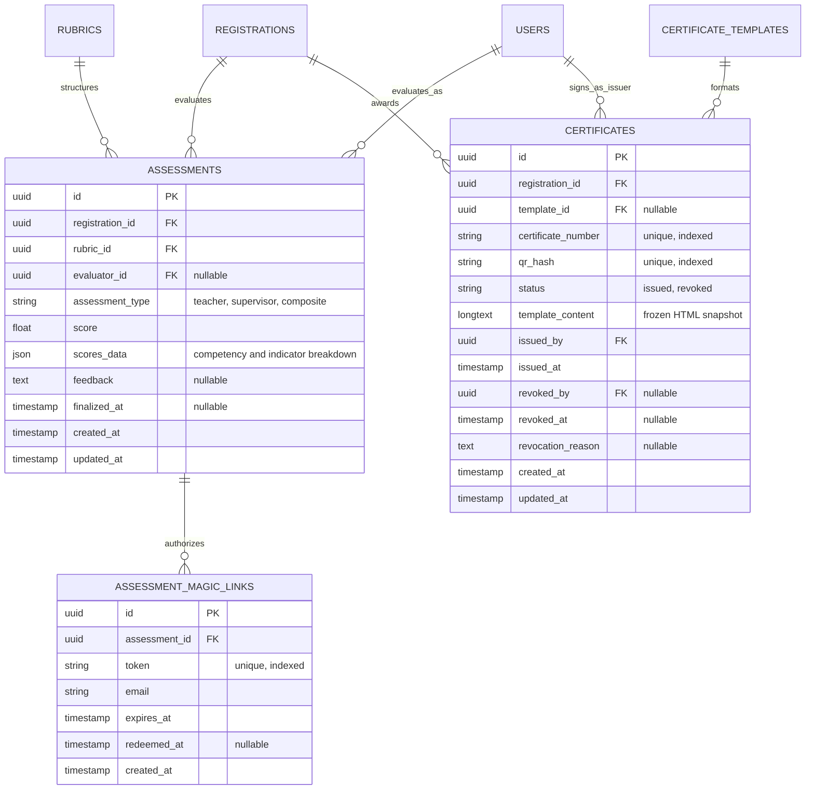

# AXKZW-J0M04 — Student Competency Assessment & Digital Certificate Issuance

**Document Version:** 1.0.0  
**Status:** Approved Specification  
**Modules:** `Assessment`, `Certification`, `Program`  
**Phase:** `Phase 9 — Assessment & Phase 10 — Certification`  
**Governing Specs:** #489 (`[AXKZW]` Evaluation), #495 (`[J0M04]` Certification), #498 (`[7UB7S]` PDF Generation)  

---

## Description

This specification governs the academic evaluation, multi-stakeholder competency assessment, and digital certificate issuance subsystem of the Internara platform. It forms Core Pillar 3 of the platform's educational lifecycle: combining structured evaluation rubrics with configurable component weights (daily journal quality, school teacher assessment, and industrial mentor appraisal), providing passwordless magic-link grading for corporate partners, calculating normalized composite scores, enforcing strict three-gate certificate eligibility criteria, generating high-fidelity PDF certificates via Dompdf, and providing public QR-code cryptographic verification for prospective employers and accreditation auditors.

---

## 1. Problem Statements

- **PS-1 — Disconnected and Unstandardized Grading Rubrics**: Vocational high school (SMK) internships require evaluations from both school instructors and corporate supervisors. In conventional practice, companies rate students using subjective, uncalibrated paper forms, while teachers score students using separate academic metrics. Without a centralized rubric with weighted competency indicators, final grades lack pedagogical consistency across differing workplace placements.
- **PS-2 — High Friction for External Workplace Evaluators**: Busy corporate supervisors frequently resist creating system accounts, remembering passwords, and completing complex multi-screen evaluation workflows. As a result, end-of-semester evaluations stall for weeks. The system must support frictionless, zero-login evaluation via secure, one-time magic links sent directly to the corporate supervisor's email.
- **PS-3 — Inflexible Grade Weighting and Drift**: Schools need flexibility in weighting evaluation components: some prioritize workplace mentor feedback (e.g., 50%), while others emphasize journal diligence and teacher supervision. Manual spreadsheet calculations introduce calculation drift and errors. The system requires administrator-configurable component weights with proportional default values and automatic redistribution if an optional component is unrecorded.
- **PS-4 — Fraudulent, Unverifiable Paper Certificates**: Traditional printed internship certificates are easily forged using graphic design tools, carrying arbitrary serial numbers with no tamper-proof verification anchor. Employers and colleges cannot verify whether a certificate corresponds to an authentic, completed placement.
- **PS-5 — Premature Certificate Issuance to Ineligible Students**: Issuing a completion certificate to a student who has not completed mandatory fieldwork days, left journals unsubmitted, or failed to acknowledge the student handbook severely undermines institutional accreditation. Certificate issuance must be blocked by a strict, immutable three-gate eligibility engine.
- **PS-6 — Cohort Bottlenecks During Mass Graduation**: At the end of an academic semester, hundreds of students complete internships simultaneously. Generating certificates manually one-by-one is an exhausting operational bottleneck. Administrators need an asynchronous, queued batch issuance engine with individual failure isolation.

---

## 2. Goals & Non-Goals

### Goals

- **Configurable Multi-Component Assessment Engine with Standardized Defaults** — Blend evaluation components into a final composite grade (*Nilai Akhir PKL*) adhering to vocational curriculum (Kurikulum Merdeka SMK) default weights:
  1. **Workplace Field Assessment (Asesmen DUDI / Capaian Pembelajaran Lapangan - Bobot Asesmen 100%)**:
     - *Internalisasi Soft Skills* (Bobot Asesmen ~20%): Karakter, budaya kerja industri, etika profesi, kedisiplinan kehadiran, kepatuhan K3, dan komunikasi tim.
     - *Penerapan Hard Skills* (Bobot Asesmen ~60%): Penguasaan kompetensi teknis kejuruan, ketepatan penyelesaian tugas spesifik, dan pemecahan masalah praktis di lini kerja.
     - *Penyiapan Kewirausahaan* (Bobot Asesmen ~20%): Pemahaman alur proses bisnis industri, inisiatif mandiri, kreativitas, dan efisiensi kerja berorientasi wirausaha.
  2. **School Final Grade Composite (Komposisi Nilai Akhir Sekolah - Bobot 100%)**:
     - *Pelaksanaan Magang di DUDI / Tempat Kerja* (Soft Skills, Hard Skills, Kewirausahaan + Logbook): **70%**
     - *Penyusunan Laporan dan Presentasi Akademis-Praktis* (Bimbingan, penulisan laporan PKL, dan ujian presentasi/sidang di hadapan guru sekolah): **30%**
  3. **Admin Configurable with Proportional Redistribution**: Administrators maintain full authority to customize weights per department or internship program, with automated 100% total sum validation and proportional redistribution. *Why:* Guarantees mathematical accuracy, pedagogical alignment with SMK curriculum, and institutional flexibility.
- **Structured Competency Rubrics** — Model rubrics with hierarchical competencies and weighted performance indicators, normalizing raw indicator scores (0–100) and automatically redistributing weights across active competencies via `AssessmentResult`. *Why:* Replaces subjective guesswork with measurable vocational competency standards.
- **Passwordless Corporate Magic Links** — Enable workplace supervisors to evaluate apprentices via expiring, signed magic links (`AssessmentMagicLink`, default 7-day validity) rendering a simplified mobile-friendly grading interface. *Why:* Eliminates login friction and accelerates corporate evaluation turnaround.
- **Strict Three-Gate Certificate Eligibility Engine** — Enforce that no certificate can be generated unless `ReadCertificateEligibilityAction` verifies: (1) Finalized competency assessment (`finalized_at !== null`), (2) Verified placement plotting (`placement_id !== null`), and (3) Acknowledged PKL Student Handbook and Integrity Pact. *Why:* Guarantees that certificates are awarded only to fully compliant students.
- **Canonical Serial Discipline & Cryptographic Fingerprinting** — Format certificate numbers as `<PREFIX>/<YEAR>/<0001>` and generate a deterministic SHA-256 hash (`qr_hash`) binding student ID, school name, final score, issuer ID, and serial number. *Why:* Prevents serial collisions and establishes an immutable verification digest.
- **High-Fidelity PDF Certificate Rendering** — Render print-ready PDF certificates via Dompdf and customizable Blade templates (`CertificateTemplate`), embedding institutional watermarks, signatures, and verifiable QR codes. *Why:* Produces professional graduation credentials suitable for employment portfolios.
- **Public QR-Code Verification Portal** — Expose a public, unauthenticated verification endpoint (`/verify-certificate/{qr_hash}`) returning the graduate's name, school, partner company, internship dates, competency score, and validity status. *Why:* Enables instant validation by corporate recruiters and accreditation bodies.
- **Asynchronous Batch Issuance & Error Collection** — Provide queue-dispatched batch issuance (`BatchIssueCertificatesJob`) capable of processing entire student cohorts while collecting and reporting per-student eligibility rejections without aborting the batch. *Why:* Streamlines end-of-term administration for large student cohorts.
- **Formal Revocation Workflow** — Support administrative revocation of issued certificates (`RevokeCertificateAction`, `CertificateStatus::REVOKED`) with mandatory justification notes, instantly invalidating the public verification QR code. *Why:* Provides an audited path to correct clerical errors or address post-issuance academic integrity violations.

### Non-Goals

- **Blockchain / Smart Contract Tokenization**. *Why:* Public cryptographic QR verification against institutional server hashes delivers complete anti-forgery protection without gas fees, wallet maintenance, or environmental costs.
- **Automated Algorithmic AI Grading of Daily Journals**. *Why:* Journal reflections require human pedagogical review and qualitative mentor feedback; AI auto-scoring is out of scope.
- **Physical Hard-Copy Print-Shop Shipping Integration**. *Why:* The platform renders canonical digital PDF files; physical paper printing and embossing are managed locally by school staff.

---

## 3. User Stories / Use Cases

| ID | Requirement | Priority | Layer | Status |
|---|---|---|---|---|
| UC-ASM-001 | School administrator constructs a competency rubric with weighted indicators | P0 | F | Full |
| UC-ASM-002 | Workplace supervisor accesses grading portal via secure one-time magic link and submits scores | P0 | F | Full |
| UC-ASM-003 | Supervising teacher scores student competencies and appends qualitative feedback | P0 | F | Full |
| UC-ASM-004 | System computes composite final score using configured component weights | P0 | U | Full |
| UC-ASM-005 | Administrator finalizes student assessment, permanently locking scores against tampering | P0 | F | Full |
| UC-CERT-001 | Administrator previews and tests digital certificate templates with institutional branding | P1 | F | Full |
| UC-CERT-002 | Administrator issues a completion certificate to an individual eligible student | P0 | F | Full |
| UC-CERT-003 | Administrator triggers batch certificate issuance for an entire cohort; system collects eligibility errors | P0 | F | Full |
| UC-CERT-004 | Student or alumnus downloads their verified completion certificate PDF from the student portal | P0 | F | Full |
| UC-CERT-005 | Corporate recruiter scans QR code and validates student credentials on public verification page | P0 | F | Full |
| UC-CERT-006 | Administrator revokes an issued certificate due to administrative error with audited reason | P1 | F | Full |

### 3.1 Competency Assessment Workflows

#### UC-ASM-002 — Corporate Supervisor Magic Link Grading
- **Preconditions**: Student registration is active; rubric is assigned; corporate supervisor email is on file.
- **Flow**:
  1. System generates a secure token via `GenerateAssessmentMagicLinkAction` and sends an invitation email containing a signed link:
     `/assessments/partner/{token}`.
  2. Supervisor clicks the link without requiring platform password authentication.
  3. `PartnerAssessmentPage` validates that the token is unexpired (< 7 days) and unused.
  4. Supervisor views student name, placement details, and rubric indicators (e.g., Technical Proficiency, Workplace Discipline, Teamwork).
  5. Supervisor assigns rating scores (0–100) per indicator and types qualitative feedback notes.
  6. Submits form via `SubmitPartnerAssessmentAction`.
  7. System marks the magic link as redeemed, saves scores to `assessments.scores_data`, and updates timestamp.
- **Postconditions**: Assessment scores persisted; magic link invalidated; student and teacher notified.

#### UC-ASM-004 / UC-ASM-005 — Composite Calculation & Finalization
- **Preconditions**: Teacher scores and partner supervisor scores are recorded.
- **Flow**:
  1. `AutoCalculateAssessmentAction` aggregates scores:
     - Calculates workplace mentor rubric score ($S_{\text{field}}$) based on:
       $$S_{\text{field}} = (S_{\text{soft\_skills}} \times 0.20) + (S_{\text{hard\_skills}} \times 0.60) + (S_{\text{entrepreneurship}} \times 0.20)$$
     - Calculates school report & presentation score ($S_{\text{school}}$) via `AssessmentResult::calculateFinalScore()`.
     - Computes weighted final composite grade (*Nilai Akhir PKL*):
       $$\text{Final Score} = (S_{\text{field}} \times 0.70) + (S_{\text{school}} \times 0.30)$$
     - If custom weights are configured by the administrator, the action dynamically uses the configured percentages.
  2. Administrator inspects summary on `AssessmentGrading` Livewire component.
  3. Administrator clicks "Finalize Assessment".
  4. `FinalizeAssessmentAction` sets `finalized_at = now()`, dispatches `AssessmentFinalized` event, and locks scores.
- **Postconditions**: Assessment marked terminal `finalized`; unblocks Gate 1 of certificate eligibility.

### 3.2 Certificate Issuance & Verification Workflows

#### UC-CERT-002 / UC-CERT-003 — Single & Batch Certificate Issuance
- **Preconditions**: Students belong to an active internship cohort; admin is authenticated.
- **Flow**:
  1. Administrator navigates to `/admin/certification/issue` and selects target cohort.
  2. For individual student: clicks "Issue Certificate".
     - `ReadCertificateEligibilityAction` evaluates the 3 gates:
       - Gate 1: `hasFinalizedAssessment()` === true.
       - Gate 2: `placementVerified()` === true.
       - Gate 3: `hasAcknowledgedCurrentHandbook()` === true.
     - If ineligible, throws `RejectedException` specifying the failing gate.
     - `IssueCertificateAction` creates `Certificate` with canonical serial `<PREFIX>/<YEAR>/<0001>`, generates SHA-256 `qr_hash`, renders HTML snapshot into `template_content`, and dispatches `CertificateIssued` event.
  3. For batch cohort: clicks "Batch Issue All".
     - `DispatchBatchIssueCertificatesAction` queues `BatchIssueCertificatesJob`.
     - Worker iterates through cohort students: eligible students receive certificates; failing students are collected in an error manifest (`ineligible_students: [id => reason]`).
     - Emits completion notification to administrator with success and error summaries.
- **Postconditions**: Certificates issued atomically; PDF files ready for generation; error manifest displayed.

#### UC-CERT-005 — Public QR Code Verification
- **Preconditions**: Certificate exists; third party scans printed QR code or opens verification URL.
- **Flow**:
  1. Client navigates to `https://school.internara.id/verify-certificate/{qr_hash}`.
  2. `VerifyCertificateController` executes `ReadCertificateStatusAction($qr_hash)`.
  3. System looks up certificate by `qr_hash` (indexed):
     - *If Valid (`status = 'issued'`)`: Displays official green badge *"Authentic Certificate"*, showing Student Full Name, School Name, Partner Company, Placement Dates, Grade Band (e.g., "Sangat Memuaskan / A"), and Issuance Date.
     - *If Revoked (`status = 'revoked'`)`: Displays prominent red alert *"Certificate Revoked"*, showing revocation date and institutional reason.
     - *If Not Found*: Displays *"Invalid / Unrecognized Certificate Fingerprint"*.
  4. Response returns with HTTP headers `Cache-Control: no-store, no-cache, must-revalidate`.
- **Postconditions**: Third party obtains authoritative validation without logging into the platform.

---

## 4. Functional Requirements

| ID | Requirement | Priority | Layer | Status |
|---|---|---|---|---|
| FR-ASM-001 | Rubric model defines competencies and weighted indicators with translatable descriptions | P0 | A | Full |
| FR-ASM-002 | `EvaluatorRole` enum distinguishes `teacher`, `supervisor`, and `coordinator` evaluators | P0 | U | Full |
| FR-ASM-003 | `GenerateAssessmentMagicLinkAction` generates secure, 7-day expiring tokens for partner evaluators | P0 | F | Full |
| FR-ASM-004 | `SubmitPartnerAssessmentAction` validates token, stores indicator scores, and redeems magic link | P0 | F | Full |
| FR-ASM-005 | `AssessmentResult::calculateFinalScore()` normalizes indicator scores (0–100) and applies weights | P0 | U | Full |
| FR-ASM-006 | Unscored competencies have weights dynamically redistributed across scored competencies | P0 | U | Full |
| FR-ASM-007 | `AutoCalculateAssessmentAction` blends workplace score (70%) and school presentation score (30%) | P0 | F | Full |
| FR-ASM-008 | System defaults to curriculum standard weights: Soft Skills 20%, Hard Skills 60%, Kewirausahaan 20%, School 30% | P0 | F | Full |
| FR-ASM-009 | Admin can configure custom component weights per department with automated 100% sum validation | P1 | F | Full |
| FR-ASM-010 | `FinalizeAssessmentAction` sets `finalized_at`, locks scores, and dispatches `AssessmentFinalized` | P0 | F | Full |
| FR-ASM-011 | Finalized assessments reject subsequent score alterations via `AssessmentResult::isFinalized()` | P0 | U | Full |
| FR-CERT-001 | `CertificateTemplate` model stores customizable Blade template layouts and CSS styling | P1 | A | Full |
| FR-CERT-002 | `CertificateStatus` enum governs lifecycle: `issued`, `revoked` | P0 | U | Full |
| FR-CERT-003 | `CertificateEntity::composeSerial()` generates canonical serials: `<PREFIX>/<YEAR>/<0001>` | P0 | U | Full |
| FR-CERT-004 | `CertificateEntity::composeQrHash()` computes deterministic SHA-256 fingerprint of issuance facts | P0 | U | Full |
| FR-CERT-005 | Database enforces unique constraints on `certificate_number` and `qr_hash` in `certificates` table | P0 | A | Full |
| FR-CERT-006 | `CertificateEntity::assertUniqueAgainst()` checks serial/hash collisions before database writes | P0 | U | Full |
| FR-CERT-007 | `ReadCertificateEligibilityAction` validates 3 gates: finalized assessment, verified placement, handbook sign-off | P0 | F | Full |
| FR-CERT-008 | `IssueCertificateAction` refuses issuance to ineligible students and throws `RejectedException` | P0 | F | Full |
| FR-CERT-009 | `IssueCertificateAction` freezes rendered HTML snapshot into `template_content` column | P0 | F | Full |
| FR-CERT-010 | `BatchIssueCertificateAction` executes cohort issuance in queue with per-student error collection | P0 | F | Full |
| FR-CERT-011 | `GenerateCertificatePdfAction` renders print-ready PDF using Dompdf with embedded QR code | P0 | F | Full |
| FR-CERT-012 | `VerifyCertificateController` serves public, unauthenticated verification at `/verify-certificate/{qr_hash}` | P0 | F | Full |
| FR-CERT-013 | `RevokeCertificateAction` transitions status to `revoked`, stamps revoker, date, and mandatory reason | P1 | F | Full |
| FR-CERT-014 | `StudentCertificates` Livewire component provides students instant PDF download of issued certificates | P0 | F | Full |

### 4.1 Assessment Math & Score Normalization

#### FR-ASM-007 / FR-ASM-008 — Standardized Default Weighting Architecture
- **Workplace Assessment Weighting (Asesmen Capaian Lapangan DUDI — 100%)**:
  1. *Internalisasi Soft Skills* ($W_{\text{soft}}$): **20%** — Karakter kerja, etika profesi, kedisiplinan kehadiran, kepatuhan K3, dan komunikasi tim.
  2. *Penerapan Hard Skills* ($W_{\text{hard}}$): **60%** — Penguasaan keterampilan teknis kejuruan, ketepatan penyelesaian tugas spesifik, dan pemecahan masalah praktis.
  3. *Penyiapan Kewirausahaan* ($W_{\text{entrepreneur}}$): **20%** — Pemahaman alur proses bisnis industri, inisiatif mandiri, kreativitas, dan efisiensi kerja berorientasi wirausaha.
  $$\text{Nilai Lapangan (Field Score)} = (S_{\text{soft}} \times 0.20) + (S_{\text{hard}} \times 0.60) + (S_{\text{entrepreneur}} \times 0.20)$$

- **School Final Grade Composite Weighting (Nilai Akhir Sekolah — 100%)**:
  1. *Pelaksanaan Magang di DUDI* ($W_{\text{field}}$): **70%** (berasal dari kalkulasi Nilai Lapangan di atas).
  2. *Penyusunan Laporan dan Presentasi Akademis-Praktis* ($W_{\text{school}}$): **30%** (bimbingan penulisan laporan PKL dan ujian sidang presentasi di sekolah).
  $$\text{Nilai Akhir Kelulusan PKL} = (\text{Nilai Lapangan} \times 0.70) + (\text{Nilai Laporan \& Presentasi} \times 0.30)$$

#### FR-ASM-005 / FR-ASM-006 — Proportional Weight Redistribution
- If an assessment rubric defines 3 competencies with weights $[20, 60, 20]$ (total 100), but Competency 3 (Penyiapan Kewirausahaan) was not applicable to a specific partner placement:
- `AssessmentResult` redistributes weights proportionally across active competencies:
  - Active weight sum: $20 + 60 = 80$.
  - Effective Weight 1 (Soft Skills): $\frac{20}{80} \times 100 = 25\%$.
  - Effective Weight 2 (Hard Skills): $\frac{60}{80} \times 100 = 75\%$.
- Guarantees that students are not penalized for unassigned industry competencies while preserving 100-point total scaling.

### 4.2 Three-Gate Certificate Eligibility

#### FR-CERT-007 — Eligibility Invariant Pipeline
- `ReadCertificateEligibilityAction` inspects three non-negotiable gates:
  1. **Gate 1 (Assessment)**:
     ```php
     $hasAssessment = $registration->assessments()->whereNotNull('finalized_at')->exists();
     ```
  2. **Gate 2 (Placement)**:
     ```php
     $hasPlacement = $registration->placement_id !== null;
     ```
  3. **Gate 3 (Handbook & Integrity Pact)**:
     ```php
     $hasHandbook = Activity::where('causer_id', $registration->student_id)
         ->where('description', 'handbook_acknowledged')
         ->exists();
     ```
- `CertificateEligibility::isEligible()` returns `true` only if all three gates evaluate to `true`.

### 4.3 QR Code & Cryptographic Verification

#### FR-CERT-004 / FR-CERT-012 — Verification Hash Architecture
- Hash is computed deterministically at issuance time:
  ```php
  $qrHash = hash('sha256', implode('|', [
      $studentId,
      $schoolName,
      $finalScore,
      $issuerId,
      $certificateNumber,
  ]));
  ```
- The printed QR code on the certificate resolves directly to:
  `https://school.internara.id/verify-certificate/{qrHash}`
- The verification view renders without user session requirements, returning no sensitive student PII beyond graduation verification data.

---

## 5. Non-Functional Requirements

| ID | Requirement | Target | Priority | Layer | Status |
|---|---|---|---|---|---|
| NFR-ASM-001 | Magic link response time on mobile devices under 3G network conditions | < 1,000 ms | P1 | F | Full |
| NFR-ASM-002 | Assessment composite calculation computation latency | < 50 ms | P0 | U | Full |
| NFR-CERT-001 | Single certificate PDF rendering latency via Dompdf | < 2,500 ms | P1 | F | Full |
| NFR-CERT-002 | Batch certificate generation throughput (queue worker execution) | > 50 certs / min | P1 | F | Full |
| NFR-CERT-003 | Public QR verification response time under load | < 200 ms | P0 | F | Full |
| NFR-CERT-004 | PDF certificate file size optimization (embedded fonts and vector QR) | < 500 KB per PDF | P1 | F | Full |
| NFR-CERT-005 | Zero unverified certificate issuances (100% eligibility check enforcement) | 0 gate bypasses | P0 | F | Full |
| NFR-CERT-006 | Dual language translation: assessment feedback and verification UI in `en` and `id` | 100% translatable | P0 | A | Full |

---

## 6. API & Data Contracts

### 6.1 Database Schema Diagram



### 6.2 Data Transfer Objects (DTOs)

#### `CertificateEligibility`
```php
namespace App\Modules\Certification\Domain\Certificate\Data;

use App\Modules\Core\Data\BaseData;

final class CertificateEligibility extends BaseData
{
    public function __construct(
        public bool $assessmentCompleted,
        public bool $placementVerified,
        public bool $handbookAcknowledged,
    ) {}

    public function isEligible(): bool
    {
        return $this->assessmentCompleted
            && $this->placementVerified
            && $this->handbookAcknowledged;
    }
}
```

#### `SubmitPartnerAssessmentData`
```php
namespace App\Modules\Assessment\Data;

use App\Modules\Core\Data\BaseData;

final class SubmitPartnerAssessmentData extends BaseData
{
    public function __construct(
        public string $token,
        public array $scores,
        public ?string $feedback = null,
    ) {}
}
```

### 6.3 Command Actions & Policies

- **`GenerateAssessmentMagicLinkAction::execute(GenerateMagicLinkData $data): AssessmentMagicLink`**
  - Mints cryptographically secure 64-char token, sets 7-day expiration, and sends evaluator email.
- **`SubmitPartnerAssessmentAction::execute(SubmitPartnerAssessmentData $data): Assessment`**
  - Validates token validity; saves scores; updates `redeemed_at = now()`.
- **`FinalizeAssessmentAction::execute(string $assessmentId): Assessment`**
  - Sets `finalized_at = now()`, emits `AssessmentFinalized` event, and locks scores.
- **`IssueCertificateAction::execute(Registration $registration, User $issuer): Certificate`**
  - Asserts eligibility via `ReadCertificateEligibilityAction`; generates unique serial and QR hash; freezes HTML snapshot; stores certificate record.
- **`BatchIssueCertificateAction::execute(BatchIssueCertificatesData $data): array`**
  - Dispatches batch job; collects per-student eligibility failures into an error manifest.
- **`RevokeCertificateAction::execute(Certificate $certificate, User $revoker, string $reason): Certificate`**
  - Transitions status to `revoked`, records reason, and logs activity audit trail.

---

## 7. Design Decisions

| ID | Requirement | Priority | Layer | Status |
|---|---|---|---|---|
| DD-ASM-001 | Passwordless One-Time Magic Links for Corporate Partner Evaluators | P0 | F | Full |
| DD-ASM-002 | Dynamic Weight Redistribution for Inapplicable Workplace Competencies | P0 | U | Full |
| DD-ASM-003 | Configurable Multi-Component Grade Weights with Proportional Defaults | P1 | F | Full |
| DD-CERT-001 | Strict Three-Gate Live Eligibility Checking over Stale Cached Flags | P0 | F | Full |
| DD-CERT-002 | SHA-256 Fingerprint Snapshot for Public QR Code Verification | P0 | U | Full |
| DD-CERT-003 | Frozen HTML Content Snapshot in Database to Guarantee Visual Immortality | P0 | A | Full |

### 7.1 Architecture Rationale

#### DD-ASM-001 — Passwordless Partner Magic Links
- *Decision*: Allow corporate mentors to grade apprentices via secure magic links without creating full user accounts.
- *Rationale*: Corporate supervisors manage numerous daily duties and frequently abandon systems that require complex registration and password recovery. Expiring magic links remove 100% of onboarding friction while securing submissions with token invalidation.

#### DD-CERT-001 — Strict Three-Gate Eligibility
- *Decision*: Evaluate certificate eligibility on demand against authoritative tables (`assessments`, `registrations`, `activity_log`) rather than caching a boolean `is_eligible` flag.
- *Rationale*: Prevents race conditions where a revoked assessment or modified placement plotting fails to update a cached flag, ensuring no ineligible certificate is ever issued.

#### DD-CERT-003 — Frozen HTML Template Content Snapshot
- *Decision*: Store the fully rendered HTML string of the certificate in `certificates.template_content` upon issuance.
- *Rationale*: School certificate templates, typography, and logos evolve over time. Storing the frozen HTML snapshot guarantees that re-downloading a certificate 5 years later produces the exact visual representation issued on graduation day, completely immune to subsequent template edits.

---

## 8. Success Metrics

- **Zero Ineligible Issuances**: 100% of issued certificates satisfy all three statutory eligibility gates.
- **Turnaround Acceleration**: Median corporate evaluation completion time reduced from 21 days to under 4 days via partner magic links.
- **Anti-Forgery Reliability**: 100% of legitimate certificates validated in < 200 ms via public QR verification.
- **Batch Processing Scalability**: End-of-cohort graduation processing executes with zero worker timeouts across 500+ students.
- **Grade Calculation Integrity**: Zero rounding discrepancies or unhandled division-by-zero errors in composite score calculations.

---

## 9. Roadmap

- **Phase 9/10 (Current Baseline)**: Multi-stakeholder rubrics, partner magic links, composite score weighting, 3-gate eligibility engine, Dompdf generation, public QR verification, batch issuance, and revocation.
- **Phase 11 (Future Enhancements)**:
  - Cryptographically signed PDF signatures conforming to PAdES / Adobe Approved Trust List (AATL) standards.
  - Integration with national Indonesian Ministry of Education vocational credential portals.
  - Automated WhatsApp delivery of certificate download links to parents and students.

---

## 10. Risks & Assumptions

| ID | Risk / Assumption / Open Question | Status | Owner | GH Issue |
|---|---|---|---|---|
| R-1 | Partner supervisor forwards magic link email to unauthorized colleagues. Mitigated by one-time redemption enforcement and IP audit logging. | Resolved | Security Lead | [#489](https://github.com/reasvyn/internara/issues/489) |
| R-2 | Complex Dompdf CSS rules causing layout breakage or memory exhaustion on large batches. Mitigated by curated, validated template CSS and queued job chunking. | Resolved | Tech Lead | [#495](https://github.com/reasvyn/internara/issues/495) |
| A-1 | We assume the school possesses institutional authority to issue official PKL graduation credentials. | Accepted | Coordinator | [#495](https://github.com/reasvyn/internara/issues/495) |
| A-2 | We assume partner evaluators possess an active email address to receive assessment magic links. | Accepted | Product Lead | [#489](https://github.com/reasvyn/internara/issues/489) |

---

## Quick References

- [`docs/index.md`](../index.md) — Documentation index
- [`docs/prd.md`](../prd.md) — Product Requirement Document (PRD)
- [`docs/specs/daily-journal-and-attendance.md`](daily-journal-and-attendance.md) — Core Pillar 1 Daily Journal & Attendance Specification
- [`docs/specs/guidance-and-monitoring.md`](guidance-and-monitoring.md) — Core Pillar 2 Guidance & Field Monitoring Specification
- [`docs/refs/modules/assessment.md`](../refs/modules/assessment.md) — Assessment module conceptual reference
- [`docs/refs/modules/certification.md`](../refs/modules/certification.md) — Certification module conceptual reference
- [GitHub Spec Issues](https://github.com/reasvyn/internara/issues?q=label%3Aspec) — Authoritative spec issues #442–#509
