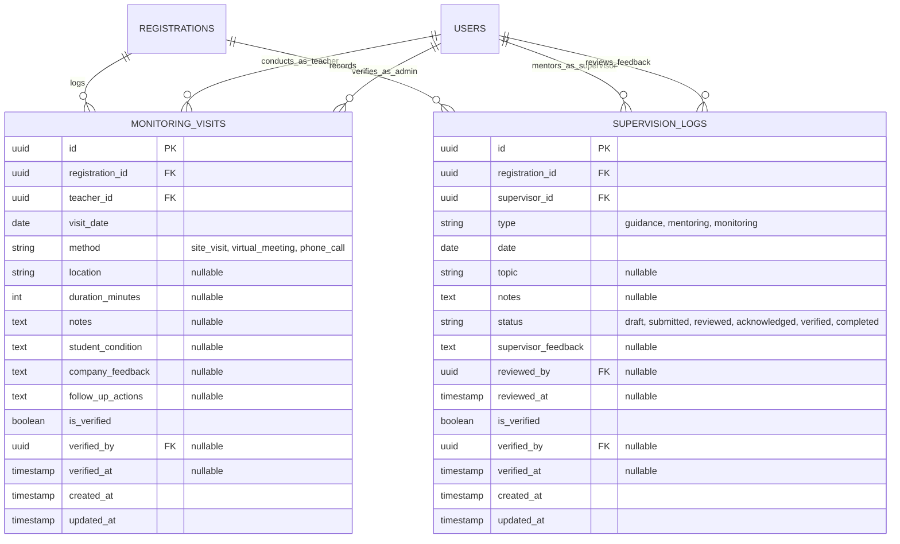

# 2EHSE — Teacher Guidance, Mentorship & Field Monitoring

**Document Version:** 1.0.0  
**Status:** Approved Specification  
**Modules:** `Journal`, `User`, `Enrollment`  
**Phase:** `Phase 8 — Daily Operations`  
**Governing Spec:** #486 (`[2EHSE]` Supervision), with references to #480 (`[J9GBH]` Placement), #485 (`[1KSWL]` Daily Activity), and #452 (`[T4B26]` RBAC & Authorization)  

---

## Description

This specification governs the teacher-led and mentor-driven guidance, supervision, and field monitoring subsystem of the Internara platform. It forms the pedagogical and institutional counterweight to student self-reporting. While daily attendance and logbooks capture the student's voice, this subsystem provides school supervising teachers (*Guru Pembimbing*) and corporate workplace mentors (*Instruktur DUDI*) with the tools to document structured mentoring sessions, log and verify physical or remote on-site monitoring visits, intervene when students exhibit signs of disengagement or absenteeism, and execute audited cross-role proxy verifications when industrial supervisors become unreachable.

---

## 1. Problem Statements

- **PS-1 — Invisible and Undocumented Workplace Mentorship**: In conventional vocational internships, industry supervisors provide day-to-day technical coaching, but no structured record of these sessions ever reaches the school. School coordinators have zero visibility into coaching frequency, topics covered, or pedagogical quality. A mentorship program without verifiable records remains an unsubstantiated claim during institutional accreditation audits.
- **PS-2 — Unverified Field Monitoring Visits**: School teachers regularly travel significant distances (often 50 to 150 km) to visit students at industrial facilities, conduct tripartite consultations, and inspect workplace safety. Traditionally, these visits leave behind only informal paper signature sheets or photo snapshots stored in personal smartphones. Coordinators cannot verify whether visits actually occurred, evaluate visit coverage equity across distant sites, or review formal feedback from company leadership.
- **PS-3 — Operational Deadlocks from Disengaged Industry Mentors**: External corporate supervisors frequently miss sign-off deadlines due to pressing commercial obligations, rotating shifts, or lack of software engagement. When a corporate mentor fails to review student logbooks or attend evaluations, student academic records pile up in unapproved queues. Without a sanctioned, audited proxy mechanism, student progression stalls indefinitely.
- **PS-4 — Late Detection of Student Truancy and Disengagement**: When an intern stops submitting daily journals or repeatedly misses work, paper-based reporting cycles hide the problem for weeks. By the time a supervising teacher discovers the student's prolonged absence at the end of the semester, corrective intervention is impossible. Silence compounds rapidly: three missing days turn into three missing weeks without proactive alerts.

---

## 2. Goals & Non-Goals

### Goals

- **Comprehensive Supervision Log Lifecycle** — Provide role-aware recording of mentoring sessions: school teachers record pedagogical guidance (*guidance*) which is immediately marked completed, while corporate mentors record technical workplace coaching (*mentoring*) through a formal review lifecycle (`draft` → `submitted` → `reviewed` → `verified`). *Why:* Distinguishes academic guidance from technical workplace coaching while creating an auditable paper trail.
- **Verifiable Monitoring Visit Records** — Enable supervising teachers to log structured monitoring visits capturing date, oversight method (`site_visit`, `virtual_meeting`, `phone_call`), location, duration, student wellbeing assessment, corporate feedback, and follow-up action items. *Why:* Proves that teachers actively monitored fieldwork and provides tangible evidence for school accreditation.
- **Administrative Visit Verification** — Require school administrators or PKL coordinators to review and formally verify submitted monitoring visits, locking the record against retroactive tampering. *Why:* Guarantees institutional oversight over teacher travel and field supervision claims.
- **Audited Cross-Role Proxy Delegation** — Empower authorized school teachers to review student journals and supervision records on behalf of an unreachable corporate supervisor after an inactivity window (default 48 hours), recording an immutable proxy audit trail (`proxy_role: 'supervisor'`, reason, timestamp). *Why:* Prevents student academic paralysis caused by external corporate delays.
- **Proactive Non-Compliance Alerts** — Automatically monitor consecutive missing logbook days, alerting assigned mentors after $N$ days (default 3 days) and escalating directly to the program coordinator at $N+2$ days (default 5 days). *Why:* Catches disengagement early so teachers can intervene before an internship fails.
- **Strict Mentorship Scoping & Access Control** — Restrict teacher and supervisor access strictly to their assigned student mentees via `MentorEntity` and Eloquent policies, preventing unauthorized cross-mentorship inspections. *Why:* Enforces student privacy and maintains clear supervisory boundaries.

### Non-Goals

- **Built-In Video Conferencing or WebRTC Streaming**. *Why:* Virtual monitoring visits record that a remote conference occurred along with duration and outcomes; integrating a real-time media server is external to core compliance tracking.
- **Automated Algorithmic Travel Route Optimization**. *Why:* Teachers coordinate travel schedules based on local road conditions and school vehicles; automated vehicle routing is outside platform scope.
- **Automated Student Disciplinary Sanctions**. *Why:* The platform issues compliance alerts to human mentors and coordinators; punitive disciplinary actions remain the exclusive domain of school committees.

---

## 3. User Stories / Use Cases

| ID | Requirement | Priority | Layer | Status |
|---|---|---|---|---|
| UC-SUPV-001 | Teacher logs an on-site or virtual monitoring visit to a student's workplace | P0 | F | Full |
| UC-SUPV-002 | Administrator/Coordinator reviews and formally verifies a completed monitoring visit | P0 | F | Full |
| UC-SUPV-003 | Workplace mentor logs technical mentoring session and submits it for review | P0 | F | Full |
| UC-SUPV-004 | Supervisor reviews submitted mentoring log and attaches constructive guidance feedback | P0 | F | Full |
| UC-SUPV-005 | Teacher exercises cross-role proxy to review student records when workplace mentor is inactive | P0 | F | Full |
| UC-SUPV-006 | System detects consecutive missing journal submissions and issues tiered compliance alerts | P1 | F | Full |
| UC-SUPV-007 | Student views logged supervision feedback and monitoring observations in their mobile portal | P1 | F | Full |
| UC-SUPV-008 | Teacher deletes an accidental draft supervision log prior to formal submission | P1 | F | Full |

### 3.1 Field Monitoring & Visit Workflows

#### UC-SUPV-001 — Supervising Teacher Field Visit Entry
- **Preconditions**: Teacher is authenticated and assigned to the student's registration; student is currently active at their placement.
- **Flow**:
  1. Teacher navigates to `/journal/visits` or clicks "Log Monitoring Visit".
  2. Teacher selects mentee registration and inputs visit details via `VisitManager`:
     - *Visit Date*: Defaults to current date.
     - *Method*: Selects `site_visit` (in-person physical visit), `virtual_meeting`, or `phone_call`.
     - *Location*: Specifies workplace address, workshop room, or meeting channel.
     - *Duration*: Records time spent in minutes (e.g., 90 minutes).
     - *Student Wellbeing*: Notes health, morale, and safety gear compliance.
     - *Company Feedback*: Documents feedback received from company mentors or HR.
     - *Follow-up Actions*: Identifies tasks for school or student remediation.
  3. Teacher submits form.
  4. `CreateVisitAction` validates payload via `CreateVisitData`, creates `MonitoringVisit` with `is_verified = false`, and logs audit trail.
- **Postconditions**: Visit recorded with unverified status; visible on teacher and coordinator dashboards.

#### UC-SUPV-002 — Administrative Visit Verification
- **Preconditions**: Administrator or PKL Coordinator is authenticated; visit has `is_verified = false`.
- **Flow**:
  1. Coordinator reviews pending monitoring visits at `/journal/visits/verification`.
  2. Inspects duration, notes, and company feedback.
  3. Clicks "Verify Visit".
  4. `VerifyVisitAction` ensures visit is not already verified, sets `is_verified = true`, stamps `verified_by` and `verified_at = now()`, and commits transaction.
- **Postconditions**: Visit locked permanently (`VisitState::canBeEdited() === false`); verified badge displayed across reports.

### 3.2 Mentoring Sessions & Cross-Role Proxy

#### UC-SUPV-003 / UC-SUPV-004 — Supervision Log Creation & Feedback Lifecycle
- **Preconditions**: User is an assigned mentor (teacher or supervisor) to the active student registration.
- **Flow**:
  1. Mentor navigates to `SupervisionManager`.
  2. Enters session date, topic (e.g., *"Database Schema Normalization"*), and guidance notes.
  3. `CreateSupervisionLogAction` evaluates author role:
     - *If author is Teacher*: sets `type = guidance`, status to `completed`, and marks `is_verified = true` immediately.
     - *If author is Workplace Supervisor*: sets `type = mentoring`, status to `submitted`, and `is_verified = false`.
  4. Later, supervisor reviews the submitted log via `ReviewLogAction`, appending structured feedback (e.g., *"Excellent grasp of foreign keys, review indexing next"*), moving status to `reviewed`.
  5. School admin verifies log via `VerifySupervisionLogAction`, transitioning status to `verified`.
- **Postconditions**: Supervision log progresses through formal state machine; feedback visible to student.

#### UC-SUPV-005 — Cross-Role Proxy Review by Teacher
- **Preconditions**: Industrial supervisor has been inactive for > 48 hours; student has pending journal/supervision entries; teacher is assigned to the mentee.
- **Flow**:
  1. Teacher accesses pending student record.
  2. Policy delegates check to `MentorEntity::canProxyAsSupervisor()`.
  3. Inactivity threshold confirmed (`supervisor_last_active_at < now() - 48 hours`).
  4. Teacher provides required review feedback along with an explicit justification note (e.g., *"Reviewing by proxy: DUDI supervisor on overseas business trip"*).
  5. `ReviewLogAction` executes and resolves proxy metadata via `$mentorEntity->resolveProxyMetadata($teacher, 'supervisor')`.
  6. Action logs `supervision_log_reviewed` audit event containing `proxy_role: 'supervisor'`, `reason`, and teacher user ID.
- **Postconditions**: Record reviewed without waiting for absent supervisor; full transparency maintained in immutable audit log.

### 3.3 Compliance Tracking & Escalation

#### UC-SUPV-006 — Proactive Disengagement Alert Pipeline
- **Preconditions**: Student fails to submit daily logbook entries on scheduled working days.
- **Flow**:
  1. Artisan command `journal:check-compliance` runs via scheduler at scheduled daily cadence.
  2. System scans active registrations against missing logbook calendar days.
  3. **Tier 1 (Mentor Notice)**: When missing days reach $N$ consecutive days (default 3):
     - Dispatches notification to assigned teacher and workplace supervisor.
     - Emits notification with student name, placement, and last active date.
  4. **Tier 2 (Coordinator Escalation)**: When silence reaches $N+2$ consecutive days (default 5):
     - Dispatches high-priority escalation notice to the PKL Program Coordinator.
  5. Deduplication logic ensures exactly one notice per tier is dispatched per day per registration.
- **Postconditions**: Teachers alerted early; coordinator equipped to initiate direct phone contact before student abandons placement.

---

## 4. Functional Requirements

| ID | Requirement | Priority | Layer | Status |
|---|---|---|---|---|
| FR-SUPV-001 | `SupervisionLogStatus` enum defines closed lifecycle: `draft`, `submitted`, `reviewed`, `acknowledged`, `verified`, `completed` | P0 | U | Full |
| FR-SUPV-002 | `SupervisionType` enum defines activity types: `guidance`, `mentoring` (stored as `mentoring`), and `monitoring` | P1 | U | Full |
| FR-SUPV-003 | `CreateSupervisionLogAction` auto-completes `guidance` for teachers and marks `mentoring` as `submitted` for supervisors | P0 | F | Full |
| FR-SUPV-004 | `ReviewLogAction` transitions log from `submitted` to `reviewed` and attaches mandatory supervisor feedback | P0 | F | Full |
| FR-SUPV-005 | `VerifySupervisionLogAction` stamps admin verifier ID and timestamp, transitioning status to `verified` | P0 | F | Full |
| FR-SUPV-006 | `DeleteLogAction` permits deletion exclusively for supervision logs in `draft` status | P1 | F | Full |
| FR-SUPV-007 | `VisitMethod` backed enum defines oversight modes: `site_visit`, `virtual_meeting`, `phone_call` | P0 | U | Full |
| FR-SUPV-008 | `CreateVisitAction` captures teacher, registration, date, method, location, duration, student condition, feedback, and actions | P0 | F | Full |
| FR-SUPV-009 | `VerifyVisitAction` validates unverified status, sets `is_verified = true`, stamps verifier and timestamp, refusing double verification | P0 | F | Full |
| FR-SUPV-010 | `VisitState` entity encapsulates editability rules (`canBeEdited`, `canBeDeleted`, `isRecent` within 7 days) | P1 | U | Full |
| FR-SUPV-011 | `SupervisionLogPolicy` delegates authorization decisions to `MentorEntity` via `HasMentorProxy` trait | P0 | U | Full |
| FR-SUPV-012 | Every proxy action records `proxy_role` and reason into `activity_log` metadata beside the actor ID | P0 | F | Full |
| FR-SUPV-013 | System detects $N$ consecutive missing logbook days (default 3) and dispatches notification to assigned mentors | P1 | F | Full |
| FR-SUPV-014 | System detects $N+2$ consecutive missing logbook days (default 5) and escalates alert to program coordinator | P1 | F | Full |
| FR-SUPV-015 | Compliance check executes on-demand via Artisan command with day-keyed notification deduplication | P1 | F | Full |
| FR-SUPV-016 | Visit authorization enforces teacher/admin creation, admin verification, and immutability once verified | P0 | F | Full |
| FR-SUPV-017 | `SupervisorLogManager` Livewire component validates and mounts modal states for quick supervision logging | P1 | F | Full |

### 4.1 Supervision Log Lifecycle Requirements

#### FR-SUPV-001 — State Machine Transitions
- `SupervisionLogStatus` enforces a strict valid transition map:
  - `draft` → `submitted`
  - `submitted` → `reviewed` or back to `draft`
  - `reviewed` → `acknowledged` or `verified`
  - `verified` → `completed`
  - Terminal states: `acknowledged` and `completed` admit no further transitions.
- Attempting an illegal status jump throws `RejectedException`.

#### FR-SUPV-003 — Role-Aware Log Initialization
- When a teacher creates a log:
  ```php
  $log = SupervisionLog::create([
      'type' => 'guidance',
      'status' => SupervisionLogStatus::COMPLETED->value,
      'is_verified' => true,
      'verified_at' => now(),
      // ...
  ]);
  ```
- Pedagogical guidance provided by school faculty does not require secondary workplace approval.
- When an external workplace mentor creates a log, it enters `submitted` with `is_verified = false`, awaiting review and administrative sign-off.

### 4.2 Monitoring Visits & Verification Requirements

#### FR-SUPV-008 — Monitoring Visit Attributes
- `MonitoringVisit` table and model mandate:
  - `registration_id`: Foreign key to `registrations` (cascading delete).
  - `teacher_id`: Foreign key to `users` (assigned school teacher).
  - `visit_date`: Date of field visit.
  - `method`: Value of `VisitMethod` enum (`site_visit`, `virtual_meeting`, `phone_call`).
  - `location`: Textual description of site or virtual link.
  - `duration_minutes`: Integer duration in minutes (e.g., 60, 90, 120).
  - `student_condition`: Observations regarding student attendance, health, and morale.
  - `company_feedback`: Observations and critiques provided by workplace management.
  - `follow_up_actions`: Required actions by school or student.
  - `is_verified`: Boolean, default `false`.
  - `verified_by`: Nullable foreign key to admin user.
  - `verified_at`: Nullable timestamp.

#### FR-SUPV-010 — Visit State Predicates
- Encapsulated within `VisitState` domain entity:
  - `canBeEdited()`: Returns `true` only if `is_verified === false`.
  - `canBeDeleted()`: Returns `true` only if `is_verified === false`.
  - `isRecent()`: Returns `true` if `visit_date` occurred within the last 7 calendar days.

### 4.3 Policy & Cross-Role Proxy Delegation

#### FR-SUPV-011 / FR-SUPV-012 — Policy Layer Delegation
- Policies (`SupervisionLogPolicy`, `MonitoringVisitPolicy`, `LogbookPolicy`) implement the `HasMentorProxy` trait.
- Rather than duplicating role-checking logic across controllers, the policy inspects `$registration->asMentorEntity()`.
- If an industrial supervisor has not recorded activity in over 48 hours, `canProxyAsSupervisor($user)` returns `true` for assigned school teachers.
- Activity logging must capture the delegation:
  ```php
  $this->log('supervision_log_reviewed', $log, array_merge([
      'reviewed_by' => $reviewer->id,
  ], [
      'proxy_role' => 'supervisor',
      'proxy_reason' => 'Supervisor inactive for > 48h',
  ]), $reviewer);
  ```

---

## 5. Non-Functional Requirements

| ID | Requirement | Target | Priority | Layer | Status |
|---|---|---|---|---|---|
| NFR-SUPV-001 | Dashboard visibility: 100% of pending supervision and visit items visible on assigned mentor dashboard | 100% surface rate | P1 | F | Full |
| NFR-SUPV-002 | Zero hardcoded user-facing strings in supervision views, components, or notifications | 0 hardcoded strings (D3 clean) | P0 | A | Full |
| NFR-SUPV-003 | Supervision audit entries mask sensitive personal data and student disciplinary notes in log payloads | Zero PII leakage | P0 | F | Full |
| NFR-SUPV-004 | Teachers read only their assigned mentees' supervision data; cross-mentorship unauthorized inspection refused | 0 cross-mentorship leaks | P0 | F | Full |
| NFR-SUPV-005 | Compliance gap alerts emit at most one notification per tier per day (idempotent daily dispatch) | 0 duplicate daily notices | P1 | F | Full |

### 5.1 Performance & Reliability Constraints

- **Query Optimization**: Dashboard queries for pending supervision reviews and visits must use eager loading (`with(['registration.student', 'registration.placement.company'])`) to prevent $N+1$ query overhead.
- **Idempotent Compliance Commands**: Running `journal:check-compliance` multiple times in a single day must not spam mentors with repeated emails or database notifications. Deduplication is maintained via cache tags or daily timestamp markers.

---

## 6. API & Data Contracts

### 6.1 Entity Relationship Diagram



### 6.2 Data Transfer Objects (DTOs)

#### `CreateVisitData`
```php
namespace App\Modules\Journal\Domain\MonitoringVisit\Data;

use App\Modules\Core\Data\BaseData;

final class CreateVisitData extends BaseData
{
    public function __construct(
        public string $teacherId,
        public string $registrationId,
        public array $data,
    ) {}
}
```

#### `CreateSupervisionLogData`
```php
namespace App\Modules\Journal\Domain\SupervisionLog\Data;

use App\Modules\Core\Data\BaseData;

final class CreateSupervisionLogData extends BaseData
{
    public function __construct(
        public string $userId,
        public string $registrationId,
        public array $data,
    ) {}
}
```

#### `ReviewLogData`
```php
namespace App\Modules\Journal\Domain\SupervisionLog\Data;

use App\Modules\Core\Data\BaseData;

final class ReviewLogData extends BaseData
{
    public function __construct(
        public string $logId,
        public string $supervisorId,
        public string $feedback,
    ) {}
}
```

### 6.3 Command Actions & Policies

- **`CreateVisitAction::execute(CreateVisitData $data): MonitoringVisit`**
  - Creates unverified `MonitoringVisit` record, associates assigned teacher, and logs creation event.
- **`VerifyVisitAction::execute(MonitoringVisit $visit, User $admin): MonitoringVisit`**
  - Asserts visit is not already verified; sets `is_verified = true`, `verified_by = $admin->id`, `verified_at = now()`.
- **`CreateSupervisionLogAction::execute(CreateSupervisionLogData $data): SupervisionLog`**
  - Resolves author role; auto-completes `guidance` for teachers; sets `submitted` for external supervisors.
- **`ReviewLogAction::execute(ReviewLogData $data): SupervisionLog`**
  - Verifies status is `submitted`; records supervisor feedback; checks and logs proxy delegation metadata.
- **`VerifySupervisionLogAction::execute(SupervisionLog $log, User $admin): SupervisionLog`**
  - Formal administrative verification stamping verifier identity.

---

## 7. Design Decisions

| ID | Requirement | Priority | Layer | Status |
|---|---|---|---|---|
| DD-SUPV-001 | `SupervisionType` retains `mentoring` stored value behind `SUPERVISORING` case for backward compatibility | P1 | U | Full |
| DD-SUPV-002 | Cross-role proxy authority modeled through `MentorEntity` and policies, not middleware or dual roles | P0 | U | Full |
| DD-SUPV-003 | Non-compliance tracking executed via on-demand Artisan command + scheduler, not persistent daemon | P1 | F | Full |

### 7.1 Architecture Rationale

#### DD-SUPV-001 — Database Stored Value Compatibility
- *Decision*: In `SupervisionType` backed enum, keep the database value `'mentoring'` behind the enum case `SUPERVISORING`.
- *Rationale*: Preserves full backward compatibility with historical database records and external analytics queries without requiring heavy database migration table rewrites.

#### DD-SUPV-002 — Policy-Layer Cross-Role Proxy Delegation
- *Decision*: Proxy capabilities are evaluated dynamically inside `MentorEntity` via `canProxyAsSupervisor()` and consumed by policies using `HasMentorProxy`, rather than granting teachers temporary global admin roles or switching user sessions.
- *Rationale*: Dynamic policy-level delegation prevents privilege escalation, maintains strict boundary separation, and guarantees that every proxy action is explicitly tagged with the proxying actor's true identity in audit records.

#### DD-SUPV-003 — On-Demand Scheduled Compliance Command
- *Decision*: Compliance gap detection (consecutive missing journal days) is implemented as an Artisan command triggered via standard Laravel scheduled cron, rather than an always-on long-running daemon.
- *Rationale*: Keeps system resource utilization lean on budget shared hosting or VPS environments typical in Indonesian public vocational schools.

---

## 8. Success Metrics

- **100% Field Monitoring Coverage**: Every active student receives at least one documented and verified on-site monitoring visit during their internship tenure.
- **Zero Workflow Deadlocks**: Median turnaround time for unblocking student records via teacher proxy is under 24 hours from reaching supervisor inactivity thresholds.
- **Early Truancy Intervention**: > 95% of students with consecutive unexcused absences are flagged to school counselors within 3 working days of initial absence.
- **Accreditation Evidence Completeness**: 100% of supervision and visit dossiers are exportable as verified legal evidence satisfying vocational education audit standards.

---

## 9. Roadmap

- **Phase 8 (Current Baseline)**: Monitoring visit logging and verification, role-aware supervision logs, cross-role proxy delegation via `MentorEntity`, and scheduled compliance alerts.
- **Phase 9 (Future Enhancements)**:
  - Mobile GPS verification for field visits (verifying that the visiting teacher is physically within the partner workplace coordinates during visit submission).
  - Tripartite digital sign-off (student, teacher, and supervisor all digitally signing the semester-end monitoring dossier).
  - Voice memo dictation transcription for quick field visit note taking.

---

## 10. Risks & Assumptions

| ID | Risk / Assumption / Open Question | Status | Owner | GH Issue |
|---|---|---|---|---|
| R-1 | Teachers might falsely record physical site visits without actually traveling. Mitigated by administrative verification requirement and photographic evidence attachment. | Resolved | Coordinator | [#486](https://github.com/reasvyn/internara/issues/486) |
| R-2 | Teachers abuse proxy permissions to bypass company supervisor evaluation. Mitigated by strict 48-hour inactivity guard and mandatory proxy reason in immutable audit logs. | Resolved | Security Lead | [#452](https://github.com/reasvyn/internara/issues/452) |
| A-1 | We assume each active registration has exactly one assigned school teacher and one assigned workplace supervisor. | Accepted | Architect | [#480](https://github.com/reasvyn/internara/issues/480) |
| A-2 | We assume supervising teachers have mobile smartphone access to log visits immediately following on-site meetings. | Accepted | Product Lead | [#486](https://github.com/reasvyn/internara/issues/486) |

---

## Quick References

- [`docs/index.md`](../index.md) — Documentation index
- [`docs/prd.md`](../prd.md) — Product Requirement Document (PRD)
- [`docs/specs/daily-journal-and-attendance.md`](daily-journal-and-attendance.md) — Core Pillar 1 Daily Activity & Attendance Specification
- [`docs/specs/registration-and-document-checklist.md`](registration-and-document-checklist.md) — Registration & Pre-PKL Document Checklist Specification
- [`docs/refs/modules/journal.md`](../refs/modules/journal.md) — Journal module conceptual reference
- [GitHub Spec Issues](https://github.com/reasvyn/internara/issues?q=label%3Aspec) — Authoritative spec issues #442–#509
