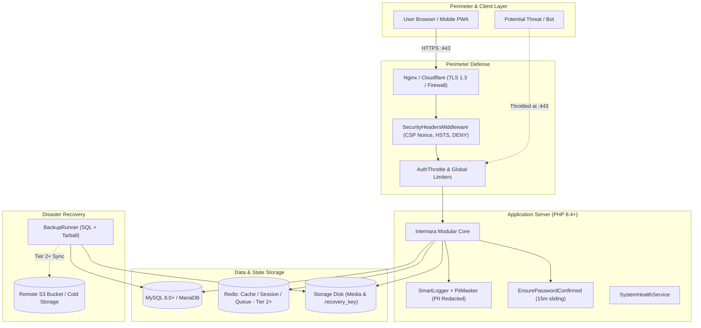
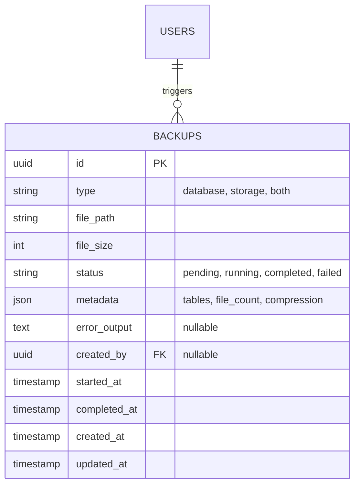

# ZT6VS-C9ZB6 — System Infrastructure & Operational Security

**Document Version:** 1.0.0  
**Status:** Approved Specification  
**Modules:** `Core`, `SysAdmin`, `Setup`, `Auth`  
**Phase:** `Phase 1 — Foundation & Infrastructure`  
**Governing Specs:** #445 (`[ZT6VS]` Core & Infrastructure Services), #459 (`[C9ZB6]` Recovery Ecosystem), #448 (`[J68GZ]` System Requirements), #450 (`[89SRA]` Logging & Error Handling), #452 (`[T4B26]` RBAC & Authorization)  

---

## Description

This specification governs the runtime infrastructure, network perimeter hardening, operational security posture, and disaster recovery ecosystem of the Internara platform. It establishes the architectural baseline that guarantees the application can run reliably across diverse educational hosting environments—from budget shared hosting with zero external dependencies (Tier 1) to high-concurrency dedicated cloud servers (Tier 2/3). It defines multi-layered defense-in-depth mechanisms, Content Security Policy (CSP) nonce injection, strict rate-limiting firewalls, PII log redaction, automated database and asset backup lifecycles, and a fail-safe Super Admin CLI recovery key ecosystem.

---

## 1. Problem Statements

- **PS-1 — Severe Hosting Heterogeneity in Vocational Schools**: Indonesian vocational schools (SMK) operate under vastly differing IT budgets and technical capacities. Some rely on inexpensive cPanel shared hosting lacking Redis, Supervisor, or shell access; others deploy modern Linux VPS instances. If the software mandates complex external daemon dependencies (e.g., Redis cluster, daemon workers, Elasticsearch), low-resource schools cannot install or maintain it. The infrastructure must provide zero-config Tier-1 defaults operating entirely on MySQL, file, and database drivers.
- **PS-2 — Web Application Vulnerabilities & Client-Side Attacks**: Educational web portals are frequent targets for script kiddies, credential stuffers, and cross-site scripting (XSS) attacks. Without a strictly enforced, dynamic Content Security Policy (CSP) and HTTP security headers, malicious scripts can steal session cookies or inject unauthorized UI elements.
- **PS-3 — Malicious Credential Stuffing & DoS Flooding**: Public-facing login and registration portals face automated bot traffic, password spraying, and HTTP resource exhaustion. Without fine-grained, IP- and account-keyed rate limiters, attackers can overwhelm the school's server or compromise weak student passwords.
- **PS-4 — Student PII Leakage in Diagnostic Logs**: Application errors and audit logging frequently write raw request payloads to disk. If personal student identifiers (such as national student numbers [NISN], home addresses, phone numbers, and parent details) are logged in plaintext, administrative staff or unauthorized server viewers gain access to sensitive minor data, violating data privacy mandates.
- **PS-5 — Catastrophic Lockout of System Administrators**: School IT administrators regularly misplace credentials, face misconfigured SMTP mail relays, or experience accidental account lockouts. If recovery depends strictly on incoming email reset tokens or browser sessions, a locked-out administrator cannot regain access without manual, error-prone database surgery.
- **PS-6 — Data Loss from Unautomated Backups**: Schools frequently neglect periodic backups until a hardware drive fails or database corruption occurs. Without an integrated, automated backup lifecycle supporting scheduled snapshots of both database schemas and uploaded student verification documents, data loss is inevitable.

---

## 2. Goals & Non-Goals

### Goals

- **Three-Tier Infrastructure Architecture** — Provide a single unified codebase capable of running on Tier 1 (Shared hosting: SQLite/MySQL, database sessions, sync queue, file cache, local disk, cron webhook), scaling seamlessly to Tier 2 (Single VPS: Redis cache/queue, Supervisor daemon, system cron) and Tier 3 (High-availability cloud: managed DB cluster, S3 storage, Redis cluster) purely via `.env` configuration swaps. *Why:* Democratizes software adoption for schools of all economic brackets.
- **Strict HTTP Security Perimeter** — Implement `SecurityHeadersMiddleware` applying strict per-request CSP nonces (`script-src 'nonce-...'; style-src 'nonce-...'`), HTTP Strict Transport Security (`max-age=31536000; includeSubDomains; preload`), `X-Frame-Options: DENY`, `X-Content-Type-Options: nosniff`, and restrictive `Permissions-Policy`. *Why:* Eliminates clickjacking, MIME sniffing, and inline script XSS vectors.
- **Multi-Layered Rate Limiting Defense** — Enforce fine-grained rate limiters in `bootstrap/app.php`: `auth.throttle` (5 attempts / 60s per IP), global API/web throttle (30 req / 60s per IP), forgot password (3 / hr per email), and password reset (5 / 300s per token). *Why:* Protects authentication endpoints from automated brute force attacks.
- **Automated PII Redaction in Logs** — Integrate `PiiMasker` directly into `SmartLogger` so that sensitive attributes (`email`, `phone`, `nisn`, `address`, `password`, GPS coordinates) are automatically masked before logging to disk or activity audit tables. *Why:* Guarantees privacy compliance and protects student data.
- **Air-Gapped Super Admin Recovery Ecosystem** — Provision a cryptographically random, single-use Recovery Key at setup finalization stored via dual mechanisms (bcrypt hash in database + air-gapped local file `storage/app/.recovery_key`). Enable CLI recovery via `php artisan internara:recover-admin` with attempt budgets and key rotation. *Why:* Guarantees that super administrators can recover system control without browser or email dependencies.
- **End-to-End Backup & Pruning Lifecycle** — Provide `CreateBackupAction`, `SystemBackupCommand`, and `CleanupBackupsAction` supporting database SQL dumps (.sql.gz), uploaded asset tarballs (.tar.gz), and combined archives (.zip) with automated retention policies (7 daily, 4 weekly, 12 monthly). *Why:* Prevents permanent data loss and keeps storage bloat bounded.
- **System Health Diagnostics** — Expose `SystemHealthService` and CLI command `health:check` monitoring database connectivity, disk space usage (> 90% alert), queue backlog, and SSL certificate validity. *Why:* Enables proactive administrative intervention before outages occur.

### Non-Goals

- **Built-In Web Application Firewall (WAF) Engine**. *Why:* Deep packet inspection and distributed DDoS mitigation belong at the reverse proxy (Cloudflare, Nginx, or AWS WAF) layer, not within PHP runtime memory.
- **Multi-Region Cross-Datacenter Replication**. *Why:* Internara installations are sovereign single-tenant institutional instances; multi-region active-active database clustering is out of scope.
- **Proprietary Hardware Appliance Integration**. *Why:* The platform runs on standard POSIX Linux/UNIX environments with open-source runtimes (PHP 8.4+, MySQL 8.0+).

---

## 3. User Stories / Use Cases

| ID | Requirement | Priority | Layer | Status |
|---|---|---|---|---|
| UC-INFRA-001 | System boots and runs all features on Tier-1 shared hosting with zero external daemon dependencies | P0 | A | Full |
| UC-INFRA-002 | Administrator switches cache and queue to Redis via `.env` configuration without changing application code | P1 | F | Full |
| UC-INFRA-003 | Administrator inspects system health and resource consumption via health check dashboard / CLI | P1 | F | Full |
| UC-SEC-001 | Browser receives strict CSP headers with dynamic cryptographic nonce for Vite and Livewire assets | P0 | F | Full |
| UC-SEC-002 | Attacker attempting brute-force login is throttled after 5 failed attempts within a 60-second window | P0 | F | Full |
| UC-SEC-003 | Sensitive student identifiers are masked with asterisks in application log files and activity records | P0 | F | Full |
| UC-SEC-004 | Super Administrator resets locked account via CLI recovery key without web or SMTP access | P0 | F | Full |
| UC-BCK-001 | Administrator triggers manual or scheduled system backup (database, uploads, or full archive) | P0 | F | Full |
| UC-BCK-002 | System automatically prunes outdated backup archives based on institutional retention policy | P1 | F | Full |

### 3.1 Network & Application Hardening Workflows

#### UC-SEC-001 — Dynamic CSP Nonce Injection
- **Preconditions**: Client initiates an HTTP request to any web route.
- **Flow**:
  1. Request reaches `SecurityHeadersMiddleware`.
  2. Middleware generates a 128-bit cryptographically secure random nonce (`base64_encode(random_bytes(16))`).
  3. Nonce is registered with Vite (`Vite::useCspNonce($nonce)`).
  4. Response is generated; Blade directives `@vite`, `@livewireStyles`, and `@livewireScripts` bind the nonce attribute.
  5. Middleware sets `Content-Security-Policy` header:
     `script-src 'self' 'nonce-{NONCE}'; style-src 'self' 'nonce-{NONCE}'; default-src 'self'`.
  6. Middleware attaches HSTS, `X-Frame-Options: DENY`, and `X-Content-Type-Options: nosniff`.
- **Postconditions**: Page renders securely; unauthorized inline scripts injected via XSS are blocked by client browser.

#### UC-SEC-002 — Brute-Force Rate Limiting Interception
- **Preconditions**: Attacker or user repeatedly enters invalid credentials at `/login`.
- **Flow**:
  1. `AuthThrottleMiddleware` intercepts request and computes signature `auth.throttle|{IP}`.
  2. Failed attempts increment cached hit counter with 60-second TTL.
  3. On the 5th failed attempt, system rejects further requests with HTTP 429 Too Many Requests, returning translatable cooldown header `Retry-After`.
  4. At 10 consecutive failures, target user account status transitions to `locked` via `CheckAccountStatusMiddleware`.
- **Postconditions**: Brute-force dictionary spraying thwarted; server resources protected.

### 3.2 Recovery & Backup Workflows

#### UC-SEC-004 — Air-Gapped Super Admin Recovery Execution
- **Preconditions**: Super Admin is locked out; web access is broken; administrator has SSH/CLI shell access.
- **Flow**:
  1. Administrator retrieves plaintext recovery key from secure physical vault or air-gapped file `storage/app/.recovery_key`.
  2. Runs CLI command: `php artisan internara:recover-admin`.
  3. Command prompts for:
     - Target Super Admin email or username.
     - Plaintext Recovery Key.
     - New desired password.
  4. Command validates key against bcrypt hash stored in `settings` table (`setup.recovery_key_hash`).
  5. If valid:
     - Resets super admin password.
     - Unlocks account status to `active`.
     - Flushes failed attempt counters.
     - Generates a fresh recovery key, overwriting the stored hash and local storage file.
     - Prints new recovery key to terminal with warning: *"Save this key immediately; it will not be shown again."*
- **Postconditions**: Access restored; single-use key safely rotated.

#### UC-BCK-001 / UC-BCK-002 — Automated Backup & Pruning Lifecycle
- **Preconditions**: Backup disk configured; scheduler cron active.
- **Flow**:
  1. Scheduler executes `SystemBackupCommand` at scheduled hour (e.g., 02:00 AM).
  2. Command invokes `CreateBackupAction` passing `BackupType::BOTH`.
  3. Creates `Backup` record with status `running`.
  4. `BackupRunner`:
     - Invokes `mysqldump` / SQLite dump to create compressed `.sql.gz`.
     - Packages `storage/app/public` media files into compressed `.tar.gz`.
     - Compiles bundle into encrypted/timestamped archive `backup-{date}-{uuid}.zip`.
  5. Action updates `Backup` model: sets status `completed`, stores `file_size`, and records `completed_at`.
  6. Invokes `CleanupBackupsAction`: scans backup directory, compares age against retention rules (7 daily, 4 weekly, 12 monthly), and unlinks expired files.
- **Postconditions**: Clean backup created; expired archives deleted to prevent disk saturation.

---

## 4. Functional Requirements

| ID | Requirement | Priority | Layer | Status |
|---|---|---|---|---|
| FR-INFRA-001 | Tier-1 default configuration uses file cache, database sessions, sync queue, and local disk | P0 | A | Full |
| FR-INFRA-002 | Cache key registry in `config/cache-keys.php` centralizes all cache tags and expiration TTLs | P0 | A | Full |
| FR-INFRA-003 | Session driver supports `database` and `redis` with 120-minute lifetime, HttpOnly, and SameSite=Lax | P0 | A | Full |
| FR-INFRA-004 | Queue infrastructure supports `sync`, `database`, and `redis` drivers with failure logging to `failed_jobs` | P0 | F | Full |
| FR-INFRA-005 | Cron execution supported via both system CLI crontab and token-authenticated `/cron/{secret}` webhook | P0 | F | Full |
| FR-INFRA-006 | `SystemHealthService` checks database, disk space (< 10% free alert), and queue responsiveness | P1 | F | Full |
| FR-SEC-001 | `SecurityHeadersMiddleware` injects per-request CSP nonce, HSTS, X-Frame-Options, and nosniff | P0 | F | Full |
| FR-SEC-002 | `AuthThrottleMiddleware` rate-limits login attempts to 5 per 60 seconds per client IP | P0 | F | Full |
| FR-SEC-003 | Global web rate limiter restricts traffic to 30 requests per 60 seconds per client IP | P0 | F | Full |
| FR-SEC-004 | Sensitive administrative mutations require 15-minute sliding session confirmation via `EnsurePasswordConfirmed` | P0 | F | Full |
| FR-SEC-005 | `PiiMasker` in `SmartLogger` automatically redacts email, phone, NISN, passwords, and GPS coordinates | P0 | F | Full |
| FR-SEC-006 | GDPR erasure requests log append-only immutable records in GDPR deletion log table | P1 | F | Full |
| FR-SEC-007 | Super Admin recovery key is generated at setup, hashed with bcrypt in DB, and mirrored to local storage file | P0 | F | Full |
| FR-SEC-008 | CLI command `internara:recover-admin` verifies recovery key, resets credentials, and rotates key immediately | P0 | F | Full |
| FR-BCK-001 | `Backup` model and `BackupStatus` enum govern backup state: `pending`, `running`, `completed`, `failed` | P0 | U | Full |
| FR-BCK-002 | `BackupType` enum supports `database`, `storage`, and `both` backup targets | P0 | U | Full |
| FR-BCK-003 | `CreateBackupAction` executes compressed dump inside isolated temp folder and updates stats | P0 | F | Full |
| FR-BCK-004 | `CleanupBackupsAction` prunes backups exceeding retention limits (7 daily, 4 weekly, 12 monthly) | P1 | F | Full |
| FR-BCK-005 | `BackupFailed` event dispatches notification to all system administrators upon backup error | P1 | F | Full |

### 4.1 Deployment Tiers Specification

#### FR-INFRA-001 — Three Deployment Tiers Matrix
- **Tier 1 (Shared Hosting)**:
  - Web Server: Apache or Nginx via cPanel/Plesk.
  - PHP: PHP 8.4+ CLI / FPM.
  - Database: MySQL 8.0+ / MariaDB 10.5+ (shared instance).
  - Cache Driver: `file` or `database`.
  - Session Driver: `database` (stored in `sessions` table).
  - Queue Driver: `sync` (inline execution).
  - Filesystem: `local` (`storage/app/public`).
  - Scheduler: Webhook via `/cron/{secret}` invoked by cPanel cron job.
- **Tier 2 (VPS / Dedicated Server)**:
  - Web Server: Nginx with TLS termination (Let's Encrypt / Certbot).
  - PHP: PHP 8.4+ FPM with Zend OPcache enabled.
  - Database: MySQL 8.0+ / PostgreSQL 14+ on dedicated socket.
  - Cache & Session: `redis` (in-memory caching with eviction policies).
  - Queue Driver: `redis` with dual queue pipelines (`high`, `default`).
  - Worker Daemon: Supervisor managing 2–4 PHP worker processes.
  - Scheduler: Minutely system crontab (`* * * * * php /path/to/artisan schedule:run`).
  - Filesystem: `local` with automated sync/backup to off-site S3 bucket.
- **Tier 3 (Clustered High Availability)**:
  - Ingress: Cloud load balancer with SSL offloading and WAF rules.
  - Application Nodes: Multi-instance stateless PHP-FPM containers.
  - Database: Managed Aurora/Galera cluster with read-replicas.
  - Storage: S3-compatible distributed object storage (AWS S3, MinIO, Wasabi).
  - Worker Nodes: Dedicated background pods for queue consumption and document rendering.

### 4.2 Security Headers & CSP Nonce Architecture

#### FR-SEC-001 — SecurityHeadersMiddleware Pipeline
- Registered globally in `bootstrap/app.php` across the `web` middleware group.
- Applies the following HTTP response headers unconditionally:
  - `Content-Security-Policy`:
    `default-src 'self'; script-src 'self' 'nonce-{NONCE}'; style-src 'self' 'nonce-{NONCE}'; img-src 'self' data: https:; font-src 'self'; connect-src 'self'; frame-ancestors 'none'; object-src 'none'; base-uri 'self';`
  - `Strict-Transport-Security`: `max-age=31536000; includeSubDomains; preload` (enforced when request is HTTPS).
  - `X-Frame-Options`: `DENY` (prevents iframe embedding / UI redressing).
  - `X-Content-Type-Options`: `nosniff` (forces browser adherence to server MIME headers).
  - `Referrer-Policy`: `strict-origin-when-cross-origin`.
  - `Permissions-Policy`: `camera=(self), microphone=(), geolocation=(self), payment=()`.

### 4.3 Recovery Key Ecosystem

#### FR-SEC-007 / FR-SEC-008 — Recovery Key Protocol
- Format: Cryptographically secure 32-character hexadecimal string (`bin2hex(random_bytes(16))`).
- Storage:
  1. Hashed copy: Stored in database via `Hash::make($recoveryKey)` under setting key `setup.recovery_key_hash`.
  2. Local copy: Written to `storage/app/.recovery_key` with strict permissions (`0600`), readable only by the web server user.
- Execution Flow:
  - Invoked via `php artisan internara:recover-admin`.
  - Compares provided key via `Hash::check($inputKey, $storedHash)`.
  - Enforces a 5-attempt brute-force lock on CLI inputs.
  - Upon successful verification, immediate key rotation is triggered: old key is invalidated, and a newly generated key is saved to both DB and disk.

---

## 5. Non-Functional Requirements

| ID | Requirement | Target | Priority | Layer | Status |
|---|---|---|---|---|---|
| NFR-SEC-001 | Content Security Policy violation rate on legitimate application assets | 0 false-positive blocks | P0 | B | Full |
| NFR-SEC-002 | Password hashing computation time and cost factor | bcrypt work factor 12 | P0 | U | Full |
| NFR-SEC-003 | Zero plaintext PII or authentication tokens written to log files | 0 leaks (PiiMasker verified) | P0 | F | Full |
| NFR-SEC-004 | Backup process execution impact on active HTTP requests | Zero request timeouts | P1 | F | Full |
| NFR-SEC-005 | Maximum Recovery Time Objective (RTO) from backup archive | < 30 minutes | P1 | F | Full |
| NFR-SEC-006 | Maximum Recovery Point Objective (RPO) based on daily backup schedule | < 24 hours | P1 | F | Full |
| NFR-SEC-007 | Health check endpoint response time | < 150 ms | P1 | F | Full |
| NFR-SEC-008 | Database connection pool reuse and idle timeout management | Zero connection leaks | P0 | A | Full |

---

## 6. API & Data Contracts

### 6.1 Infrastructure Deployment Topology

### 6.2 Backup Schema & Model

### 6.3 Command Contracts

- **`php artisan internara:recover-admin`**
  - Options: `--username=`, `--key=`, `--new-password=`
  - Interactively verifies key, updates password, unlocks user, and generates fresh recovery key.
- **`php artisan internara:backup {--type=both} {--prune}`**
  - Triggers synchronous or queue-dispatched backup run via `CreateBackupAction`.
- **`php artisan health:check`**
  - Outputs system diagnostics: database response time, disk free percentage, cache responsiveness.
- **`php artisan internara:prune-backups`**
  - Scans storage disk and deletes archives exceeding retention policy thresholds.

---

## 7. Design Decisions

| ID | Requirement | Priority | Layer | Status |
|---|---|---|---|---|
| DD-INFRA-001 | Tier-1 Zero-Config Default Architecture Supporting Budget Shared Hosting | P0 | A | Full |
| DD-INFRA-002 | Dynamic CSP Nonce Generation Tied to Vite Asset Bundling | P0 | F | Full |
| DD-INFRA-003 | Dual Storage Model for Super Admin Emergency Recovery Key | P0 | F | Full |
| DD-INFRA-004 | Native PHP/CLI Backup Engine without Third-Party Heavy SaaS Dependencies | P0 | F | Full |
| DD-INFRA-005 | Automatic In-Flight PII Redaction via SmartLogger Middleware | P0 | F | Full |

### 7.1 Architecture Rationale

#### DD-INFRA-001 — Zero-Config Tier 1 Architecture
- *Decision*: Internara must run out of the box using only PHP and MySQL, with queue jobs executing inline (`sync`) and cache stored in files or tables.
- *Rationale*: Forcing vocational schools to configure Redis or Supervisor daemons creates high adoption barriers and frequent configuration drift. Advanced services scale cleanly as `.env` variables when schools upgrade infrastructure.

#### DD-INFRA-002 — Dynamic CSP Nonce Generation
- *Decision*: Generate an ephemeral 128-bit base64 nonce per request in `SecurityHeadersMiddleware` and share it directly with Vite and Livewire asset compilers.
- *Rationale*: Avoids using unsafe directives like `'unsafe-inline'` or `'unsafe-eval'` in the Content Security Policy while allowing Livewire's dynamic DOM updates and Vite's bundle script tags to execute without browser security violations.

#### DD-INFRA-003 — Dual Storage for Recovery Keys
- *Decision*: Store the recovery key hash in the SQL database, while mirroring the initial plaintext key to an air-gapped local file `storage/app/.recovery_key`.
- *Rationale*: If an administrator loses the setup printout, the key remains accessible on the server's filesystem under root/server file permissions. Storing the database representation as a bcrypt hash prevents database dumps from leaking the plaintext key.

#### DD-INFRA-004 — Native Backup Engine
- *Decision*: Build backup generation using native `mysqldump` and PHP Phar/ZipArchive utilities rather than requiring commercial backup services.
- *Rationale*: Ensures that the backup system functions autonomously inside any standard Linux environment without recurring third-party API subscription costs.

---

## 8. Success Metrics

- **Zero Unauthorized Invasions**: 0 security breaches resulting from XSS, SQL injection, clickjacking, or brute-force credential stuffing.
- **Deployment Compatibility**: 100% of features operational across Tier-1 shared hosting environments.
- **Recovery Success Rate**: 100% successful administrator credential restorations via the CLI recovery key during simulated lockout tests.
- **Data Protection Compliance**: 0 occurrences of unmasked PII (passwords, NISN, GPS) logged to diagnostic channels.
- **Disaster Recovery RTO**: Restoration of complete database and student media files verified under 30 minutes.

---

## 9. Roadmap

- **Phase 1 (Current Baseline)**: Three-tier infrastructure support, CSP nonce injection, rate-limiting suites, PII log redaction, CLI recovery key, and local backup lifecycle.
- **Phase 2 (Future Hardening)**:
  - FIDO2 / WebAuthn biometric passkey authentication for Super Administrators.
  - Automated encrypted backup streaming to decentralized S3 cold storage.
  - Automated database anomaly detection alerting on bulk record deletion spikes.

---

## 10. Risks & Assumptions

| ID | Risk / Assumption / Open Question | Status | Owner | GH Issue |
|---|---|---|---|---|
| R-1 | Low-cost shared hosts may disable `exec()` or `proc_open()`, preventing `mysqldump` execution. Mitigated by native PHP SQL dump fallback. | Resolved | Tech Lead | [#445](https://github.com/reasvyn/internara/issues/445) |
| R-2 | Server storage exhaustion from accumulated unpruned backup archives. Mitigated by automated `CleanupBackupsAction` retention enforcement. | Resolved | SysAdmin | [#459](https://github.com/reasvyn/internara/issues/459) |
| A-1 | We assume the production web server terminates TLS with valid SSL certificates (e.g., Let's Encrypt). | Accepted | DevOps | [#448](https://github.com/reasvyn/internara/issues/448) |
| A-2 | We assume server system time is synchronized via NTP for accurate HSTS and session validity checks. | Accepted | DevOps | [#445](https://github.com/reasvyn/internara/issues/445) |

---

## Quick References

- [`docs/index.md`](../index.md) — Documentation index
- [`docs/prd.md`](../prd.md) — Product Requirement Document (PRD)
- [`docs/guides/infra/infrastructure.md`](../guides/infra/infrastructure.md) — Infrastructure operational overview
- [`docs/guides/infra/security.md`](../guides/infra/security.md) — Security infrastructure and operational reference
- [`docs/guides/infra/deployment.md`](../guides/infra/deployment.md) — Production deployment paths and checklists
- [`docs/specs/installation-and-initial-configuration.md`](installation-and-initial-configuration.md) — CLI installation and setup wizard spec
- [`docs/specs/authentication-and-user-management.md`](authentication-and-user-management.md) — Auth, User CRUD, and Flat RBAC spec
- [GitHub Spec Issues](https://github.com/reasvyn/internara/issues?q=label%3Aspec) — Authoritative spec issues #442–#509
