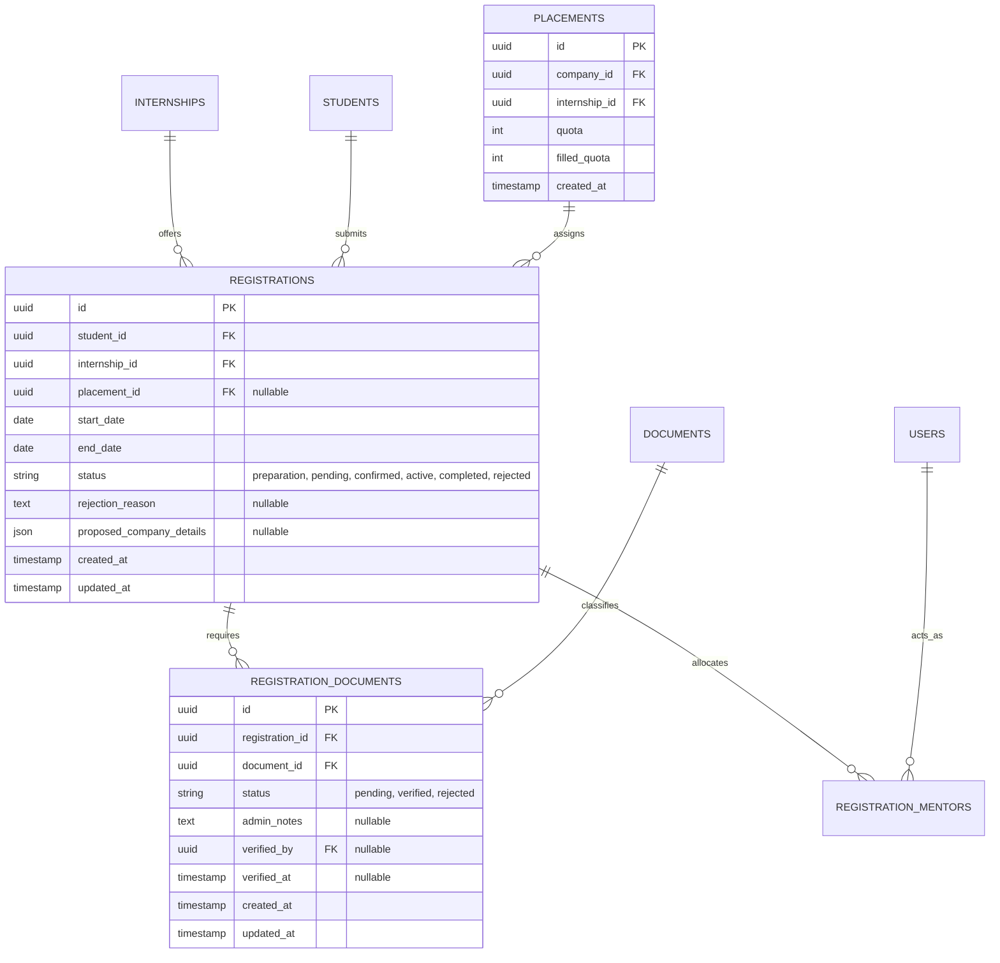
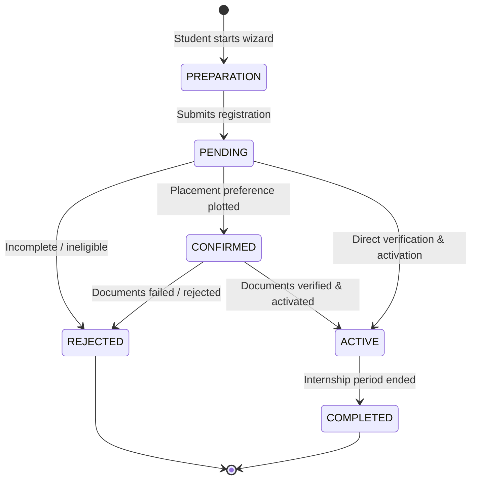

# MBB5R-7H5D6 — PKL Registration & Pre-Internship Document Checklist

**Document Version:** 1.0.0  
**Status:** Approved Specification  
**Modules:** `Enrollment`, `Document`, `Program`  
**Phase:** `Phase 7 — Enrollment`  
**Governing Specs:** #479 (`[MBB5R]` Registration), #480 (`[J9GBH]` Placement), #481 (`[920SO]` Account Application), #500 (`[7H5D6]` Official Documents), #494 (`[ZUFG8]` Handbooks)  

---

## Description

This specification governs the student enrollment intake, placement preference selection, and pre-internship document completeness workflow within the Internara platform. It defines the end-to-end procedural pipeline that prepares vocational students for industrial fieldwork: verifying cohort eligibility, offering guided placement options (school-partnered industrial slots vs. student-proposed independent companies), enforcing strict partner quota limits, managing the mandatory pre-PKL document checklist (Parent Consent Form, School Introduction Letter, Company Acceptance Confirmation, Supervisor Assignment Letter, and Student Integrity Pact), and guarding placement activation behind a strict, audited verification gate.

---

## 1. Problem Statements

- **PS-1 — Disorganized Paper-Based Document Tracking**: In conventional school operations, pre-PKL document administration relies on physical paperwork: students collect paper consent forms from parents, obtain signed recommendation letters from homeroom teachers, and receive paper acceptance letters from company reception desks. These loose papers are frequently misplaced, torn, or submitted past deadlines, leaving vocational coordinators unable to track who is genuinely cleared for deployment.
- **PS-2 — Uncontrolled Quota Oversubscription**: When placement plotting is done through manual sign-up sheets or informal messaging, popular partner companies (DUDI) become heavily oversubscribed. Coordinators face chaotic conflicts when fifteen students show up for five allocated company slots, damaging institutional credibility with corporate partners.
- **PS-3 — Legal and Child Welfare Liabilities**: Deploying minor students to industrial worksites without verified parental permission or formal school assignment orders creates severe legal liabilities in the event of industrial accidents or workplace disputes. Schools require an absolute system barrier preventing students from starting internships before all statutory documents are verified.
- **PS-4 — Opaque Proposal Process for Independent Companies**: Students who find their own internship opportunities (independent/mandiri) often lack a clear channel to submit company profiles, address details, and contact personnel. Administrative staff spend weeks clarifying incomplete company information through informal channels.
- **PS-5 — Ignorance of Workplace Safety and Ethical Guidelines**: Students frequently arrive at partner companies without reading safety protocols or professional codes of conduct. Without a mandatory digital acknowledgement of the PKL Student Handbook and Integrity Pact, schools have no legal record proving the student was formally instructed on institutional and workplace guidelines.

---

## 2. Goals & Non-Goals

### Goals

- **Guided Multi-Step Registration Wizard** — Provide an intuitive, step-by-step registration experience navigating students through program selection, placement choice (verified partner vs. student-proposed company), and confirmation. *Why:* Eliminates confusion, prevents incomplete records, and enforces logical ordering.
- **Strict Availability Gating** — Automatically evaluate school registration window dates, returning distinct states (`open`, `upcoming`, `closed`, `not_configured`). *Why:* Prevents premature or tardy submissions and communicates clear timeline boundaries to students.
- **Mandatory Pre-PKL Document Checklist Pipeline** — Model each required document (Parent Consent, School Introduction, Company Acceptance, Assignment Order, Integrity Pact) as a distinct entity with lifecycle states (`pending`, `verified`, `rejected`), file upload handling via Spatie MediaLibrary, and reviewer audit trails. *Why:* Replaces physical paper filing with a centralized, accountable compliance record.
- **Automated Official Introduction Letters** — Enable instant, templated PDF rendering of formal School-to-Company Introduction Letters via `OfficialDocument` and Dompdf, complete with institutional headers and verifiable QR codes. *Why:* Removes administrative bottlenecks in issuing hundreds of introduction letters before deployment.
- **Digital Handbook & Integrity Pact Sign-Off** — Enforce mandatory digital review and acknowledgement of the PKL Handbook and ethical conduct guidelines prior to registration approval. *Why:* Establishes verifiable proof of student orientation and workplace safety compliance.
- **Hard Verification Gate Before Deployment** — Enforce that a registration cannot transition to `active` unless 100% of required documents hold `verified` status and the target placement has remaining quota capacity. *Why:* Guarantees zero unverified student deployments and safeguards institutional partner relationships.
- **Duplicate Registration Prevention** — Enforce database-level and application-level unique constraints preventing a student from maintaining multiple active or pending registrations in the same internship cohort. *Why:* Protects data integrity and prevents artificial quota depletion.

### Non-Goals

- **Automated Algorithmic Matching / Machine Learning Plotting**. *Why:* Placement allocation requires nuanced human judgment, student home proximity, and interpersonal mentor considerations; matching is student-selected and coordinator-approved.
- **Live In-App Chat with Corporate HR**. *Why:* Inter-organizational corporate negotiations occur through established formal phone/email channels; the platform stores authoritative decisions and documentation.
- **Multi-Tenant Cross-School Placement Sharing**. *Why:* Internara operates as a sovereign, single-tenant institutional platform tailored to one school's specific partner network.

---

## 3. User Stories / Use Cases

| ID | Requirement | Priority | Layer | Status |
|---|---|---|---|---|
| UC-REG-001 | Student navigates guided wizard to register for internship and select partner placement or propose company | P0 | F | Full |
| UC-REG-002 | Student uploads required pre-PKL documents (Parent Consent, Company Acceptance) with file preview | P0 | F | Full |
| UC-REG-003 | Student reads and digitally acknowledges the PKL Student Handbook & Integrity Pact | P0 | F | Full |
| UC-REG-004 | Admin/Coordinator reviews pending student documents, marking each as verified or rejected with notes | P0 | F | Full |
| UC-REG-005 | Admin/Coordinator verifies registration, checks quota capacity, assigns mentors, and activates placement | P0 | F | Full |
| UC-REG-006 | Admin/Coordinator rejects incomplete registration with explanatory reason, notifying the student | P1 | F | Full |
| UC-REG-007 | Coordinator generates and issues official school introduction letters in batch or single PDF format | P1 | F | Full |
| UC-REG-008 | Coordinator manages placement change requests or student relocation during preparation stage | P1 | F | Full |

### 3.1 Student Registration & Onboarding Workflows

#### UC-REG-001 — Guided Student Registration Flow
- **Preconditions**: Student is authenticated; registration period status is `open`; student has no active or pending registration for the target cohort.
- **Flow**:
  1. Student navigates to `/register`.
  2. System checks `ReadRegistrationAvailabilityAction` and confirms active window.
  3. **Step 1 (Internship Selection)**: Student reviews active internship programs and selects their academic cohort.
  4. **Step 2 (Placement Selection)**: Student chooses between:
     - *Partner Placement*: Selects an accredited company slot with available quota.
     - *Independent Proposal*: Enters proposed company name, address, contact person, and phone number.
  5. Student reviews submission summary and clicks "Submit Registration".
  6. `RegisterInternshipAction` validates unique constraints, creates `Registration` with status `pending`, dispatches `StudentRegistered` event, and clears dashboard cache.
- **Postconditions**: Registration record created with status `pending`; student redirected to document checklist page.

#### UC-REG-002 — Document Submission & Upload Flow
- **Preconditions**: Student holds a registration in `preparation` or `pending` status.
- **Flow**:
  1. Student navigates to `/registration/documents`.
  2. System presents required document checklist dynamically populated from `internship.required_document_ids`.
  3. For each document slot (e.g., Parent Consent Form), student selects a PDF or image file (max 5MB).
  4. `UploadRegistrationDocumentAction` stores file in Spatie MediaLibrary `file` collection, creates or updates `RegistrationDocument` record with status `pending`, and timestamps submission.
  5. Checklist displays uploaded filename, preview affordance, and `Pending Review` badge.
- **Postconditions**: Files stored securely; documents marked `pending` in the verification queue.

#### UC-REG-003 — Handbook & Integrity Pact Acknowledgement
- **Preconditions**: Student is enrolled in an active registration preparation flow.
- **Flow**:
  1. Student navigates to `/handbooks` or clicks handbook requirement link.
  2. Component displays active PKL Handbook and ethical guidelines.
  3. Student reads guidelines and checks mandatory declaration checkbox: *"I have read, understood, and agreed to abide by the workplace rules and student code of conduct."*
  4. Clicks "Sign & Acknowledge".
  5. `AcknowledgeHandbookAction` records student ID, handbook ID, and timestamp.
- **Postconditions**: Integrity pact acknowledgement verified; unblocks subsequent verification steps.

### 3.2 Administrative Verification & Placement Plotting

#### UC-REG-004 — Pre-PKL Document Verification Flow
- **Preconditions**: Administrator or PKL Coordinator is authenticated.
- **Flow**:
  1. Coordinator navigates to `/admin/registrations/{id}/verification`.
  2. System lists all uploaded `RegistrationDocument` items with media download/view links.
  3. Coordinator reviews file contents:
     - If document is compliant: clicks "Verify Document", setting status to `verified`.
     - If document is deficient (e.g., missing parent signature, blurry scan): clicks "Reject", enters explanatory note (e.g., *"Tanda tangan orang tua belum ada"*), setting status to `rejected`.
  4. System updates `RegistrationDocument` with `verified_by` admin ID and `verified_at` timestamp.
- **Postconditions**: Per-document compliance state updated; student notified if document is rejected.

#### UC-REG-005 — Registration Verification & Activation Gate
- **Preconditions**: Registration is in `pending` status; all required documents have been reviewed.
- **Flow**:
  1. Coordinator clicks "Verify & Activate Placement".
  2. `VerifyRegistrationAction` performs atomic checks inside a database transaction:
     - Validates registration is `pending`.
     - Validates that every required document in `$registration->documents` is `verified`. Throws `RejectedException` if any document is unverified or missing.
     - Retrieves target `Placement` and evaluates `$placement->asPlacementCapacity()->isFull()`. Throws `RejectedException` if quota is full.
  3. Action sets registration `placement_id`, stamps `start_date` and `end_date`, updates status to `active`, and increments `placement.filled_quota`.
  4. Action attaches assigned school teacher and industry supervisor IDs to registration mentor pivot table.
  5. Dispatches `RegistrationVerified` event and logs activity audit record.
  6. Student receives notification confirming active placement and assigned mentors.
- **Postconditions**: Registration becomes `active`; placement quota incremented; student granted access to Daily Journal and Attendance modules.

#### UC-REG-006 — Registration Rejection Flow
- **Preconditions**: Registration is in `pending` status.
- **Flow**:
  1. Coordinator determines registration is unacceptable (e.g., forged documents, ineligible student).
  2. Clicks "Reject Registration" and provides mandatory rejection reason.
  3. `RejectRegistrationAction` updates registration status to `rejected`, records `rejection_reason`, and dispatches `RegistrationRejected` event.
  4. System sends notification with reason to student.
- **Postconditions**: Registration marked terminal `rejected`; student may submit a fresh registration if permitted.

---

## 4. Functional Requirements

| ID | Requirement | Priority | Layer | Status |
|---|---|---|---|---|
| FR-REG-001 | `ReadRegistrationAvailabilityAction` returns period state (`open`, `upcoming`, `closed`, `not_configured`) | P0 | F | Full |
| FR-REG-002 | Registration wizard accessible only while current date falls within configured registration window | P0 | F | Full |
| FR-REG-003 | `RegistrationState` entity computes `isActive`, `isPending`, `isCurrentlyOngoing`, `hasEnded`, and `canBeApproved` | P0 | U | Full |
| FR-REG-004 | `RegistrationState::canBeApproved()` requires `pending` status combined with assigned placement | P0 | U | Full |
| FR-REG-005 | `RegistrationState` computes duration metrics: `totalDuration`, `daysRemaining`, and elapsed percentage | P1 | U | Full |
| FR-REG-006 | `RegistrationState` evaluates internship milestone progress (`currentPhaseIndex`, `currentPhase`) | P2 | U | Full |
| FR-REG-007 | `RegisterInternshipAction` refuses duplicate active or pending registrations for same student and internship | P0 | F | Full |
| FR-REG-008 | Database enforces compound unique constraint on `(student_id, internship_id)` in `registrations` table | P0 | A | Full |
| FR-REG-009 | `registrations` table uses UUID primary key with cascading foreign key deletions on student and internship | P0 | A | Full |
| FR-REG-010 | Placement foreign key reference in `registrations` is nullable with `onDelete('set null')` | P0 | A | Full |
| FR-REG-011 | Student-proposed company details persist in JSON column `proposed_company_details` | P1 | F | Full |
| FR-REG-012 | `RegistrationStatus` backed enum governs lifecycle: `preparation`, `pending`, `confirmed`, `active`, `completed`, `rejected` | P0 | U | Full |
| FR-REG-013 | `StudentRegistered` event dispatches on registration creation, clearing student dashboard cache | P0 | F | Full |
| FR-REG-014 | `VerifyRegistrationAction` enforces that registration status must be `pending` prior to activation | P0 | F | Full |
| FR-REG-015 | `VerifyRegistrationAction` enforces that target placement has available capacity before incrementing quota | P0 | F | Full |
| FR-REG-016 | `VerifyRegistrationAction` enforces that 100% of required registration documents are in `verified` status | P0 | F | Full |
| FR-REG-017 | Verification atomically updates placement ID, duration dates, status to `active`, and increments `filled_quota` | P0 | F | Full |
| FR-REG-018 | `VerifyRegistrationAction` attaches assigned school teacher and industry supervisor IDs to mentor pivot | P0 | F | Full |
| FR-REG-019 | `RegistrationPolicy` allows students to view and update their own registrations in `preparation` or `pending` | P0 | U | Full |
| FR-REG-020 | `RegistrationPolicy` restricts verification, quota alteration, and approval actions exclusively to admins/coordinators | P0 | U | Full |
| FR-REG-021 | `RegistrationDocument` model stores document submission linked to `registration_id` and `document_id` | P0 | A | Full |
| FR-REG-022 | `RegistrationDocumentStatus` backed enum governs document states: `pending`, `verified`, `rejected` | P0 | U | Full |
| FR-REG-023 | `UploadRegistrationDocumentAction` stores file in Spatie MediaLibrary single-file `file` collection | P0 | F | Full |
| FR-REG-024 | `UploadRegistrationDocumentAction` accepts only documents listed in `internship.required_document_ids` | P0 | F | Full |
| FR-REG-025 | Document upload component renders checklist of required items with current submission badge and preview link | P1 | F | Full |
| FR-REG-026 | `RegistrationDocumentPolicy` separates student upload permission from admin verification permission | P0 | U | Full |
| FR-REG-027 | Document status transitions enforce terminal states: `verified` and `rejected` cannot be modified without resubmission | P0 | U | Full |
| FR-REG-028 | `RejectRegistrationAction` records mandatory `rejection_reason` and dispatches `RegistrationRejected` event | P1 | F | Full |
| FR-REG-029 | `RegistrationVerified` event triggers notification to student confirming placement activation | P1 | F | Full |
| FR-REG-030 | `PlacementCapacity` domain entity computes remaining slots, filled percentage, and over-capacity guards | P0 | U | Full |
| FR-DOC-001 | `OfficialDocument` generates School-to-Company Introduction Letters using Blade templates and Dompdf | P1 | F | Full |
| FR-DOC-002 | `OfficialDocument` embeds cryptographic verification QR code linking to document validity checker | P1 | F | Full |
| FR-DOC-003 | `AcknowledgeHandbookAction` records student acknowledgement timestamp for PKL Handbook & Integrity Pact | P0 | F | Full |

### 4.1 Intake & Availability Requirements

#### FR-REG-001 — Availability Gating
- `ReadRegistrationAvailabilityAction` inspects configuration settings `registration.start_date` and `registration.end_date`.
- Returns an enum-like semantic availability string:
  - `not_configured`: Dates are null or unassigned.
  - `upcoming`: Current date is strictly prior to `start_date`.
  - `open`: Current date falls inclusively between `start_date` and `end_date`.
  - `closed`: Current date is strictly after `end_date`.

#### FR-REG-007 / FR-REG-008 — Duplicate Registration Guards
- Application logic checks whether the authenticated student already owns a registration with status `pending`, `confirmed`, or `active`.
- Database enforces `UNIQUE(student_id, internship_id)`. Any race condition triggers `RejectedException` or database constraint violation caught gracefully.

### 4.2 Document Completeness Checklist Requirements

#### FR-REG-021 / FR-REG-023 — Spatie MediaLibrary Integration
- `RegistrationDocument` implements `Spatie\MediaLibrary\HasMedia` using the `InteractsWithMedia` trait.
- Registers a single-file media collection named `file`.
- Re-uploading a document replaces any prior media item in that collection, resetting status to `pending`.
- Supported MIME types: `application/pdf`, `image/jpeg`, `image/png`. Max file size: 5,120 KB (5 MB).

#### FR-REG-016 — Hard Verification Gate
- Prior to transitioning `Registration` to `active`, `VerifyRegistrationAction` loads all required documents for the internship program.
- Invariant:
  ```php
  if ($registration->documents->isNotEmpty() && $registration->documents->contains(fn ($doc) => ! $doc->status->isVerified())) {
      throw new RejectedException(__('registration.documents_not_verified'));
  }
  ```
- If any required document is missing or has status `pending`/`rejected`, verification aborts and rolls back the database transaction.

### 4.3 Quota & Placement Capacity Requirements

#### FR-REG-015 / FR-REG-030 — Placement Capacity Encapsulation
- `PlacementCapacity` entity wraps `Placement` model and encapsulates slot calculations:
  - `totalSlots = $placement->quota`
  - `filledSlots = $placement->filled_quota`
  - `remainingSlots = max(0, $totalSlots - $filledSlots)`
  - `isFull = $remainingSlots <= 0`
- `VerifyRegistrationAction` enforces `$placement->asPlacementCapacity()->isFull() === false`. Attempting to verify a registration against an exhausted placement throws `RejectedException(__('placement.quota_full'))`.

---

## 5. Non-Functional Requirements

| ID | Requirement | Target | Priority | Layer | Status |
|---|---|---|---|---|---|
| NFR-REG-001 | Registration creation and verification executed inside strict database transactions | 100% atomicity | P0 | F | Full |
| NFR-REG-002 | Pre-PKL document upload response time under 5MB payload | < 1,500 ms | P1 | F | Full |
| NFR-REG-003 | Document checklist UI rendering and availability check response time | < 300 ms | P1 | F | Full |
| NFR-REG-004 | File upload security: strict MIME sniffing, extension whitelist, virus/malware path isolation | Zero unvalidated files | P0 | F | Full |
| NFR-REG-005 | Registration wizard accessibility compliance: labeled inputs, step progression indicators, ARIA alerts | WCAG 2.1 Level AA | P1 | B | Full |
| NFR-REG-006 | Complete audit logging: all status changes, document approvals, and rejections logged via `SmartLogger` | 100% auditable events | P0 | F | Full |
| NFR-REG-007 | Dual localization support: English (`en`) and Indonesian (`id`) for all wizard steps and error messages | 100% string coverage | P0 | A | Full |
| NFR-REG-008 | Storage optimization: PDF generation and image storage clean up temp files upon completion | 0 orphan temp files | P1 | F | Full |

### 5.1 Security & Storage Constraints

#### NFR-REG-004 — File Upload Defense-in-Depth
- Uploaded files are inspected using file signature (magic bytes) detection rather than trusting client-provided MIME headers.
- Executable files (`.php`, `.sh`, `.exe`, `.js`) are strictly rejected.
- Files are stored using opaque UUID names in private or signed-URL media storage disks, preventing direct public path traversals.

#### NFR-REG-006 — Audit Trail Integrity
- Every call to `VerifyRegistrationAction`, `RejectRegistrationAction`, or `UploadRegistrationDocumentAction` generates an immutable `activity_log` record capturing:
  - Causer ID (User executing the action).
  - Subject ID (Registration / RegistrationDocument).
  - Payload metadata (assigned placement ID, rejection reason, document count).

---

## 6. API & Data Contracts

### 6.1 Database Schema Diagram



### 6.2 Data Transfer Objects (DTOs)

#### `RegistrationData`
```php
namespace App\Modules\Enrollment\Domain\Registration\Data;

use App\Modules\Core\Data\BaseData;
use Carbon\Carbon;

final class RegistrationData extends BaseData
{
    public function __construct(
        public string $internshipId,
        public ?string $placementId = null,
        public ?Carbon $startDate = null,
        public ?Carbon $endDate = null,
        public ?string $proposedCompanyName = null,
        public ?string $proposedCompanyAddress = null,
        public ?string $notes = null,
    ) {}
}
```

#### `VerifyRegistrationData`
```php
namespace App\Modules\Enrollment\Domain\Registration\Data;

use App\Modules\Core\Data\BaseData;
use Carbon\Carbon;

final class VerifyRegistrationData extends BaseData
{
    public function __construct(
        public string $registrationId,
        public string $placementId,
        public ?Carbon $startDate = null,
        public ?Carbon $endDate = null,
        public array $mentorIds = [],
    ) {}
}
```

### 6.3 Domain Command & Read Actions

- **`RegisterInternshipAction::execute(User $student, RegistrationData $data): Registration`**
  - Validates duplicate guards; creates `Registration`; stamps `pending`; dispatches `StudentRegistered`.
- **`UploadRegistrationDocumentAction::execute(Registration $registration, array $uploads): void`**
  - Receives mapping of `document_id => UploadedFile`; updates/creates `RegistrationDocument`; syncs Spatie Media file collection.
- **`VerifyRegistrationAction::execute(VerifyRegistrationData $data): Registration`**
  - Enforces pending status; enforces 100% document verification; verifies quota capacity; updates dates; sets status to `active`; attaches mentors; logs activity.
- **`RejectRegistrationAction::execute(string $registrationId, RejectRegistrationData $data): Registration`**
  - Enforces pending status; sets status to `rejected`; records rejection reason; dispatches `RegistrationRejected`.
- **`ReadRegistrationAvailabilityAction::execute(): string`**
  - Reads settings; evaluates current timestamp; returns `open`, `upcoming`, `closed`, or `not_configured`.

### 6.4 Key Enums & Transitions

#### `RegistrationStatus` State Machine


#### `RegistrationDocumentStatus`
- `PENDING`: Uploaded by student, awaiting administrative review.
- `VERIFIED`: Approved by coordinator; immutable until new file uploaded.
- `REJECTED`: Rejected with notes; triggers student resubmission prompt.

---

## 7. Design Decisions

| ID | Requirement | Priority | Layer | Status |
|---|---|---|---|---|
| DD-REG-001 | Dedicated `RegistrationDocument` Join Entity over Polymorphic Attachments | P0 | A | Full |
| DD-REG-002 | Strict Verification Gate Invariant Enforcing 100% Verified Documents | P0 | F | Full |
| DD-REG-003 | Encapsulated Quota Capacity via `PlacementCapacity` Domain Entity | P0 | U | Full |
| DD-REG-004 | Dual Placement Intake Model (Partner Slot vs. Student-Proposed DUDI) | P1 | F | Full |
| DD-REG-005 | Digital Student Handbook Acknowledgement as a Prerequisite Gate | P0 | F | Full |

### 7.1 Architecture Rationale

#### DD-REG-001 — Dedicated `RegistrationDocument` Join Entity
- *Decision*: Model document compliance using an explicit relational join table (`registration_documents`) with foreign keys to `registrations` and `documents`, rather than generic polymorphic attachments.
- *Rationale*: Pre-PKL document checking requires individual lifecycle auditing, rejection notes, verifier signatures, and verification timestamps per document requirement. A dedicated entity provides clean typed attributes and avoids polymorphic query overhead.

#### DD-REG-002 — Strict Verification Gate Invariant
- *Decision*: Hardcode a non-bypassable verification check in `VerifyRegistrationAction` requiring all program documents to be `verified` before setting registration status to `active`.
- *Rationale*: Indonesian vocational education standards require strict compliance prior to student industrial dispatch. Allowing manual overrides without document clearance exposes the institution to severe legal and physical safety liabilities.

#### DD-REG-003 — Encapsulated Quota Capacity via `PlacementCapacity`
- *Decision*: Move capacity math and full-slot detection out of models and controllers into a dedicated domain entity `PlacementCapacity`.
- *Rationale*: Prevents race conditions and duplicate capacity calculation bugs across direct placement managers, relocation actions, and registration verification workflows.

#### DD-REG-004 — Dual Placement Intake Model
- *Decision*: Accommodate both pre-approved school partner placements and student-proposed independent companies within a unified registration wizard.
- *Rationale*: A significant percentage of vocational students source their own internships through family networks or specialized local businesses. The platform must capture company profile details without forcing students into partner slots.

---

## 8. Success Metrics

- **Zero Unverified Field Deployments**: 100% of students in `active` placement status hold fully verified pre-PKL documentation dossiers.
- **Quota Integrity**: Zero occurrences of oversubscribed partner company placements.
- **Document Processing Cycle Time**: Median time from student document upload to administrative review under 48 hours.
- **Reduction in Paper Loss**: 100% elimination of missing parent consent forms and physical recommendation slips.
- **Orientation Compliance**: 100% of active interns digitally sign and acknowledge the PKL Handbook & Integrity Pact prior to their first fieldwork day.

---

## 9. Roadmap

- **Phase 7 (Current Baseline)**: Guided registration wizard, availability gating, dual placement selection, document checklist upload/verification, handbook acknowledgement, and quota capacity enforcement.
- **Phase 8 (Next Enhancements)**:
  - Automated SMS/WhatsApp notifications alerting students when a document is rejected.
  - Digital in-browser signature pad for parent consent forms.
  - OCR extraction for automated identity card (KTP/NISN) verification.

---

## 10. Risks & Assumptions

| ID | Risk / Assumption / Open Question | Status | Owner | GH Issue |
|---|---|---|---|---|
| R-1 | Low-bandwidth mobile users struggle to upload high-resolution phone photos of documents. Mitigated by client-side image compression and max 5MB ceiling. | Resolved | Tech Lead | [#479](https://github.com/reasvyn/internara/issues/479) |
| R-2 | Students propose fraudulent or non-existent companies in independent submissions. Mitigated by mandatory admin verification and company phone contact checks before approval. | Resolved | Product Lead | [#480](https://github.com/reasvyn/internara/issues/480) |
| A-1 | We assume each student is registered in at most one active internship cohort per academic year. | Accepted | Architect | [#479](https://github.com/reasvyn/internara/issues/479) |
| A-2 | We assume partner company quotas are negotiated and locked by the school coordinator prior to the registration window opening. | Accepted | Coordinator | [#480](https://github.com/reasvyn/internara/issues/480) |

---

## Quick References

- [`docs/index.md`](../index.md) — Documentation index
- [`docs/prd.md`](../prd.md) — Product Requirement Document (PRD)
- [`docs/specs/daily-journal-and-attendance.md`](daily-journal-and-attendance.md) — Core Pillar 1 Daily Journal & Attendance Specification
- [`docs/refs/modules/enrollment.md`](../refs/modules/enrollment.md) — Enrollment module conceptual reference
- [`docs/refs/modules/document.md`](../refs/modules/document.md) — Document module conceptual reference
- [GitHub Spec Issues](https://github.com/reasvyn/internara/issues?q=label%3Aspec) — Authoritative spec issues #442–#509
