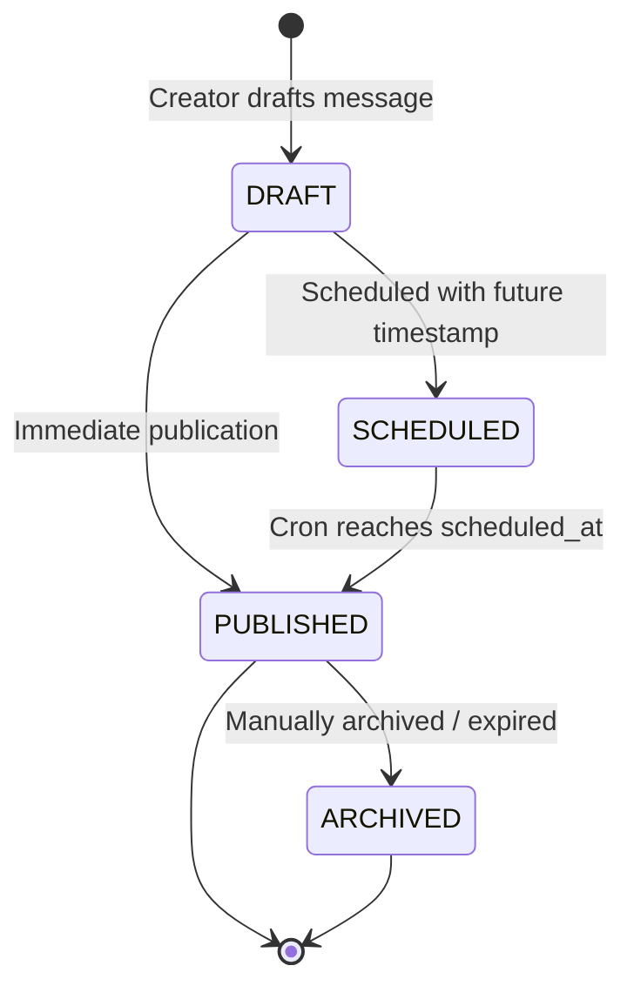
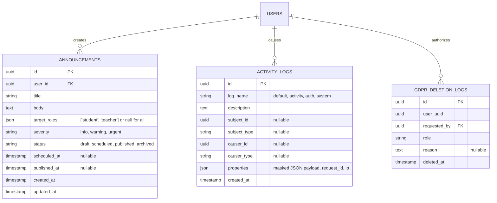

# 3S55V-89SRA — System Administration & Platform Observability

**Document Version:** 1.0.0  
**Status:** Approved Specification  
**Modules:** `SysAdmin`, `Core`  
**Phase:** `Phase 3 — System Administration & Operations`  
**Governing Specs:** #467 (`[3S55V]` Announcement System), #450 (`[89SRA]` Logging & Error Handling), #445 (`[ZT6VS]` Core & Infrastructure Services), #459 (`[C9ZB6]` Recovery Ecosystem)  

---

## Description

This specification governs the operational administration, targeted communication, telemetry, auditability, and observability ecosystem of the Internara platform. It equips school system administrators and IT coordinators with the centralized control panel needed to maintain institutional software health: broadcast role-targeted announcements with automated publishing schedules, inspect real-time system performance and registration telemetry via Laravel Pulse, review immutable business audit logs enriched with request correlation IDs, audit environment security configurations, ensure regulatory compliance through append-only GDPR deletion logs, and maintain zero-leakage error handling through the `SmartLogger` dual-channel architecture with automatic Personally Identifiable Information (PII) redaction.

---

## 1. Problem Statements

- **PS-1 — Operational Blindness in Production Environments**: School IT administrators rarely have dedicated monitoring infrastructure (e.g., Datadog, New Relic, Grafana). When server response times degrade, queue workers freeze, or disk space reaches capacity, administrators remain unaware until end-users file complaints. The platform must provide built-in, lightweight observability directly inside the admin panel via Laravel Pulse and diagnostic CLI commands.
- **PS-2 — Cluttered and Unauditable Administrative Logging**: Traditional monoliths log application debugging noise and critical administrative actions into a single unformatted text file (`laravel.log`). Administrators looking for evidence of an unauthorized user promotion or modified placement quota must manually sift through thousands of lines of stack traces. Business audit records must be segregated from technical system logs into an auditable relational format (`activity_log`).
- **PS-3 — Privacy Violations and PII Exposure in Diagnostic Dumps**: Unhandled exceptions and verbose request logging often dump raw user input (including passwords, student national ID numbers [NISN], home addresses, phone numbers, and geolocation coordinates) into persistent log files. A subsequent diagnostic export or unauthorized log file access exposes minor student records, violating personal data protection mandates (UU Perlindungan Data Pribadi / GDPR).
- **PS-4 — Untargeted and Untracked Institutional Announcements**: School administrators currently announce policy updates, schedule changes, and emergency closures through informal WhatsApp groups or static paper notices. Messages fail to reach targeted cohorts (e.g., announcing an industry safety update to students only, without spamming teachers), lack scheduling capabilities, and provide no auditable receipt proving who received the notice prior to an accreditation inspection.
- **PS-5 — Compliance Deficits in Right-to-Erasure (GDPR) Inquiries**: When a graduated student or departed teacher requests the formal deletion of their personal account, manual database row deletion leaves no verifiable compliance record proving that the deletion occurred, who authorized it, and when it was completed. The platform must maintain an immutable, anonymized audit log for data erasure requests.

---

## 2. Goals & Non-Goals

### Goals

- **Dual-Channel Logging Architecture (SmartLogger)** — Provide a unified logger with distinct sinks: technical developer debugging directed to rotating local log files (`storage/logs/laravel.log`) and business audit events directed to the database `activity_log` table, enriched with `LogContextMiddleware` correlation attributes (`request_id`, `user_id`, `ip_address`, `route`). *Why:* Keeps audit trails clean and structured while preserving technical error detail.
- **Automated In-Flight PII Redaction** — Automatically mask sensitive attributes (`email`, `phone`, `nisn`, `password`, `address`, GPS coordinates) via `PiiMasker` before logging to either system logs or database audit records. *Why:* Enforces data privacy by design and prevents accidental compliance breaches.
- **Embedded Telemetry & Health Monitoring (Laravel Pulse)** — Integrate real-time system cards (`SystemCard`, `RegistrationsCard`) displaying server CPU/memory load, cache hit ratios, queue throughput, slow database queries, and active internship registration velocity. *Why:* Enables single-pane-of-glass diagnostics without third-party SaaS subscriptions.
- **Role-Targeted Announcement Lifecycle** — Support broadcast and targeted announcements with a staged lifecycle (`draft` → `scheduled` → `published`), role filtering (`student`, `teacher`, `supervisor`, `admin`), rich Markdown bodies, and per-minute scheduled publishing via `PublishScheduledAnnouncementsCommand`. *Why:* Guarantees relevant, timely institutional communication with an audit trail.
- **Immutable GDPR Deletion Logging** — Record append-only, tamper-proof logs (`GdprDeletionLog`) for account purges, capturing anonymized user identifiers, requesting administrator, timestamp, and legal reason. *Why:* Satisfies statutory data privacy compliance without retaining deleted personal data.
- **Proactive System Maintenance CLI Suite** — Provide native Artisan commands for health diagnostics (`health:check`), cache warming (`sys:cache-warm`), notification pruning (`sys:prune-notifications`), and system maintenance toggling (`sys:maintenance`). *Why:* Simplifies routine operational maintenance for low-resource school IT teams.

### Non-Goals

- **External Log Shipping Daemon (Fluentd / Logstash / ELK)**. *Why:* Internara is designed to run self-contained on single-server or shared hosting; managing external log forwarders is an unnecessary operational burden for high schools.
- **Real-Time WebRTC Paging or Audio Broadcasting**. *Why:* Announcements deliver structured written notifications, banners, and email digests; audio/intercom capabilities belong to physical school bells.
- **Automated Algorithmic Anomaly Remediation**. *Why:* The platform surfaces warnings and telemetry metrics; operational decisions (e.g., restarting web servers or increasing VPS RAM) remain with human system administrators.

---

## 3. User Stories / Use Cases

| ID | Requirement | Priority | Layer | Status |
|---|---|---|---|---|
| UC-SYS-001 | Administrator drafts, previews, and schedules an institutional announcement targeting specific roles | P0 | F | Full |
| UC-SYS-002 | System automatically publishes scheduled announcements at designated time and delivers notifications | P0 | F | Full |
| UC-SYS-003 | Administrator inspects real-time server vitals and registration throughput via Laravel Pulse dashboard | P1 | F | Full |
| UC-SYS-004 | Administrator audits operational changes and filter activity logs by user, date, or event type | P0 | F | Full |
| UC-SYS-005 | Administrator inspects immutable GDPR account deletion records to verify right-to-erasure compliance | P1 | F | Full |
| UC-SYS-006 | System detects duplicate or cloned student accounts based on matching identity markers | P1 | F | Full |
| UC-LOG-001 | Application captures request context (UUID, IP, user ID) across all logs without exposing raw PII | P0 | F | Full |
| UC-LOG-002 | Unhandled domain exception displays user-safe translatable error while logging full trace to system log | P0 | U | Full |

### 3.1 SysAdmin Announcement Workflows

#### UC-SYS-001 / UC-SYS-002 — Announcement Creation & Scheduled Delivery
- **Preconditions**: Administrator is authenticated with `admin` or `super_admin` role.
- **Flow**:
  1. Administrator navigates to `/admin/announcements` and clicks "New Announcement".
  2. Fills `AnnouncementForm` fields:
     - *Title*: e.g., *"Final Report Submission Deadline"*.
     - *Target Roles*: Selects `student` and `teacher` (or checks "All Roles").
     - *Severity*: Selects `info`, `warning`, or `urgent`.
     - *Content*: Enters Markdown-formatted message body with optional external resource links.
     - *Publishing Schedule*: Sets `scheduled_at` to a future timestamp (or leaves null for immediate publication).
  3. Clicks "Save as Draft" or "Schedule Announcement".
  4. State machine sets status:
     - If immediate: `PublishAnnouncementAction` executes, sets status `published`, dispatches queued notification job `SendAnnouncementNotificationsAction`.
     - If future: status transitions to `scheduled`.
  5. When current time reaches `scheduled_at`, scheduled command `PublishScheduledAnnouncementsCommand` detects pending records, transitions status to `published`, and broadcasts notifications.
- **Postconditions**: Targeted users receive in-app notifications and banner alerts; announcement logged to database.

### 3.2 Observability & Telemetry Workflows

#### UC-SYS-003 — Telemetry Inspection via Pulse Dashboard
- **Preconditions**: Administrator accesses `/pulse` protected by `PulseGuard`.
- **Flow**:
  1. `PulseGuard` verifies authenticated user holds `super_admin` or `admin` role and environment is authorized.
  2. Pulse dashboard mounts:
     - `SystemCard`: Displays memory usage, CPU load average, slow HTTP requests (> 1,000 ms), and database query latency.
     - `RegistrationsCard`: Displays real-time chart of student registration intake velocity, document verification queues, and placement capacity usage.
  3. Recorders (`SystemRecorder`, `RegistrationRecorder`) continuously capture periodic snapshot metrics into pulse tables.
- **Postconditions**: Real-time performance bottlenecks identified immediately without server command line overhead.

#### UC-SYS-004 — Business Audit Trail Exploration
- **Preconditions**: Administrator navigates to `/admin/audit-logs`.
- **Flow**:
  1. `AuditLogManager` Livewire component queries `activity_log` table with pagination.
  2. Administrator filters by causer (User), subject (e.g., `Registration`, `Placement`), date range, or event type (e.g., `registration_verified`).
  3. Clicking an audit entry reveals JSON properties:
     - Shows old values vs. new values.
     - Confirms PII attributes are masked with `***`.
     - Displays originating IP address and correlation `request_id`.
- **Postconditions**: Complete transparent audit trail available for administrative or accreditation verification.

---

## 4. Functional Requirements

| ID | Requirement | Priority | Layer | Status |
|---|---|---|---|---|
| FR-ANN-001 | `AnnouncementStatus` enum defines lifecycle: `draft`, `scheduled`, `published`, `archived` | P0 | U | Full |
| FR-ANN-002 | `Announcement` model stores `title`, `body`, `target_roles` (array/json), `severity`, and `scheduled_at` | P0 | A | Full |
| FR-ANN-003 | `PublishAnnouncementAction` validates status transition and executes immediate publication | P0 | F | Full |
| FR-ANN-004 | `PublishScheduledAnnouncementsCommand` executes per minute via cron, publishing due scheduled announcements | P0 | F | Full |
| FR-ANN-005 | `SendAnnouncementNotificationsAction` queues multi-channel notification dispatch to targeted role recipients | P0 | F | Full |
| FR-ANN-006 | `AnnouncementManager` Livewire component restricts editing and deletion exclusively to announcement creator or super admin | P0 | F | Full |
| FR-OBS-001 | `PulseGuard` restricts access to Laravel Pulse dashboard exclusively to authorized administrator roles | P0 | F | Full |
| FR-OBS-002 | `SystemCard` renders memory, CPU utilization, and slow request latency metrics | P1 | F | Full |
| FR-OBS-003 | `RegistrationsCard` renders real-time intake telemetry, placement load, and document verification velocity | P1 | F | Full |
| FR-OBS-004 | `AuditLogManager` provides paginated search and multi-facet filtering over `activity_log` records | P0 | F | Full |
| FR-OBS-005 | `GdprDeletionLog` model maintains append-only, immutable records of all account erasure requests | P1 | A | Full |
| FR-OBS-006 | `AccountCloneDetector` identifies potential duplicate student registrations based on NISN and name matching | P1 | F | Full |
| FR-OBS-007 | `EnvironmentAuditor` evaluates PHP version, file permissions, SSL status, and config caching | P1 | F | Full |
| FR-LOG-001 | `SmartLogger` provides single entry-point routing to system logs (`storage/logs/`) and activity logs (`activity_log`) | P0 | F | Full |
| FR-LOG-002 | `LogContextMiddleware` injects `request_id`, `user_id`, `ip`, and route metadata into global logging context | P0 | F | Full |
| FR-LOG-003 | `PiiMasker` automatically redacts sensitive keys (`password`, `email`, `phone`, `nisn`, `address`, `lat/long`) | P0 | U | Full |
| FR-LOG-004 | Sibling exception hierarchy (`AppException` vs `ModuleException`) prevents leaking raw database queries to UI | P0 | U | Full |
| FR-LOG-005 | `SystemCleanupCommand` purges expired cache keys, stale sessions, and pruned notifications | P1 | F | Full |

### 4.1 Logging & PII Redaction Pipeline

#### FR-LOG-001 / FR-LOG-003 — SmartLogger Dual-Channel & PiiMasker
- When application code invokes `SmartLogger`:
  ```php
  SmartLogger::activity()->info('User placement modified', [
      'user_id' => $user->id,
      'email' => $user->email, // Auto-redacted by PiiMasker to 'u***@example.com'
      'phone' => $user->phone, // Auto-redacted to '0812****789'
      'old_placement_id' => $oldId,
      'new_placement_id' => $newId,
  ]);
  ```
- Redaction applies recursively across all nested array levels before data is committed to disk or database.
- Technical developer exceptions write full stack traces to `storage/logs/laravel-{date}.log`, while end-users receive safe, translated error banners.

### 4.2 Announcement State Machine

#### FR-ANN-001 — Announcement Status Lifecycle


- An announcement in `published` status cannot be reverted to `draft`.
- Editing a `published` announcement updates content but preserves the original publication timestamp.

### 4.3 GDPR Erasure Compliance

#### FR-OBS-005 — GdprDeletionLog Specifications
- Table: `gdpr_deletion_logs`
- Columns:
  - `id`: UUID primary key.
  - `user_uuid`: Anonymized UUID of the deleted user.
  - `requested_by`: User UUID of the requesting actor.
  - `role`: Role of the deleted user (`student`, `teacher`, `supervisor`).
  - `reason`: Optional text justifying deletion (e.g., *"Graduation retention period expired"*).
  - `deleted_at`: Immutable timestamp of record destruction.
- Invariant: `GdprDeletionLog` records have no update or delete affordances in policies, models, or UI; they are strictly append-only.

---

## 5. Non-Functional Requirements

| ID | Requirement | Target | Priority | Layer | Status |
|---|---|---|---|---|---|
| NFR-LOG-001 | Zero unmasked personal identifiable information (PII) leakage in persistent log files | 0 PII leaks | P0 | F | Full |
| NFR-OBS-001 | Laravel Pulse telemetry sampling overhead on active request processing time | < 10 ms | P1 | F | Full |
| NFR-OBS-002 | Audit log search query response time across 100,000+ records | < 500 ms | P1 | F | Full |
| NFR-ANN-001 | Scheduled announcement dispatch latency past `scheduled_at` timestamp | < 60 seconds | P1 | F | Full |
| NFR-SYS-001 | Zero unhandled internal server error stack traces exposed to client browser UI | 0 trace leaks | P0 | B | Full |
| NFR-SYS-002 | Multi-lingual support: 100% of sysadmin and announcement strings localized in `en` and `id` | 100% coverage | P0 | A | Full |

---

## 6. API & Data Contracts

### 6.1 Database Schema Diagram



### 6.2 Telemetry & Observability Recorders

- **`SystemRecorder`**: Captures CPU usage, memory consumption, cache hit/miss ratio, and disk capacity.
- **`RegistrationRecorder`**: Captures active registration volume, document backlog count, and verification turnaround metrics.
- **`EnvironmentAuditor`**: Returns `AuditReport` containing an array of `AuditCheck` objects categorized under `AuditCategory::SECURITY`, `AuditCategory::PERFORMANCE`, and `AuditCategory::CONFIGURATION`.

### 6.3 Command Line Interface (CLI) Contracts

- **`php artisan sys:health`**
  - Evaluates system connectivity, database read/write latency, and cache operations.
- **`php artisan sys:cache-warm`**
  - Pre-compiles and warms critical application caches (settings, translation strings, route maps).
- **`php artisan sys:cleanup`**
  - Prunes expired sessions, clears completed temporary export artifacts, and optimizes storage.
- **`php artisan sys:prune-notifications {--days=30}`**
  - Removes read database notifications older than configured threshold (default 30 days).
- **`php artisan announcements:publish-scheduled`**
  - Scans for `scheduled` announcements where `scheduled_at <= now()`, promoting them to `published`.

---

## 7. Design Decisions

| ID | Requirement | Priority | Layer | Status |
|---|---|---|---|---|
| DD-SYS-001 | Segregated Dual-Channel Logging via SmartLogger | P0 | A | Full |
| DD-SYS-002 | Native Laravel Pulse Observability over External APM Agents | P1 | F | Full |
| DD-SYS-003 | Append-Only Immutable Architecture for GDPR Deletion Records | P0 | A | Full |
| DD-SYS-004 | Target-Role JSON Filtering for Granular Announcement Scoping | P1 | F | Full |

### 7.1 Architecture Rationale

#### DD-SYS-001 — Segregated Dual-Channel Logging
- *Decision*: Decouple technical application logs from administrative audit logs at the architectural layer via `SmartLogger`.
- *Rationale*: School administrators cannot parse standard Laravel stack traces, while system developers do not want developer log files bloated by every routine attendance button click. Writing business actions to `activity_log` and technical errors to `laravel.log` satisfies both personas cleanly.

#### DD-SYS-002 — Embedded Pulse Observability
- *Decision*: Leverage Laravel Pulse with customized metric recorders rather than mandating external monitoring SaaS agents (Datadog/NewRelic).
- *Rationale*: Public vocational schools cannot budget for recurring monthly monitoring subscriptions. An embedded telemetry dashboard running on the existing MySQL/Redis infrastructure delivers instant visibility with zero software subscription fees.

#### DD-SYS-003 — Append-Only GDPR Deletion Logs
- *Decision*: Model GDPR compliance tracking using a dedicated append-only table without update or delete policies.
- *Rationale*: Proves right-to-erasure compliance to educational oversight bodies while permanently destroying the underlying personal user record.

---

## 8. Success Metrics

- **Zero PII Exposure**: 100% of sensitive fields (passwords, NISN, GPS coordinates) masked in persistent log records.
- **Incident Resolution Speed**: Mean Time to Detection (MTTD) of server bottlenecks reduced by > 60% via Pulse dashboard cards.
- **Announcement Delivery Timeliness**: 100% of scheduled announcements published within 60 seconds of designated target time.
- **Audit Completeness**: 100% of privileged mutations (user creation, quota override, registration verification) captured in `activity_log`.
- **System Stability**: 0 unhandled application exceptions exposing raw database schema or stack traces to end-user browsers.

---

## 9. Roadmap

- **Phase 3 (Current Baseline)**: SmartLogger dual-channel, PII masking, Laravel Pulse telemetry cards, role-targeted announcements, and GDPR deletion logs.
- **Phase 4 (Future Enhancements)**:
  - Automated webhook alerts to institutional Telegram / Discord channels for critical server errors.
  - Automated slow query log analyzer highlighting unindexed queries on large databases.
  - Push notification broadcasting for urgent announcements directly to mobile PWA clients.

---

## 10. Risks & Assumptions

| ID | Risk / Assumption / Open Question | Status | Owner | GH Issue |
|---|---|---|---|---|
| R-1 | High-frequency Pulse metric recording on budget shared hosting causes database write contention. Mitigated by low sampling rates and optional Redis buffer. | Resolved | DevOps | [#445](https://github.com/reasvyn/internara/issues/445) |
| R-2 | Admins mistakenly send urgent announcements to unintended roles. Mitigated by clear role multi-select badges and draft preview step. | Resolved | Product Lead | [#467](https://github.com/reasvyn/internara/issues/467) |
| A-1 | We assume the server environment maintains accurate system clock synchronization via NTP for accurate scheduled announcement dispatch. | Accepted | DevOps | [#467](https://github.com/reasvyn/internara/issues/467) |
| A-2 | We assume administrative personnel accessing Pulse and audit logs possess authorized school management credentials. | Accepted | Security Lead | [#452](https://github.com/reasvyn/internara/issues/452) |

---

## Quick References

- [`docs/index.md`](../index.md) — Documentation index
- [`docs/prd.md`](../prd.md) — Product Requirement Document (PRD)
- [`docs/specs/infrastructure-and-security.md`](infrastructure-and-security.md) — System Infrastructure & Security Specification
- [`docs/specs/authentication-and-user-management.md`](authentication-and-user-management.md) — Authentication & User Management Specification
- [`docs/refs/modules/sysadmin.md`](../refs/modules/sysadmin.md) — SysAdmin module conceptual reference
- [`docs/guides/arch/logging-pattern.md`](../guides/arch/logging-pattern.md) — Architectural pattern for SmartLogger
- [GitHub Spec Issues](https://github.com/reasvyn/internara/issues?q=label%3Aspec) — Authoritative spec issues #442–#509
